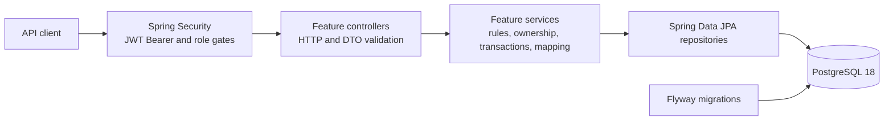

<h1 align="center">Libro — Library Management API</h1>

<p align="center"></p>


[](https://github.com/kyledelfin2006/libro-library-system/actions/workflows/ci.yml)

Libro is a Java 25 / Spring Boot 4 REST API for the Aklan State University College of Computer Studies library. It manages physical book copies, patron and staff accounts, and the full checkout history of each copy. The API, PostgreSQL schema, security rules, tests, and container delivery pipeline are implemented. The planned OCI deployment is **not live**.

## What the system does

| Area | Implemented behavior |
| --- | --- |
| Catalog | Create and manage physical copies; search, filter, sort, and paginate by catalog fields and replacement cost; view collection statistics. |
| Circulation | Students and faculty borrow and return copies. Loans are due in 14 days, limited to three active loans per borrower; overdue loans block new checkouts. Staff can mark a loan and its copy lost. |
| Accounts | Public student signup; librarian-created faculty and library-assistant accounts; role-scoped profile and password management. `ADMINISTRATOR` is the library-assistant role. |
| Security | 15-minute HS256 Bearer tokens, BCrypt passwords, route role gates, service-level ownership checks, login/signup rate limits, and consistent JSON errors with request IDs. |

Every book row represents **one physical copy**, so a loan refers to the exact item issued. Loan history remains after return or loss. A PostgreSQL partial unique index prevents two active loans for the same copy, while transactions and row locks protect concurrent checkout rules. See [Domain Decisions](docs/guides/domain-decisions.md) and the [Loan Guide](docs/guides/loan.md).

## Architecture



The single-module codebase groups `auth`, `book`, `loan`, and `user` by feature, then by layer. Controllers accept and return DTOs; services own business rules, transactions, and entity-to-DTO mapping; repositories own persistence. Shared responses, errors, request IDs, time handling, and OpenAPI configuration live in `global`. Flyway owns the schema, and Hibernate validates it at startup. [Architecture Overview](docs/architecture.md) shows the request and data flows; [ADR 0002](docs/adr/0002-layered-feature-packages.md) records the package decision.

### Notable code changes

| Change | Result |
| --- | --- |
| Standardized feature packages and moved DTO mapping into services | Controllers stay focused on HTTP, and JPA entities do not cross the API boundary. |
| Moved account ownership and target-role rules into `UserAccessPolicy` | One policy handles student, faculty, assistant, and librarian account operations. |
| Introduced shared not-found and invalid-request exception types | Expected client errors have consistent status codes; unexpected faults get a generic 500 response. |
| Layered the test profile over runtime configuration | Tests exercise the real application defaults with only test-specific overrides. |

## Key workflows

1. **Sign in:** `POST /app/auth/login` verifies the stored BCrypt hash and issues a short-lived token. Protected requests send `Authorization: Bearer <token>`; signup and health probes are public.
2. **Borrow and return:** `POST /app/loans/{bookId}` derives the borrower from the token, checks the copy and patron limits, and creates an `ACTIVE` loan. `GET /app/loans/me` shows paged history; `PUT /app/loans/{loanId}/return` records the return.
3. **Resolve a lost copy:** authorized staff use `PUT /app/loans/{loanId}/lost`; the loan retains who resolved it and when, and the copy becomes unavailable. Loan history prevents deletion of the referenced user or copy.
4. **Manage the catalog and accounts:** staff roles gate writes, while service checks enforce account ownership and target-role rules. Book reads are available to all authenticated roles.

The [Role and JWT Guide](docs/reference/security-roles-and-jwt-guide.md) has the full permission matrix. The generated OpenAPI document is the endpoint contract; Swagger UI and `/v3/api-docs` are disabled by default and can be enabled locally with `LIBRO_API_DOCS_ENABLED=true`.

## Engineering problems solved

| Problem | Project change |
| --- | --- |
| Entity types and database columns disagreed at startup | Made Flyway the sole schema authority, aligned migrations with JPA, and kept Hibernate schema validation enabled. |
| Container startup could race PostgreSQL readiness | Added a database health check and made the app wait for a healthy database. |
| Concurrent checkout could assign one copy twice | Added row locking, a database unique index for active loans, and PostgreSQL concurrency tests. |
| HTTP-only or mocked tests could miss real persistence errors | Split fast unit/MVC tests from Testcontainers integration tests that exercise migrations, JPA, constraints, and loan races. |
| Scattered account rules and error handling were hard to audit | Centralized target-role/ownership checks in `UserAccessPolicy` and mapped client failures through shared exception types. |

The [Development Problems Solved](docs/guides/development-problems-solved.md) guide traces more issues from symptom to fix and verification. The [Engineering Reference](docs/reference/engineering-reference.md) documents current code contracts and test boundaries.

## CI/CD and operations

Every pull request and push to `main` runs three independent GitHub Actions jobs:

| Job | Gate |
| --- | --- |
| `unit-test` | Unit and MVC tests with an 80% JaCoCo line-coverage floor. |
| `integration-test` | Testcontainers with PostgreSQL 18: Flyway, schema validation, persistence, and concurrent loans. Unit tests are skipped in this job so they run once. |
| `security-scan` | Trivy scans dependencies and the built image for fixable HIGH or CRITICAL findings. |

After successful CI on `main`, the CD workflow:

1. Builds and scans a native ARM64 image, publishes it to GitHub Container Registry by commit SHA, and records its immutable digest.
2. Runs the deploy job only when `OCI_DEPLOY_ENABLED=true` and the `production` environment approves it. The target is one OCI VM with the API, PostgreSQL, and Caddy under Docker Compose.
3. Uses deployment scripts to back up the database, start the pinned image, smoke-test readiness and authenticated access, and roll back the app image on failure.

The VM has **not been provisioned**, so deployment is gated; the scripts were rehearsed locally. Public `/livez` and `/readyz` probes, private Prometheus metrics, and request IDs support operations.

See [CI/CD and DevOps](docs/devops/ci-cd.md) for pipeline and security details, and the [Operations Runbook](docs/devops/runbook.md) for provisioning, backups, restore, and deployment. [ROADMAP](docs/reference/ROADMAP.md) tracks the remaining production gates.

## Run locally

Docker Compose builds the API and starts PostgreSQL. Copy `.env.example` to `.env`, then set the required PostgreSQL credentials, a test/local `LIBRO_ADMIN_PASSWORD_HASH` (BCrypt), and `LIBRO_JWT_SECRET_BASE64` (at least 32 decoded bytes). `.env` is ignored by Git.

```powershell
Copy-Item .env.example .env
docker compose up --build
```

Check `http://localhost:8080/readyz`, then sign in through `POST /app/auth/login`. The Maven Wrapper pins the build tool; Docker is required for the integration suite.

```bash
./mvnw verify
./mvnw -Pintegration -DskipUTs -Djacoco.haltOnFailure=false verify
```

The integration run also needs a test-only `LIBRO_ADMIN_PASSWORD_HASH` in the shell environment; Maven does not load Compose's `.env`. See [Local Setup](docs/guides/local-setup.md) for configuration and the [API Documentation Guideline](docs/guides/api-documentation-guideline.md) for OpenAPI conventions.

## License

[MIT](LICENSE)
