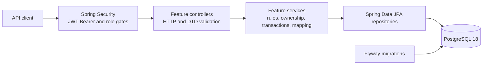
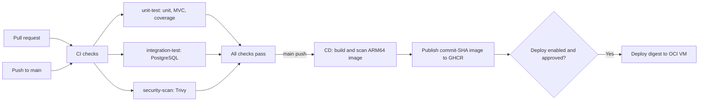

<h1 align="center">Libro - Library Management System</h1>

<p align="center">
  
</p>

[](https://github.com/kyledelfin2006/libro-library-system/actions/workflows/ci.yml)
[](https://github.com/kyledelfin2006/libro-library-system/actions/workflows/cd.yml)


## Project Overview

Libro is a Spring Boot REST API for the library of Aklan State University – College of Computer Studies (ASU-CCS). It manages physical book copies, user accounts, and loan history. Each catalog record is one physical copy, which keeps loan history accurate per copy (see [Domain Decisions](docs/guides/domain-decisions.md)).

## Table of Contents

- [Project Overview](#project-overview)
- [Features](#features)
- [Architecture](#architecture)
- [Notable code changes](#notable-code-changes)
- [Engineering problems solved](#engineering-problems-solved)
- [Demo Accounts](#demo-accounts)
- [Quick Start](#quick-start)
  - [Prerequisites](#prerequisites)
  - [Installation](#installation)
- [Configuration & Secrets Management](#configuration--secrets-management)
  - [Environment Variables](#environment-variables)
  - [CI/CD Secrets](#cicd-secrets)
  - [Security Policy](#security-policy)
- [API Usage & Documentation](#api-usage--documentation)
  - [Authentication](#authentication)
  - [Request/Response Examples](#requestresponse-examples)
  - [API Reference](#api-reference)
- [CI/CD Pipeline Architecture](#cicd-pipeline-architecture)
  - [Pipeline Flow](#pipeline-flow)
  - [Workflow Breakdown](#workflow-breakdown)
  - [Triggers & Quality Gates](#triggers--quality-gates)
- [Deployment](#deployment)
  - [Environments](#environments)
  - [Deployment Process](#deployment-process)
  - [Manual Deployment & Rollback](#manual-deployment--rollback)
- [Testing](#testing)
- [Documentation](#documentation)
  - [Repo map](#repo-map)
- [Contributing](#contributing)
- [Project Status](#project-status)
- [License](#license)

## Features

- **Catalog:** search, filter, sort, and paginate copies by title, author, genre, or replacement cost; collection and genre statistics.
- **Loans:** students and faculty borrow for 14 days, up to three active loans each; overdue loans block new checkouts. See the [Loan Implementation Guide](docs/guides/loan.md).
- **Accounts and roles:** public signup creates students; librarians create faculty and library-assistant accounts. Four roles (`STUDENT`, `FACULTY`, `ADMINISTRATOR`, `LIBRARIAN`) are enforced at the route and service layers.
- **Security:** stateless HS256 JWT Bearer authentication, BCrypt passwords, per-IP rate limits on login and signup, and a uniform JSON error contract. See the [JWT Authentication Design](docs/reference/jwt-authentication-design.md).
- **Operations:** Flyway-owned schema, Docker Compose, public `/livez` and `/readyz` probes, and Prometheus metrics on a private management port.

| Layer | Technology |
| --- | --- |
| Language and framework | Java 25, Spring Boot 4.1.2 (Web, Data JPA, Security, OAuth2 Resource Server, Validation) |
| Data | PostgreSQL 18, Flyway 13.3.0, Hibernate with schema validation |
| Build and test | Maven, JUnit 5, Mockito, Testcontainers, JaCoCo |
| Delivery | Docker, Docker Compose, Caddy, GitHub Actions, Trivy |

## Architecture



The single-module codebase groups `auth`, `book`, `loan`, and `user` by feature, then by layer. Controllers accept and return DTOs; services own business rules, transactions, and entity-to-DTO mapping; repositories own persistence. Shared responses, errors, request IDs, time handling, and OpenAPI configuration live in `global`. Flyway owns the schema, and Hibernate validates it at startup. [Architecture Overview](docs/architecture.md) shows the request and data flows; its Design Rules section records the package decision.

## Notable code changes

| Change | Result |
| --- | --- |
| Standardized feature packages and moved DTO mapping into services | Controllers stay focused on HTTP, and JPA entities do not cross the API boundary. |
| Moved account ownership and target-role rules into `UserAccessPolicy` | One policy handles student, faculty, assistant, and librarian account operations. |
| Introduced shared not-found and invalid-request exception types | Expected client errors have consistent status codes; unexpected faults get a generic 500 response. |
| Layered the test profile over runtime configuration | Tests exercise the real application defaults with only test-specific overrides. |

## Engineering problems solved

| Problem | Project change |
| --- | --- |
| Entity types and database columns disagreed at startup | Made Flyway the sole schema authority, aligned migrations with JPA, and kept Hibernate schema validation enabled. |
| Container startup could race PostgreSQL readiness | Added a database health check and made the app wait for a healthy database. |
| Concurrent checkout could assign one copy twice | Added row locking, a database unique index for active loans, and PostgreSQL concurrency tests. |
| HTTP-only or mocked tests could miss real persistence errors | Split fast unit/MVC tests from Testcontainers integration tests that exercise migrations, JPA, constraints, and loan races. |
| Scattered account rules and error handling were hard to audit | Centralized target-role/ownership checks in `UserAccessPolicy` and mapped client failures through shared exception types. |

The [Development Problems Solved](docs/guides/development-problems-solved.md) guide traces more issues from symptom to fix and verification. The [Engineering Reference](docs/reference/engineering-reference.md) documents current code contracts and test boundaries.

## Demo Accounts

> **Try Libro:** [Demo patron accounts](#demo-accounts) are documented below. The public OCI instance is not deployed yet; seed them locally to use the API now. Staff credentials stay private.

These **public patron-only accounts** use synthetic data. They can browse and borrow under the normal loan rules, but cannot manage books or other accounts. Their shared password is published on purpose; do not reuse it elsewhere.

| Role | University ID | Password | Seed method |
| --- | --- | --- | --- |
| `STUDENT` | `2025-0001` | `DemoPatron@2026` | `bash scripts/seed-demo.sh --patrons-only` |
| `FACULTY` | `2025-0002` | `DemoPatron@2026` | `bash scripts/seed-demo.sh` (requires a librarian) |

After starting the [local stack](#quick-start), use the first command to create the student. The full seed also creates the faculty account and sample books and prompts for the librarian password. See [Demo Accounts](docs/guides/demo-accounts.md) for staff-account setup and [Local Setup](docs/guides/local-setup.md) for the optional first-librarian bootstrap. No public instance is available yet.

## Quick Start

### Prerequisites

Requires Docker Engine with the Compose plugin. The stack builds the API from source and starts PostgreSQL 18; Java and Maven run inside the container build. Running the app directly on the host requires JDK 25. The optional demo seed script needs Bash and curl.

### Installation

1. Clone the repository, then create the environment file:

   ```bash
   git clone https://github.com/kyledelfin2006/libro-library-system.git
   cd libro-library-system
   cp .env.example .env
   ```

   In PowerShell, use `Copy-Item .env.example .env` for the last command. Set your own PostgreSQL credentials, `LIBRO_ADMIN_PASSWORD_HASH` (a BCrypt hash of a password you choose), and `LIBRO_JWT_SECRET_BASE64` (`openssl rand -base64 32`). The [Operations Runbook](docs/devops/runbook.md#3-configure-secrets) shows hash generation. `.env` is git-ignored.

2. Start the stack:

   ```bash
   docker compose up --build
   ```

3. Check readiness at `http://localhost:8080/readyz`. [Seed the demo student](#demo-accounts) or create your own student through signup, then follow the [login example](#requestresponse-examples).

Swagger UI and `/v3/api-docs` are off unless `LIBRO_API_DOCS_ENABLED=true`, which you can set in your local `.env` (the template leaves it `false`). To run the app outside Docker, enable the TLS proxy profile, or provision the first librarian, see [Local Setup and Configuration](docs/guides/local-setup.md).

## Configuration & Secrets Management

### Environment Variables

Copy [`.env.example`](.env.example) for the local template. The settings below cover the app and Compose; blank optional values disable the related feature.

| Variable | Required | Default or purpose |
| --- | --- | --- |
| `POSTGRES_DB`, `POSTGRES_USER`, `POSTGRES_PASSWORD` | Yes for Compose | Set your own database name, role, and password. |
| `LIBRO_ADMIN_PASSWORD_HASH` | First startup of an empty database | BCrypt hash for Flyway V2's library-assistant account; may be blank once V2 has run. |
| `LIBRO_JWT_SECRET_BASE64` | Yes | No default; must decode to at least 32 random bytes. |
| `LIBRO_JWT_ISSUER`, `LIBRO_JWT_AUDIENCE` | No | `libro-api` for both. |
| `LIBRO_JWT_ACCESS_TOKEN_TTL_SECONDS` | No | `900` seconds. |
| `LIBRO_CORS_ALLOWED_ORIGINS` | No | Blank denies cross-origin browser access; accepts comma-separated exact origins. |
| `SERVER_FORWARD_HEADERS_STRATEGY` | No | `none`; use `native` only behind a trusted proxy with no direct app ingress. |
| `LIBRO_LOGIN_RATE_LIMIT_REQUESTS`, `LIBRO_LOGIN_RATE_LIMIT_WINDOW_SECONDS` | No | `20` requests per `60` seconds per client IP. |
| `LIBRO_SIGNUP_RATE_LIMIT_REQUESTS`, `LIBRO_SIGNUP_RATE_LIMIT_WINDOW_SECONDS` | No | `10` requests per `3600` seconds per client IP. |
| `LIBRO_RATE_LIMIT_MAX_TRACKED_CLIENT_ROUTES` | No | `10000` in-memory client/route counters. |
| `LIBRO_BOOTSTRAP_LIBRARIAN_UNIVERSITY_ID`, `LIBRO_BOOTSTRAP_LIBRARIAN_EMAIL`, `LIBRO_BOOTSTRAP_LIBRARIAN_FIRST_NAME`, `LIBRO_BOOTSTRAP_LIBRARIAN_LAST_NAME`, `LIBRO_BOOTSTRAP_LIBRARIAN_PASSWORD_HASH` | No | Set all five together to create the first librarian once; supply a BCrypt hash. |
| `LIBRO_API_DOCS_ENABLED` | No | `false`; `true` serves Swagger UI and `/v3/api-docs` publicly. |
| `LIBRO_DOMAIN` | For the TLS proxy | `localhost` locally; set a real host name for deployment. |
| `MANAGEMENT_SERVER_PORT` | No | `9091`; private Actuator health and Prometheus port. |
| `LIBRO_DATA_DIR` | Production deploy only | Block-volume path for database data, backups, and release state. |
| `LIBRO_BACKUP_BUCKET` | No | Optional OCI Object Storage bucket for off-host backups. |

### CI/CD Secrets

The deploy job needs four **GitHub `production` environment secrets**; application secrets stay in the private host `.env`:

| Secret | Purpose |
| --- | --- |
| `OCI_HOST`, `OCI_USER` | SSH target and deploy user. |
| `OCI_SSH_KEY`, `OCI_SSH_KNOWN_HOSTS` | Deploy private key and verified host key. |

Image publishing uses GitHub's built-in `GITHUB_TOKEN`. The [runbook setup](docs/devops/runbook.md#7-enable-automated-deployment) explains the environment, repository variable `OCI_DEPLOY_ENABLED`, and branch checks.

### Security Policy

Real `.env` files and private keys are git-ignored. Keep passwords, JWT keys, and staff credentials out of commits and logs. See [CI/CD and DevOps](docs/devops/ci-cd.md#secrets-handling) for production handling.

## API Usage & Documentation

### Authentication

The local base URL is `http://localhost:8080`. Signup (`POST /app/users/signup`), login (`POST /app/auth/login`), `/livez`, and `/readyz` are public. Other routes require an `Authorization: Bearer <token>` header; HTTP Basic is not accepted.

### Request/Response Examples

Log in with the seeded demo student:

```http
POST /app/auth/login HTTP/1.1
Host: localhost:8080
Content-Type: application/json

{"universityId":"2025-0001","password":"DemoPatron@2026"}
```

Successful response (`accessToken` and `timestamp` vary):

```json
{
  "success": true,
  "message": "Success",
  "data": {"accessToken": "<signed JWT>", "tokenType": "Bearer", "expiresIn": 900},
  "timestamp": 1720000000000
}
```

Use the returned token for a protected catalog request:

```http
GET /app/books/all?page=0&size=12 HTTP/1.1
Host: localhost:8080
Authorization: Bearer <signed JWT>
```

### API Reference

| Area | Representative endpoints | Access |
| --- | --- | --- |
| Books | `GET /app/books/all`, `GET /app/books/query`, `GET /app/books/{id}`, `POST /app/books/add` | All roles read; library assistants and librarians write. |
| Users | `POST /app/users/signup`, `GET /app/users/me`, `GET /app/users/{universityId}`, `POST /app/users/faculty` | Signup is public; profiles are owner/staff scoped; only librarians create faculty. |
| Loans | `POST /app/loans/{bookId}`, `PUT /app/loans/{loanId}/return`, `GET /app/loans/me`, `GET /app/loans` | Students/faculty borrow and return their own loans; staff can list loans across permitted borrowers. |

Successful responses use an `ApiResponse` envelope; errors use `ErrorResponse` with a `requestId`. List results are paginated (default size 12, maximum 100). Enable `LIBRO_API_DOCS_ENABLED=true` locally for `/swagger-ui.html` and `/v3/api-docs`; they are off by default. See the [Engineering Reference](docs/reference/engineering-reference.md) for the API inventory and [Roles and JWT Guide](docs/reference/security-roles-and-jwt-guide.md) for permissions.

## CI/CD Pipeline Architecture

### Pipeline Flow



### Workflow Breakdown

Every pull request and every push to `main` runs three parallel checks in [`.github/workflows/ci.yml`](.github/workflows/ci.yml):

| Check | What it proves |
| --- | --- |
| `unit-test` | Unit and MVC tests, with an 80% line-coverage floor |
| `integration-test` | Flyway migrations, schema validation, and loan concurrency against PostgreSQL 18 |
| `security-scan` | Trivy finds no fixable HIGH or CRITICAL issues in dependencies or the container image |

### Triggers & Quality Gates

After CI passes on a `main` push, [`.github/workflows/cd.yml`](.github/workflows/cd.yml) builds and scans one immutable ARM64 image on a native ARM runner and publishes it to GitHub Container Registry by commit SHA. A manual `workflow_dispatch` can also build and publish; pull requests that change the CD workflow or Dockerfile get a build-and-scan dry run without publishing. The deploy job runs only when the repository variable `OCI_DEPLOY_ENABLED=true` and the `production` environment's required reviewers approve it.

## Deployment

### Environments

Local development uses Docker Compose; CI uses ephemeral GitHub runners. The planned production demo target is a single **OCI Always Free Ampere A1 VM** running the API, PostgreSQL, and a Caddy TLS proxy under Docker Compose. There is no separate staging environment.

### Deployment Process

`scripts/deploy.sh` already does the deploy step by hand: it backs up the database, starts the new image, runs a smoke test (readiness, login, authenticated read, anonymous rejection), and restarts the previous image if anything fails. Flyway migrations are forward-only, so database recovery uses `scripts/restore.sh`. `backup.sh` and `seed-demo.sh` cover backups and demo data. The pipeline stages, environments, rollback, and monitoring are in [CI/CD and DevOps](docs/devops/ci-cd.md); first deploy, manual update, restore, and automation setup are in the [Operations Runbook](docs/devops/runbook.md).

### Manual Deployment & Rollback

On a provisioned VM, use `scripts/deploy.sh` for a manual release or [the runbook's update procedure](docs/devops/runbook.md#6-updating-and-rolling-back) for a rollback. If a release applied a bad database migration, restore the pre-deploy backup; an application image rollback cannot reverse Flyway migrations.

**The service is not deployed yet:** the scripts were rehearsed against a local Docker stack and the image-publishing workflow is in place, but no VM is provisioned, so the deploy job is switched off.

## Testing

Run `./mvnw verify` for unit/MVC tests and the 80% line-coverage gate. Run `./mvnw -Pintegration -DskipUTs -Djacoco.haltOnFailure=false verify` for the PostgreSQL suite (unit tests run once, in the first command); it needs Docker and a test-only `LIBRO_ADMIN_PASSWORD_HASH` in the shell environment, because Maven does not load Compose's `.env`. On Windows, use `mvnw.cmd`. The [Engineering Reference](docs/reference/engineering-reference.md#testing-strategy) explains test scope and where to add coverage.

## Documentation

| Start here for | Document |
| --- | --- |
| System design, flows, and data model | [Architecture](docs/architecture.md) |
| Current repository map, API inventory, configuration, and tests | [Engineering Reference](docs/reference/engineering-reference.md) |
| Running and configuring a local stack | [Local Setup](docs/guides/local-setup.md) |
| Public patron logins and private staff-account policy | [Demo Accounts](docs/guides/demo-accounts.md) |
| Physical-copy and loan decisions | [Domain Decisions](docs/guides/domain-decisions.md) and [Loan Implementation Guide](docs/guides/loan.md) |
| Role boundaries and authentication internals | [Roles and JWT Guide](docs/reference/security-roles-and-jwt-guide.md) and [JWT Authentication Design](docs/reference/jwt-authentication-design.md) |
| API documentation conventions | [API Documentation Guideline](docs/guides/api-documentation-guideline.md) |
| Pipeline, infrastructure, and recovery | [CI/CD and DevOps](docs/devops/ci-cd.md) and [Operations Runbook](docs/devops/runbook.md) |
| Engineering choices and institutional domain | [Development Problems Solved](docs/guides/development-problems-solved.md) and [Institutional Context](docs/guides/institutional-context.md) |
| Remaining work and contribution rules | [Development Roadmap](docs/reference/ROADMAP.md) and [Agent and Contributor Guide](AGENTS.md) |

### Repo map

```text
src/             Spring Boot application (controllers, services, repositories, Flyway migrations) and tests
infra/           Production Compose override and the Caddy reverse-proxy configuration
scripts/         Deploy, rollback, smoke-test, backup, restore, and demo-seed scripts
docs/adr/        Open implementation plan (problems and remaining work)
docs/
  architecture.md  Design, request flows, API inventory, data model, troubleshooting, tests
  devops/          CI/CD, environments, secrets, rollback, monitoring, operations runbook
  guides/          Domain decisions, loan guide, local setup, institutional context, API documentation standard
  reference/       Engineering reference, JWT design, role policy, roadmap
.github/         CI workflow and Dependabot configuration
Dockerfile, docker-compose.yml, pom.xml, mvnw   Build and runtime entry points
AGENTS.md        Contributor and AI-agent guide
```

Start with [Architecture and Reference](docs/architecture.md) for how the system works, the [Engineering Reference](docs/reference/engineering-reference.md) for contracts and configuration, and [Development Problems Solved](docs/guides/development-problems-solved.md) for the engineering decisions behind it. [Institutional Context](docs/guides/institutional-context.md) explains the ASU-CCS user domain.

## Contributing

Read the [Agent and Contributor Guide](AGENTS.md) before changing code or documentation. It maps each contract to its source of truth and defines the contribution workflow. The [Development Roadmap](docs/reference/ROADMAP.md) tracks remaining work.

## Project Status

| Area | State |
| --- | --- |
| Catalog, accounts, roles, JWT authentication, loans | Implemented and covered by unit, MVC, and PostgreSQL tests |
| CI (`unit-test`, `integration-test`, `security-scan`) | Running on every pull request and push to `main`; required by branch protection on `main` |
| Container image and Compose stack | Implemented, with health checks |
| Deploy, rollback, backup, and smoke-test scripts; runbook | Implemented and rehearsed locally |
| CD workflow (ARM64 build, scan, publish, gated deploy) | Implemented; deploy job off until the VM exists |
| OCI VM | Not provisioned; see the [implementation plan](docs/adr/IMPLEMENTATION_PLAN.md) |
| Open items | Fix the [OpenAPI browser review findings](docs/reference/openapi-browser-review.md); TLS with a real domain, login-failure and rate-limit alerts, and an independent security review before public exposure |

The [Development Roadmap](docs/reference/ROADMAP.md) tracks the detail.

## License

This project is licensed under the [MIT License](LICENSE).
