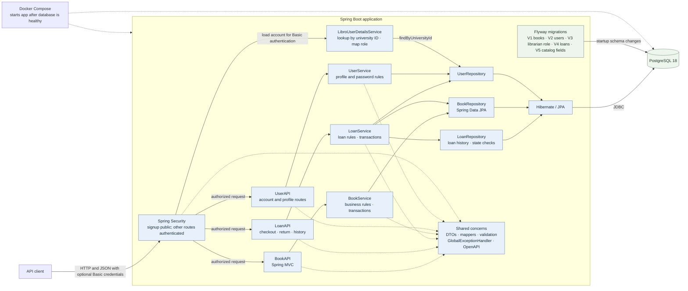
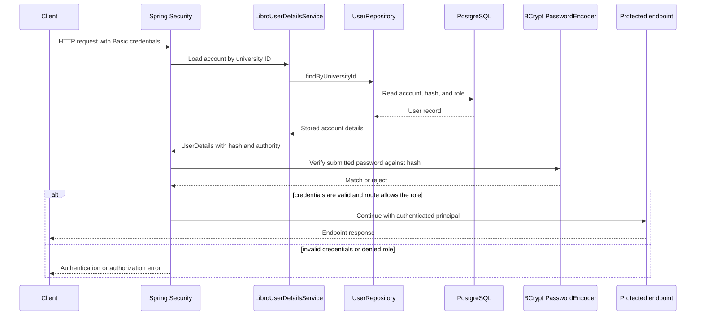
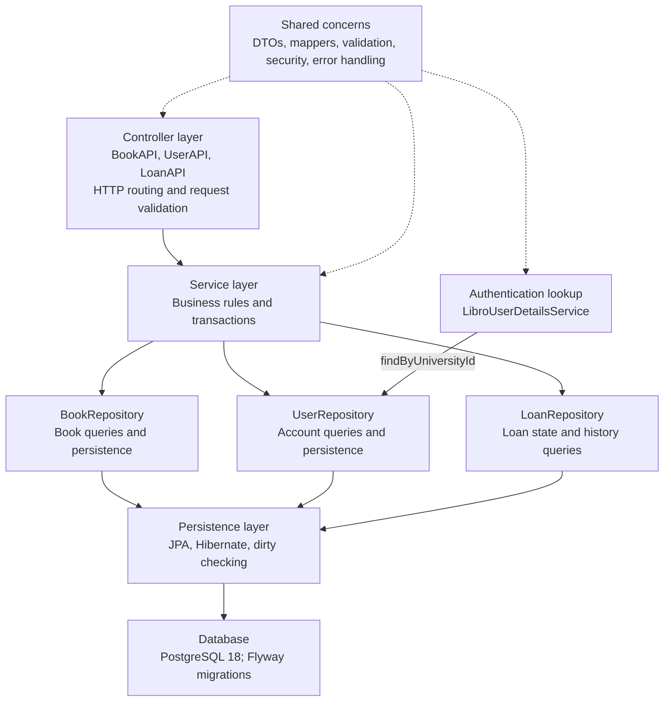
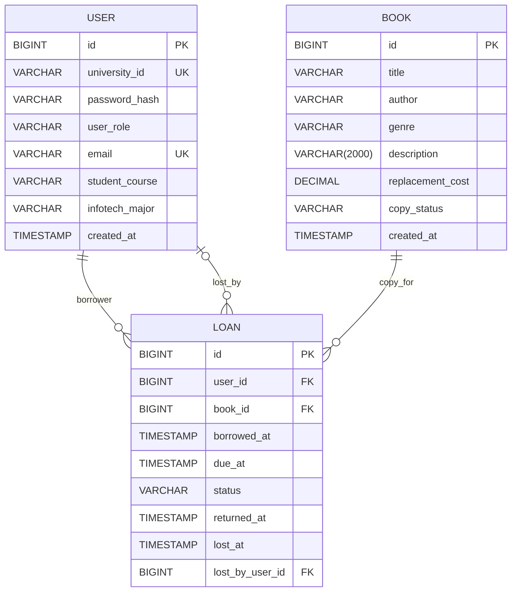
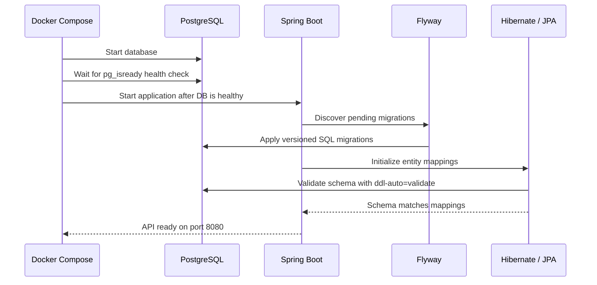
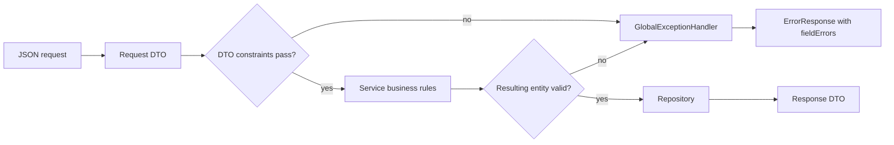

<h1 align="center">Libro - Library Management System</h1>

<p align="center">
  
</p>


Libro is a library management system built with Spring Boot. It helps manage a library's physical book copies, user accounts, and loan history.

### Features

- 📚 **Books:** create, view, replace, partially update, and delete physical-copy records.
- 🔎 **Search:** find books by title, author, genre, or exact replacement cost; combine filters, sort, paginate, and filter by replacement cost or budget.
- 📊 **Insights:** view book counts, total and average replacement cost, the copy with the highest replacement cost, and genre counts.
- 👥 **Accounts:** sign up, browse permitted listings, look up profiles, update details, change passwords, and delete accounts. Staff access follows role permissions.
- 🔄 **Loans:** students and faculty borrow and return physical copies; staff can review permitted histories and mark lost copies.
- 🛠️ **Built for development:** Docker, PostgreSQL 18, Flyway migrations, request validation, and consistent error responses.
- 🩺 **Health check:** check API and database reachability.

Each `Book` is one physical copy; separate copies of a title have separate records. Loans use a 14-calendar-day term, allow up to three active loans per borrower, and block new checkouts while any loan is overdue. See the [Loan Implementation Guide](docs/loan.md) and [Domain Decisions](docs/domain-decisions.md).

### API access

Explore the generated API docs in [Swagger UI](http://localhost:8080/swagger-ui.html) or [`/v3/api-docs`](http://localhost:8080/v3/api-docs). HTTP Basic authentication is required except for `POST /app/users/signup`; write requests also require a CSRF token. See [Institutional Context](docs/institutional-context.md) and the [API Documentation Guideline](docs/api-documentation-guideline.md).

Main Developer: **Aldrin Kyle Delfin**

## Tech Stack

| Layer | Technology / Framework |
| --- | --- |
| Language | Java 25 |
| Framework | Spring Boot 4.1.0 (Web, Data JPA, Security, Validation) |
| Database | PostgreSQL 18 |
| Migrations | Flyway 13.3.0 |
| Containerization | Docker & Docker Compose |
| Build Tool | Maven 3.x |
| Code Generation | Lombok 1.18.46 |
| Testing | JUnit 5, Mockito, Testcontainers, JaCoCo |
| Serialization | Jackson (JSON) |
| Validation | Jakarta Bean Validation |
| Logging | SLF4J via Lombok `@Slf4j` |

## Table of Contents

* [Architecture Overview](#architecture-overview)
* [Layered Design](#layered-design)
* [Current Authentication and Authorization Flow](#current-authentication-and-authorization-flow)
* [Current Persistence Model](#current-persistence-model)
* [File Structure](#file-structure)
* [Core Design Patterns](#core-design-patterns)
* [Key Features](#key-features)
* [Request Lifecycle](#request-lifecycle)
* [Code Highlights](#code-highlights)
* [API Endpoints](#api-endpoints)
* [Setup & Installation](#setup--installation)
* [Troubleshooting](#troubleshooting)
* [Data Management](#data-management)
* [Testing](#testing)
* [Documentation](#documentation)
* [Problems I Solved](#problems-i-solved)
* [Upcoming Improvements](#upcoming-improvements)
* [License](#license)

## Documentation

This README remains the project's main portfolio entry point. Supporting documents are grouped by audience so readers can choose a project overview or implementation reference.

**For technical and peer review**

1. The Architecture Overview and Request Lifecycle sections below explain the current system with component, security, persistence, and startup diagrams.
2. [Development Problems Solved](docs/development-problems-solved.md) explains major engineering challenges, decisions, and verification.
3. [Institutional Context](docs/institutional-context.md) describes the ASU-CCS academic model and existing MIS assumptions behind the user domain.
4. [Domain Decisions](docs/domain-decisions.md) explains why a Book represents one physical copy and how loans preserve copy history.
5. [Loan Implementation Guide](docs/loan.md) explains the loan lifecycle, permissions, API, database design, and local build flow.

### For agents, AI, and contributors

1. [Agent and Contributor Guide](AGENTS.md) records current facts, source-of-truth rules, do's and don'ts, and the contribution workflow.
2. [Current System Engineering Reference](guiding-docs/engineering-reference.md) contains the detailed repository map, layer contracts, endpoint inventory, configuration, and test strategy.
3. [Development Roadmap](guiding-docs/TODO.md) tracks current implementation status and remaining work.
4. [Security Roles and JWT Guide](guiding-docs/security-roles-and-jwt-guide.md) defines the role policy, live loan permissions, and planned JWT design.
5. [API Documentation Guideline](docs/api-documentation-guideline.md) sets the standard for accurate OpenAPI and Swagger documentation without unnecessary annotation boilerplate.

## Architecture Overview

The system runs as a Spring Boot API alongside PostgreSQL. Book, user, and loan requests pass through their HTTP and business layers to persistence; Flyway prepares the schema at startup. Shared validation, mapping, security configuration, and error handling support the API. `UserRepository` serves account and loan use cases, plus `LibroUserDetailsService` for Spring Security's HTTP Basic account lookup.



The authentication branch is separate from user account operations. For a protected request, Spring Security asks `LibroUserDetailsService` to load the account by university ID; that service reads the same `UserRepository` used by `UserService`, then returns Spring Security's user details with the stored password hash and mapped role. Signup is permitted without authentication; the remaining routes require authentication. Controllers do not access the repository directly.

### Current Authentication and Authorization Flow

This is the live HTTP Basic flow. The client sends its university ID and password with every protected request. Spring Security loads the account and role, checks the password with BCrypt, then applies the route's role rule. Basic credentials are Base64-encoded, not encrypted; use HTTPS outside local development.



Account and loan access is checked against the authenticated user's university ID and role. `ADMINISTRATOR` is the library-assistant role, and `LIBRARIAN` is the library's librarian. Students and faculty borrow and return their own loans; staff review only the histories permitted by their role.

| Current rule | Allowed access |
| --- | --- |
| Public signup | POST /app/users/signup |
| Read books | STUDENT, FACULTY, ADMINISTRATOR, LIBRARIAN |
| Add, update, or delete books | ADMINISTRATOR, LIBRARIAN |
| Create school faculty and library assistant accounts | LIBRARIAN |
| List/read student and faculty profiles | ADMINISTRATOR, LIBRARIAN |
| List/read library assistant profiles | LIBRARIAN |
| Update student/faculty profiles and passwords | Owner, ADMINISTRATOR, LIBRARIAN |
| Update library assistant profiles and passwords | Owner, LIBRARIAN |
| Delete own student/faculty account | Owner |
| Delete student/faculty accounts | ADMINISTRATOR, LIBRARIAN |
| Delete library assistant accounts | LIBRARIAN |
| Borrow and return own loans | STUDENT, FACULTY |
| View own loan history | STUDENT, FACULTY, ADMINISTRATOR, LIBRARIAN |
| View or mark student/faculty loans lost | ADMINISTRATOR, LIBRARIAN |
| View or mark library-assistant loans lost | LIBRARIAN |

### Layered Design



Account operations and Basic authentication use `UserRepository`: `UserService` uses it for signup, profile, and password operations; `LoanService` uses it to identify and lock borrowers; `LibroUserDetailsService` loads the account Spring Security authenticates. Authentication does not route through `UserAPI` or `UserService`.

### Current Persistence Model

The current schema stores books, users, and loans. A Book row is one physical copy. Loan rows identify the borrower from the authenticated principal and preserve checkout, return, or loss history. The database permits only one active loan per copy. See [Domain Decisions](docs/domain-decisions.md) for the reasoning.



Each checkout creates a new `LOAN` row for one physical copy and one borrower; `lost_by_user_id` is optional because only a lost loan has a staff resolver. Its lifecycle status is `ACTIVE`, `RETURNED`, or `LOST`; overdue is calculated at request time and is not stored. Returned and lost events remain in history. Students and faculty may have up to three active loans each, and a borrower with an overdue loan cannot start another loan. Library assistants and librarians can mark authorized active loans lost, which also marks the physical copy lost. A copy with any loan history is retained and cannot be deleted; deletion returns `409 Conflict`. Penalties and repeat-offender rules are future scope.

## File Structure

This is a selected map of the main application and test files. See the [engineering reference](guiding-docs/engineering-reference.md) for the fuller repository map.

```text
AGENTS.md
README.md
Dockerfile
docker-compose.yml
envFileExample
pom.xml
docs/
  api-documentation-guideline.md
  development-problems-solved.md
  domain-decisions.md
  institutional-context.md
  loan.md
guiding-docs/
  engineering-reference.md
  security-roles-and-jwt-guide.md
  TODO.md

src/main/java/app/
  LibraryApplication.java
  auth/
    SecurityConfig.java
    LibroUserDetailsService.java
  loan/
    config/LoanTimeConfig.java
    controller/LoanAPI.java
    dto/LoanResponseDTO.java
    entity/Loan.java
    entity/LoanStatus.java
    mapper/LoanMapper.java
    repository/LoanRepository.java
    service/LoanService.java
  book/
    controller/
      BookAPI.java
    service/
      BookService.java
    repository/
      BookRepository.java
      projection/
        GenreCount.java
        LibraryAggregate.java
    entity/
      Book.java
      BookCopyStatus.java
    dto/
      BookRequestDTO.java
      BookPatchRequestDTO.java
      BookResponseDTO.java
      LibraryStatisticsDTO.java
    mapper/
      BookMapper.java
    exceptions/
      BookNotFoundException.java
      BookValidationException.java
  global/
    config/
      OpenApiConfig.java
    exceptions/
      GlobalExceptionHandler.java
    responses/
      ApiResponse.java
      ErrorResponse.java
  user/
    config/PasswordConfig.java
    controller/UserAPI.java
    dto/
      ChangePasswordDTO.java
      UserCreateRequestDTO.java
      UserCreateUpdateDTO.java
      UserReplaceRequest.java
      UserResponseDTO.java
    entity/
      User.java
      enums/
        UserCourse.java
        UserITMajor.java
        UserRole.java
    mapper/UserMapper.java
    repository/UserRepository.java
    exception/UserNotFoundException.java
    service/UserService.java
    validation/PasswordPolicy.java

src/main/resources/
  application.properties
  db/
    migration/
      V1__create_books_table.sql
      V2__create_users_table.sql
      V3__add_librarian_role.sql
      V4__add_loans_and_copy_status.sql
      V5__describe_books_and_rename_price_to_replacement_cost.sql

src/test/java/
  unit/
    auth/
      SecurityFlowMvcTest.java
    book/
      BookApiMvcTest.java
      BookMapperTest.java
      BookTest.java
      BookServiceTest.java
    user/
      UserApiMvcTest.java
      UserServiceTest.java
    loan/
      LoanSecurityMvcTest.java
      LoanServiceTest.java
    global/
      GlobalExceptionHandlerTest.java
      OpenApiMvcTest.java
  integration/
    PostgresTestConfig.java
    book/
      BookPersistenceIT.java
    user/
      UserPersistenceIT.java
    loan/
      LoanPersistenceIT.java

src/test/resources/
  junit-platform.properties
  logback-test.xml
```

## Core Design Patterns

- **Layered Architecture** keeps HTTP, business, and persistence concerns separate and testable.
- **DTO-based request handling** protects the entity model and keeps validation at the boundary.
- **Transactional service methods** rely on Hibernate dirty checking, so updates are flushed automatically when the managed entity changes.
- **Centralized exception handling** ensures consistent JSON failures across validation, not-found, database, and parsing errors.
- **Repository abstraction** through Spring Data JPA keeps persistence code small and expressive.
- **Typed repository projections** give aggregate queries named fields instead of positional `Object[]` values. `LibraryAggregate` and `GenreCount` are internal immutable projections; public endpoints retain their existing DTO/map response shapes.
- **Mapper pattern** centralizes entity-DTO conversion to avoid duplication across controllers and services.
- **Flyway migrations** version the database schema alongside application code.

## DTO-Wrapped Entity Models

The application never exposes `Book` (or future entity) objects directly to clients. All inbound data is wrapped in request DTOs, and all outbound data is wrapped in response DTOs.

### Rules

- **Never** instantiate an entity directly from client input.
- **Never** return an entity directly in a controller response.
- Controllers accept request DTOs (`BookRequestDTO` for create/PUT and `BookPatchRequestDTO` for PATCH) and return response DTOs.
- For book operations, `BookMapper` is the conversion point between `Book` entities and book DTOs; user and loan features use their own mappers.

### Why This Matters

1. **Decouples the entity model from the client-facing API**
   The database schema can evolve independently of the API contract. If a column is renamed or removed in the database, only the mapper and entity need to change; the JSON contract stays stable.

2. **Ties the entity model only to the database**
   Entities represent persistence state, not API state. This keeps JPA/Hibernate concerns isolated and prevents accidental leakage of database-only fields (e.g., audit timestamps, soft-delete flags) into API responses.

3. **Prevents accidental data leaks**
   Response DTOs explicitly choose which fields are exposed. Sensitive or internal fields never appear in JSON unless intentionally added to the response DTO.

4. **Enforces request validation at the boundary**
   `BookRequestDTO` validates required title, author, genre, and positive replacement cost; description is optional and limited to 2,000 characters. `@Valid` triggers request checks for create and PUT. PATCH uses a separate optional `BookPatchRequestDTO`; service logic validates supplied values without marking omitted fields as required in OpenAPI.

5. **Allows response customization**
   Response DTOs can reshape, rename, compute, or omit fields without changing the entity. For example, `LibraryStatisticsDTO` aggregates data from multiple repository calls into a single read-only snapshot.

### Example

```java
// Controller accepts only the request DTO
@PostMapping("/add")
public ResponseEntity<ApiResponse<BookResponseDTO>> addBook(@Valid @RequestBody BookRequestDTO input) {
    Book newBook = service.addBook(input);           // DTO -> Entity inside service/mapper
    return ResponseEntity.status(HttpStatus.CREATED)
            .body(new ApiResponse<>(true, "Book Added Successfully", mapper.toResponseDTO(newBook)));
}
```

## Key Features

- CRUD operations for books.
- Each `Book` represents one physical borrowable copy. Duplicate titles and authors are allowed because separate copies have separate generated IDs; the model does not yet include an ISBN or edition key.
- Pagination and sorting through `GET /app/books/all` and paginated filtering through `GET /app/books/query`.
- Advanced search by title, author, genre, or replacement cost.
- Replacement cost range filtering through `GET /app/books/replacement-cost`.
- Budget filtering through `GET /app/books/budget`.
- Statistics endpoints for total books, total replacement cost, average replacement cost, and the copy with the highest replacement cost.
- Genre distribution endpoint.
- User-domain API for account creation, profile lookup and updates, password changes, and deletion; the service applies duplicate checks, academic business rules, and BCrypt password hashing.
- OpenAPI 3 documentation through Springdoc Swagger UI and `/v3/api-docs`, with operation-specific behavior, DTO schemas, and expected error responses.
- Validation with `@Valid` on create and replace requests.
- Global handling for `BookNotFoundException`, validation errors, malformed JSON, number format errors, database issues, and unsupported methods.
- Validation errors also include a `fieldErrors` map keyed by request field (or `_global` when no field is available), so clients can render precise messages without parsing the combined `details` string.
- HTTP Basic authentication through Spring Security; signup is public and other routes require authentication.
- Versioned database schema via Flyway.

## Request Lifecycle

### Create flow (`POST /app/books/add`)

1. Client sends a JSON payload to `/app/books/add`.
2. `BookAPI` receives the request and binds it to `BookRequestDTO`.
3. `@Valid` triggers Jakarta Validation on the DTO.
4. On success, `BookService.addBook()` converts the DTO to an entity via `BookMapper`.
5. `BookRepository.save()` persists the entity and returns the generated ID.
6. The controller maps the saved entity to `BookResponseDTO` and returns `201 Created`.

### Update flow (`PATCH /app/books/{id}`)

1. The controller passes `BookPatchRequestDTO` to `BookService.patchBook()`.
2. The service loads the managed `Book` entity with `findBookByIdForUpdate()`, taking a row lock shared with checkout and lost-copy resolution.
3. Field changes are applied conditionally to the locked, managed entity.
4. Hibernate dirty checking detects the modifications.
5. The transaction commits and flushes the update without an explicit `save()` call.

### Startup flow



Flyway owns schema creation and updates; Hibernate validates the resulting schema instead of changing it. The filter chain exposes public signup, retains HTTP Basic and CSRF protection, and enforces the current route rules.

## Code Highlights

### DTO validation on create

```java
@PostMapping("/add")
public ResponseEntity<ApiResponse<BookResponseDTO>> addBook(@Valid @RequestBody BookRequestDTO input) {
    Book newBook = service.addBook(input);
    return ResponseEntity.status(HttpStatus.CREATED)
            .body(new ApiResponse<>(true, "Book Added Successfully", mapper.toResponseDTO(newBook)));
}
```

### Partial Updates: PUT vs PATCH

Separate request types make the OpenAPI schema match each contract:

| PUT (replacement) | PATCH (partial update) |
| --- | --- |
| `BookRequestDTO`; title, author, genre, and replacement cost are required. Description is optional. | `BookPatchRequestDTO`; every field is optional. Omitted/null fields and blank text values are ignored. |
| Replaces all mutable fields; optional description may be set to null. | Changes only supplied fields; a supplied replacement cost must be positive. Null or blank description values are ignored. |

Both service operations update a managed entity inside a transaction; Hibernate dirty checking persists the change.
### Centralized API errors

Request validation and business-rule validation converge on the shared exception handler. This keeps error responses consistent while preserving endpoint-specific status codes.



```java
@ExceptionHandler(BookNotFoundException.class)
public ResponseEntity<ErrorResponse> handleBookNotFound(BookNotFoundException ex) {
    ErrorResponse error = new ErrorResponse("Book not found", ex.getMessage(), 404);
    return ResponseEntity.status(HttpStatus.NOT_FOUND).body(error);
}
```

### Statistics aggregation

```java
public LibraryStatisticsDTO getLibraryStatistics() {
    LibraryAggregate aggregate = repository.getCountAndTotalReplacementCost();
    Book highestReplacementCostBook = repository.findTopByOrderByReplacementCostDesc();
    BookResponseDTO highestReplacementCostDTO = (highestReplacementCostBook != null)
            ? mapper.toResponseDTO(highestReplacementCostBook) : null;
    return new LibraryStatisticsDTO(
            aggregate.totalBooks(),
            aggregate.totalReplacementCost(),
            highestReplacementCostDTO
    );
}
```

`LibraryAggregate` and `GenreCount` are internal immutable repository projections. They keep book counts, total replacement cost, and genre-distribution queries type-safe while `LibraryStatisticsDTO` and the genre endpoint's `Map<String, Long>` remain the public API response models.

## API Endpoints

### Book API

| Method | Path | Description | Example Request | Example Response |
| --- | --- | --- | --- | --- |
| `GET` | `/app/books/health` | Health check for the API | `GET /app/books/health` | `{"success":true,"message":"Health check","data":{"api":true,"database":true},"timestamp":172...}` |
| `GET` | `/app/books/all` | Returns a paginated list of books | `GET /app/books/all?page=0&size=12&sort=id,asc` | `{"content":[{"id":1,"title":"1984","author":"George Orwell","genre":"Dystopian","description":"A novel about surveillance.","replacementCost":19.99}],"pageable":{...}}` |
| `GET` | `/app/books/query` | Paginates books with optional title, author, genre, and inclusive replacement cost filters | `GET /app/books/query?author=orwell&minReplacementCost=10&sort=replacementCost,desc&page=0&size=12` | `{"content":[{"id":1,"title":"1984","author":"George Orwell","genre":"Dystopian","description":"A novel about surveillance.","replacementCost":19.99}],"totalElements":1,"totalPages":1,...}` |
| `GET` | `/app/books/{id}` | Fetches a single book by ID | `GET /app/books/1` | `{"id":1,"title":"1984","author":"George Orwell","genre":"Dystopian","description":"A novel about surveillance.","replacementCost":19.99}` |
| `POST` | `/app/books/add` | Creates a new book using `BookRequestDTO` validation | `POST /app/books/add` with `{"title":"1984","author":"George Orwell","genre":"Dystopian","description":"A novel about surveillance.","replacementCost":19.99}` | `{"success":true,"message":"Book Added Successfully","data":{"id":1,"title":"1984","author":"George Orwell","genre":"Dystopian","description":"A novel about surveillance.","replacementCost":19.99},"timestamp":172...}` |
| `PATCH` | `/app/books/{id}` | Partially updates a book | `PATCH /app/books/1` with `{"replacementCost":15.99}` | `{"success":true,"message":"Book updated successfully","data":{"id":1,"title":"1984","author":"George Orwell","genre":"Dystopian","replacementCost":15.99},"timestamp":172...}` |
| `PUT` | `/app/books/{id}` | Replaces a book completely | `PUT /app/books/1` with full DTO payload | `{"success":true,"message":"Book updated successfully","data":{"id":1,"title":"Animal Farm","author":"George Orwell","genre":"Political Satire","description":"A farmyard allegory.","replacementCost":12.99},"timestamp":172...}` |
| `DELETE` | `/app/books/{id}` | Deletes a book by ID | `DELETE /app/books/1` | `{"success":true,"message":"Book deleted successfully","timestamp":172...}` |
| `GET` | `/app/books/search?type=title&value=orwell` | Searches by title, author, genre, or replacement cost | `GET /app/books/search?type=author&value=orwell` | `[{"id":1,"title":"1984","author":"George Orwell","genre":"Dystopian","replacementCost":19.99}]` |
| `GET` | `/app/books/budget?maxReplacementCost=20` | Returns copies with a replacement cost at or below the given value | `GET /app/books/budget?maxReplacementCost=20` | `[{"id":1,"title":"1984","author":"George Orwell","genre":"Dystopian","replacementCost":19.99}]` |
| `GET` | `/app/books/sorted?category=title` | Returns books sorted by title, author, genre, replacement cost, or id | `GET /app/books/sorted?category=replacementCost` | `[{"id":2,"title":"Animal Farm","author":"George Orwell","genre":"Political Satire","description":"A farmyard allegory.","replacementCost":12.99}]` |
| `GET` | `/app/books/genre` | Returns genre distribution counts | `GET /app/books/genre` | `{"Fiction":3,"Fantasy":2,"Dystopian":1}` |
| `GET` | `/app/books/replacement-cost?minReplacementCost=10&maxReplacementCost=25` | Returns books within a replacement cost range | `GET /app/books/replacement-cost?minReplacementCost=10&maxReplacementCost=25` | `[{"id":1,"title":"1984","author":"George Orwell","genre":"Dystopian","description":"A novel about surveillance.","replacementCost":19.99}]` |
| `GET` | `/app/books/stats` | Returns total books, total replacement cost, and the copy with the highest replacement cost | `GET /app/books/stats` | `{"totalBooks":6,"totalReplacementCost":123.45,"highestReplacementCostBook":{"id":4,"title":"...","author":"...","genre":"...","replacementCost":49.99}}` |
| `GET` | `/app/books/stats/average-replacement-cost` | Returns the average replacement cost of all books | `GET /app/books/stats/average-replacement-cost` | `{"success":true,"message":"Average replacement cost of collection","data":20.50,"timestamp":172...}` |
| `GET` | `/app/books/stats/count` | Returns the total number of books | `GET /app/books/stats/count` | `{"success":true,"message":"Book Collection Count","data":6,"timestamp":172...}` |

`/app/books/query` combines supplied filters with AND. Text matching is case-insensitive literal substring matching; `minReplacementCost` and `maxReplacementCost` are inclusive and either may be used alone. Without filters, it returns all books as a page. Pages start at 0, default to size 12 and `id` ascending, and are capped at size 100. Sort with `sort=property,direction` using `id`, `title`, `author`, `genre`, or `replacementCost`; invalid ranges, decimals, or sort fields return HTTP 400. The `replacementCost` JSON field is the recorded amount used to replace one physical copy; it does not trigger a charge. `description` is optional and limited to 2,000 characters. Existing list routes retain their response shapes apart from the renamed and added book fields. `BookResponseDTO` also includes `copyStatus` (`IN_COLLECTION` or `LOST`); the compact book examples above omit it for readability.

### User API

Signup is public and always creates a student. Only librarians can create faculty and library assistant accounts. Administrators can manage student and faculty accounts; librarians can also manage library assistant accounts. Students and faculty can manage their own profiles and passwords and delete their own accounts. Staff cannot manage another librarian account or delete their own account. All other routes require HTTP Basic authentication, and unsafe requests also require a CSRF token. See the [role permissions table](guiding-docs/security-roles-and-jwt-guide.md#role-policy) for the full policy.

| Method | Path | Description | Example Request | Example Response |
| --- | --- | --- | --- | --- |
| `GET` | `/app/users` | Lists student/faculty accounts for administrators; librarians also see library assistants | `GET /app/users?page=0&size=12` | Spring `Page<UserResponseDTO>` |
| `GET` | `/app/users/{universityId}` | Gets own profile or a profile visible to the caller's staff role | `GET /app/users/2025-4321` | `UserResponseDTO` |
| `POST` | `/app/users/signup` | Creates a user account | `POST /app/users/signup` with `UserCreateRequestDTO` | `ApiResponse<UserResponseDTO>`, HTTP 201 |
| `POST` | `/app/users/faculty` | Librarian creates a faculty account | `POST /app/users/faculty` with `UserCreateRequestDTO` | `ApiResponse<UserResponseDTO>`, HTTP 201 |
| `PATCH` | `/app/users/{universityId}` | Updates supplied profile fields | `PATCH /app/users/2025-4321` with `UserCreateUpdateDTO` | `ApiResponse<UserResponseDTO>` |
| `PUT` | `/app/users/{universityId}` | Replaces profile fields | `PUT /app/users/2025-4321` with `UserReplaceRequest` | `ApiResponse<UserResponseDTO>` |
| `PUT` | `/app/users/{universityId}/password` | Changes own password or resets a permitted account's password as staff | `PUT /app/users/2025-4321/password` with `ChangePasswordDTO` | `ApiResponse<Void>` |
| `DELETE` | `/app/users/{universityId}` | Owner deletes a student/faculty account; administrator deletes student/faculty; librarian also deletes library assistants | `DELETE /app/users/2025-4321` | `ApiResponse<Void>` |
| `POST` | `/app/users/administrators` | Librarian creates a library assistant account | `POST /app/users/administrators` with `UserCreateRequestDTO` | `ApiResponse<UserResponseDTO>`, HTTP 201 |

### Loan API

| Method | Path | Description | Access |
| --- | --- | --- | --- |
| `POST` | `/app/loans/{bookId}` | Borrows one physical copy; 14-day due time | Students and faculty |
| `PUT` | `/app/loans/{loanId}/return` | Returns caller's own active loan | Students and faculty |
| `PUT` | `/app/loans/{loanId}/lost` | Closes a loan as lost and marks copy unavailable | Library assistants/librarians within target-role scope |
| `GET` | `/app/loans/me` | Reads caller's paged history | All roles |
| `GET` | `/app/loans/users/{universityId}` | Reads another user's paged loan history | Library assistants/librarians within target-role scope |

## Setup & Installation

### Recommended: Docker

Docker is the preferred way to run the project because it brings up both PostgreSQL 18 and the Spring Boot application together.

1. Create your environment file from the example:
    ```powershell
    Copy-Item envFileExample .env
    ```
    Use values like:
    ```env
    POSTGRES_DB=librarydb
    POSTGRES_USER=admin
    POSTGRES_PASSWORD=change_me
    LIBRO_ADMIN_PASSWORD_HASH=<BCrypt hash for a password you choose>
    ```
    Replace the hash placeholder before starting the app. Flyway V2 seeds the administrator as university ID `0000-0000`; no librarian is seeded. Only BCrypt hashes are stored in the database. Keep `.env` private. Librarian-only routes require an existing librarian account; initial librarian provisioning is deferred.
2. Build the application jar:
    ```bash
    mvn clean package
    ```
3. Start the full stack:
    ```bash
    docker compose up --build
    ```
4. Open [Swagger UI](http://localhost:8080/swagger-ui.html) to explore and try the API endpoints. The raw OpenAPI specification is available at [`http://localhost:8080/v3/api-docs`](http://localhost:8080/v3/api-docs). Both routes require HTTP Basic authentication. Swagger UI is an interactive API reference; it does not deploy the service. Unsafe requests are subject to CSRF protection as well as authentication rules.

### Local development

If you prefer to run the application directly on the host machine, start only PostgreSQL with Docker and then run Spring Boot locally.

1. Start the database:
    ```powershell
    docker compose up -d db
    ```
2. Set the datasource environment variables:
    ```powershell
    $env:SPRING_DATASOURCE_URL="jdbc:postgresql://localhost:5432/librarydb"
    $env:SPRING_DATASOURCE_USERNAME="admin"
    $env:SPRING_DATASOURCE_PASSWORD="change_me"
    $env:LIBRO_ADMIN_PASSWORD_HASH="<BCrypt hash for the local bootstrap account>"
    ```
    Maven does not read Docker Compose's `.env` file, so set the bootstrap hash in the shell environment used to run the app.
3. Run the app:
    ```bash
    mvn spring-boot:run
    ```

## Troubleshooting

| Symptom | Likely Cause | Fix |
| --- | --- | --- |
| App fails to start with datasource errors | Missing or incorrect `SPRING_DATASOURCE_*` variables | Check `.env` and Docker Compose values |
| `400 Bad Request` on create or replace | Validation failed in `BookRequestDTO` | Make sure `title`, `author`, `genre`, and `replacement cost` are valid |
| `Invalid JSON format in request body` | Malformed request payload | Send valid JSON and set `Content-Type: application/json` |
| `Book not found` | The requested ID does not exist | Verify the ID with `GET /app/books/all` |
| `Invalid Number Format` | Non-numeric values were sent to a numeric endpoint | Use numeric values for `replacement cost`, `minReplacementCost`, `maxReplacementCost`, and similar fields |
| `Method not allowed` | Wrong HTTP verb was used | Match the method listed in the endpoint table |
| Docker app container fails to start | The jar was not built before `docker compose up --build` | Run `mvn clean package` first |
| Swagger UI loads but API calls fail, or `library-app` keeps restarting | Inspect `docker compose logs app`; an old development volume may have `books.id` as `INTEGER` while Hibernate expects `BIGINT` | If the volume contains only disposable development data, back up anything needed and intentionally remove it with `docker compose down -v`; otherwise preserve the volume and resolve the schema through a forward migration. Then rebuild with `docker compose up -d --build` |
| No Flyway messages or `flyway_schema_history` table | The Boot 4 Flyway starter is absent, or the container contains an old jar | Keep `spring-boot-starter-flyway`, rebuild the jar, and rebuild the image |

The complete diagnosis, pre-release reset procedure, clean-install behavior, and production-data warning are in [Development Problems Solved](docs/development-problems-solved.md).

## Quick Start

1. Copy `envFileExample` to `.env` and fill in PostgreSQL credentials and `LIBRO_ADMIN_PASSWORD_HASH` for Flyway V2's bootstrap account.
2. Run `mvn clean package`.
3. Run `docker compose up --build`.
4. Open `http://localhost:8080/app/books/health` with HTTP Basic credentials; the health endpoint is protected like other application routes.

## Data Management

- PostgreSQL 18 stores physical book copies, user accounts, and loan history.
- Flyway manages schema changes via versioned SQL migrations in `src/main/resources/db/migration/`.
  - `V1__create_books_table.sql` creates the `books` table with the `created_at` column and indexes.
  - `V2__create_users_table.sql` creates the users table with role, course, major, identity-format, uniqueness, and relationship constraints, then seeds the historical bootstrap library assistant from `LIBRO_ADMIN_PASSWORD_HASH`.
  - `V3__add_librarian_role.sql` adds `LIBRARIAN` to the accepted database roles and applies the staff academic-field rules.
  - `V4__add_loans_and_copy_status.sql` adds physical-copy status, loan history, state constraints, deletion restrictions, and the one-active-loan-per-copy index.
  - `V5__describe_books_and_rename_price_to_replacement_cost.sql` adds optional descriptions and renames stored values to replacement costs without changing the amounts.
- Compose no longer mounts SQL into PostgreSQL's init directory; Flyway is the only schema owner.
- V1 uses `BIGSERIAL`, matching the entity's Java `Long`/SQL `BIGINT` mapping from the first migration.
- The app uses JPA and Hibernate for entity persistence with `ddl-auto=validate`.
- `Book.createdAt` maps to `books.created_at` and is set automatically on insert. It is intentionally omitted from `BookResponseDTO`, so clients do not receive it and cannot provide it through create, patch, or replace requests.
- Updates rely on Hibernate dirty checking inside transactional service methods.
- `BookRequestDTO` validates create and replacement requests; `BookPatchRequestDTO` describes optional PATCH fields. `BookResponseDTO` and `LibraryStatisticsDTO` shape book responses.
- `BookMapper` centralizes conversion between entities and DTOs.
- `UserService` normalizes identity values, checks duplicates, enforces academic rules, validates create requests with Jakarta Validator, bounds passwords to 8–72 characters before BCrypt processing, and persists only BCrypt-hashed passwords.
- `UserMapper` keeps password fields out of `UserResponseDTO`.
- `UserAPI` delegates user operations to `UserService` and returns DTOs rather than entities. Its routing and serialization have MVC-slice coverage.

## Testing

The project uses JUnit 5, Mockito, AssertJ, Jakarta Validator, Testcontainers, and JaCoCo. The Docker-free suite covers book, user, and loan service/MVC contracts, generated OpenAPI security-sensitive schemas, DTOs, mappings, and exception handling. The opt-in PostgreSQL profile checks Flyway startup, Hibernate schema validation, repository queries/projections, transaction dirty checking, database constraints, loan lifecycle persistence, and the race between catalog edits and lost-loan resolution. A concurrent borrower-limit checkout test remains outstanding. PostgreSQL integration execution requires Docker and a valid test-only `LIBRO_ADMIN_PASSWORD_HASH` for Flyway V2. Set the variable in the environment inherited by Maven; Maven does not load Docker Compose's `.env` file.

Tests are grouped by test scope and domain: `src/test/java/unit/auth`, `src/test/java/unit/loan`, `src/test/java/unit/book`, `src/test/java/unit/user`, and `src/test/java/unit/global`; PostgreSQL integration tests live under `src/test/java/integration/book`, `src/test/java/integration/loan`, and `src/test/java/integration/user`. Keep new tests with the domain they exercise. Shared PostgreSQL test configuration lives directly under `integration` so all integration classes use one Spring context and container.

- `BookTest` verifies book construction and request DTO constraints.
- `BookApiMvcTest` verifies routes, status codes, JSON response shapes, invalid request payloads, pagination/query binding, and global exception responses without starting JPA or PostgreSQL.
- `BookMapperTest` verifies field mapping, null handling, list mapping, empty-list handling, and that `createdAt` is omitted from response JSON.
- `BookServiceTest` verifies service rules, repository interaction, search, sorting, pricing, typed statistics projections, genre-distribution mapping, and dirty-checking expectations.
- `UserApiMvcTest` verifies all user routes, request binding and validation, paging defaults, direct DTO versus envelope response shapes, 404/409 error responses, and that public responses do not expose password fields. It mocks `UserService` and does not start JPA or PostgreSQL.
- `SecurityFlowMvcTest` exercises the real filter chain and `LibroUserDetailsService` with a mocked user repository: public signup, unauthenticated rejection, valid university-ID/password authentication, and incorrect-password rejection.
- `LoanServiceTest` covers checkout rules, active-loan/overdue rejection, return ownership, staff loss scope, history permissions, and pagination restrictions.
- `LoanSecurityMvcTest` exercises loan route role rules, principal-derived identity, authenticated history, and CSRF enforcement through the real filter chain.
- `OpenApiMvcTest` generates `/v3/api-docs` in an MVC slice and checks representative routes, response codes, write-only password inputs, absence of password fields in public responses, and loan-history pagination/sort documentation without Docker.
- `GlobalExceptionHandlerTest` directly invokes the exception handlers and verifies HTTP status, public error fields, validation-message aggregation, and protection against leaking parser, database, constraint, or fallback exception details.
- `UserServiceTest` verifies partial-update normalization, DTO and business validation, password verification and encoding, unchanged-email handling, duplicate-email rejection, and dirty-checking expectations. Academic combinations still need focused coverage; `UserPersistenceIT` covers selected real-database paths.
- `BookPersistenceIT` runs only with the `integration` profile and Docker. It checks fresh V1-to-V5 migration/schema validation, the V4-to-V5 value-preserving upgrade, PostgreSQL book queries and projections, committed PATCH/PUT updates, and that an edit waiting for a concurrent lost-loan resolution preserves the copy's `LOST` status.
- `LoanPersistenceIT` checks returned history persistence, the one-active-loan-per-copy database index, and deletion restrictions for borrowers and copies with history.
- `UserPersistenceIT` checks normalized user creation, stored password hashes, committed profile/password changes, and PostgreSQL uniqueness and ID-format constraints. All three integration classes share a PostgreSQL 18 container and serialize access to it; running them requires Docker and a test-only `LIBRO_ADMIN_PASSWORD_HASH`.

### Unit-test performance

The suite is configured for fast, deterministic feedback:

- Test classes run concurrently through `junit-platform.properties`, while methods inside each class remain sequential to protect shared fixtures.
- PostgreSQL integration classes use a shared JUnit resource lock so their shared container state cannot race across classes. Read-only schema checks do no cleanup; repository query fixtures roll back, and write tests clean up their rows.
- `BookServiceTest` creates its repository mock and service once, resets the mock before each scenario, and uses the real stateless `BookMapper`.
- `BookTest` creates one Jakarta `ValidatorFactory` for the class and closes it after all validation tests.
- `GlobalExceptionHandlerTest` uses one stateless handler and real Spring exception objects instead of unnecessary mocks.
- `logback-test.xml` disables application logs during tests so expected exception scenarios do not spend time printing stack traces.

Use `mvn test` for incremental feedback and `mvn clean verify` for the default verification lifecycle. Read test counts and failures from the reports produced by that run under `target/surefire-reports/`; the opt-in integration profile writes its results under `target/failsafe-reports/`. Build times depend on the machine, cache, and dependency downloads.

Run all unit tests:

```powershell
mvn clean test
```

Run PostgreSQL integration tests (requires Docker and `LIBRO_ADMIN_PASSWORD_HASH` set in the shell environment inherited by Maven to a test-only BCrypt hash):

```powershell
mvn -Pintegration verify
```

Run only the global exception-handler tests:

```powershell
mvn -Dtest=GlobalExceptionHandlerTest test
```

Run only the user API MVC contract tests:

```powershell
mvn -Dtest=UserApiMvcTest test
```

Run only book unit/MVC tests:

```powershell
mvn -Dtest=BookApiMvcTest,BookMapperTest,BookServiceTest,BookTest test
```

Generate the JaCoCo report at `target/site/jacoco/index.html`:

```powershell
mvn clean verify
```

The default suite includes plain unit tests and MVC slices. It verifies HTTP Basic authentication and request protection through the real filter chain, while real JPA transactions, Flyway migrations, and PostgreSQL constraints require the Docker-backed integration profile. Role-based permissions are enforced for book and account operations; production identity-provider choices remain open.

Validation failures retain the `error`, `details`, `timestamp`, and `statusCode` fields and additionally return a structured map:

```json
{
  "error": "Validation failed",
  "details": "Title cannot be empty, Replacement cost must be greater than 0",
  "timestamp": 1720000000000,
  "statusCode": 400,
  "fieldErrors": {
    "title": "Title cannot be empty",
    "replacementCost": "Replacement cost must be greater than 0"
  }
}
```

## Problems I Solved

I worked through problems at several boundaries of the system and fixed them where they originated:

- **Database startup and schema drift:** aligned the PostgreSQL schema with the Java entity model, made Flyway the schema authority, and kept Hibernate validation enabled.
- **Unreliable container startup:** added PostgreSQL health checks and made the application wait for the database to become ready.
- **Create, replace, and partial-update validation:** separated PUT's full-replacement rules from PATCH's optional-field behavior, with service-level validation as a second boundary.
- **Fragile aggregate results:** replaced positional query results with typed projections for collection statistics and genre counts.
- **Unbounded filtered results:** added a paginated query that combines text and replacement cost filters while validating sort fields.
- **Account and credential safety:** normalized institutional IDs and emails, enforced account rules, stored BCrypt hashes, and kept password data out of response DTOs.

The [Development Problems Solved](docs/development-problems-solved.md) write-up gives the symptoms, reasoning, fixes, and verification details for these problems. It also distinguishes unit/MVC evidence from PostgreSQL integration checks that still require Docker.

## Upcoming Improvements

- Inspect the generated OpenAPI document and Swagger UI with the application and database running; verify parameter defaults, request/response schemas, statuses, errors, and examples against the implementation.
- Replace HTTP Basic with the planned short-lived JWT Bearer flow, or choose institutional SSO before deployment.
- Review the HTTP Basic and CSRF model before exposing the API to external clients.
- Add a concurrent borrower-limit checkout test; include the PostgreSQL integration profile in CI when a CI workflow is introduced.
- Benchmark case-insensitive substring searches as the catalog grows; add database search indexes only if measurements justify them.

## License

No license file is currently included in the repository. Add one if you plan to distribute or reuse this project.
