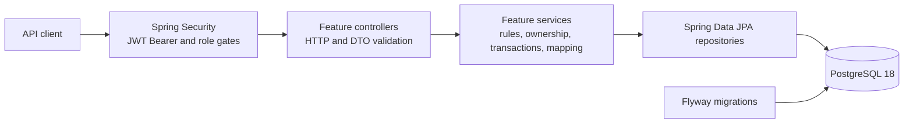
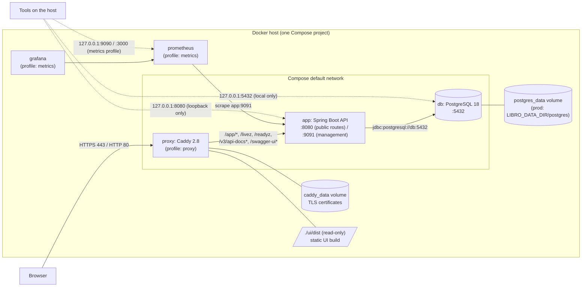
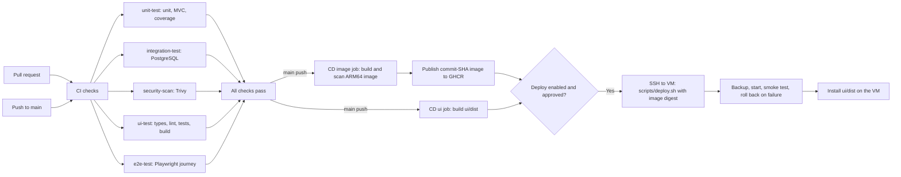

<h1 align="center">Libro - Library Management System</h1>

<p align="center">
  
</p>

[](https://github.com/kyledelfin2006/libro-library-system/actions/workflows/ci.yml)
[](https://github.com/kyledelfin2006/libro-library-system/actions/workflows/cd.yml)


## Project Overview

Libro is a Spring Boot REST API for the library of Aklan State University – College of Computer Studies (ASU-CCS). It manages physical book copies, user accounts, and loan history. Each catalog record is one physical copy, which keeps loan history accurate per copy (see [Domain Decisions](docs/guides/domain-decisions.md)).

## Table of Contents

- [Project Overview](#project-overview)
- [Features](#features)
- [Architecture](#architecture)
- [Notable code changes](#notable-code-changes)
- [Engineering problems solved](#engineering-problems-solved)
- [Demo Accounts](#demo-accounts)
- [Quick Start](#quick-start)
  - [Prerequisites](#prerequisites)
  - [Installation](#installation)
- [Configuration & Secrets Management](#configuration--secrets-management)
  - [Environment Variables](#environment-variables)
  - [CI/CD Secrets](#cicd-secrets)
  - [Security Policy](#security-policy)
- [API Usage & Documentation](#api-usage--documentation)
  - [Authentication](#authentication)
  - [Request/Response Examples](#requestresponse-examples)
  - [API Reference](#api-reference)
- [Docker Infrastructure](#docker-infrastructure)
  - [Container topology](#container-topology)
  - [File inventory](#file-inventory)
  - [The application image (Dockerfile)](#the-application-image-dockerfile)
  - [Local stack (docker-compose.yml)](#local-stack-docker-composeyml)
  - [Production override (infra/docker-compose.prod.yml)](#production-override-infradocker-composeprodyml)
  - [Caddy reverse proxy](#caddy-reverse-proxy)
  - [Operations scripts](#operations-scripts)
  - [Networking, ports, volumes, and health](#networking-ports-volumes-and-health)
  - [Image pinning and updates](#image-pinning-and-updates)
  - [Docker safety rules](#docker-safety-rules)
- [CI/CD Pipeline Architecture](#cicd-pipeline-architecture)
  - [Pipeline Flow](#pipeline-flow)
  - [Workflow Breakdown](#workflow-breakdown)
  - [Triggers & Quality Gates](#triggers--quality-gates)
- [Deployment](#deployment)
  - [Environments](#environments)
  - [Deployment Process](#deployment-process)
  - [Manual Deployment & Rollback](#manual-deployment--rollback)
- [Testing](#testing)
- [Documentation](#documentation)
  - [Repo map](#repo-map)
- [Contributing](#contributing)
- [Project Status](#project-status)
- [License](#license)

## Features

- **Catalog:** search, filter, sort, and paginate copies by title, author, genre, or replacement cost; collection and genre statistics.
- **Loans:** students and faculty borrow for 14 days, up to three active loans each; overdue loans block new checkouts. See the [Loan Implementation Guide](docs/guides/loan.md).
- **Accounts and roles:** public signup creates students; librarians create faculty and library-assistant accounts. Four roles (`STUDENT`, `FACULTY`, `ADMINISTRATOR`, `LIBRARIAN`) are enforced at the route and service layers.
- **Security:** stateless HS256 JWT Bearer authentication, BCrypt passwords, per-IP rate limits on login and signup, and a uniform JSON error contract. See the [JWT Authentication Design](docs/reference/jwt-authentication-design.md).
- **Operations:** Flyway-owned schema, Docker Compose, public `/livez` and `/readyz` probes, and Prometheus metrics on a private management port.

| Layer | Technology |
| --- | --- |
| Language and framework | Java 25, Spring Boot 4.1.2 (Web, Data JPA, Security, OAuth2 Resource Server, Validation) |
| Data | PostgreSQL 18, Flyway 13.3.0, Hibernate with schema validation |
| Build and test | Maven, JUnit 5, Mockito, Testcontainers, JaCoCo |
| Delivery | Docker, Docker Compose, Caddy, GitHub Actions, Trivy |

## Architecture



The single-module codebase groups `auth`, `book`, `loan`, `user`, `audit`, and `info` by feature, then by layer. Controllers accept and return DTOs; services own business rules, transactions, and entity-to-DTO mapping; repositories own persistence. Shared responses, errors, request IDs, time handling, and OpenAPI configuration live in `global`. Flyway owns the schema, and Hibernate validates it at startup. [Architecture Overview](docs/architecture.md) shows the request and data flows; its Design Rules section records the package decision.

## Notable code changes

| Change | Result |
| --- | --- |
| Standardized feature packages and moved DTO mapping into services | Controllers stay focused on HTTP, and JPA entities do not cross the API boundary. |
| Moved account ownership and target-role rules into `UserAccessPolicy` | One policy handles student, faculty, assistant, and librarian account operations. |
| Introduced shared not-found and invalid-request exception types | Expected client errors have consistent status codes; unexpected faults get a generic 500 response. |
| Layered the test profile over runtime configuration | Tests exercise the real application defaults with only test-specific overrides. |

## Engineering problems solved

| Problem | Project change |
| --- | --- |
| Entity types and database columns disagreed at startup | Made Flyway the sole schema authority, aligned migrations with JPA, and kept Hibernate schema validation enabled. |
| Container startup could race PostgreSQL readiness | Added a database health check and made the app wait for a healthy database. |
| Concurrent checkout could assign one copy twice | Added row locking, a database unique index for active loans, and PostgreSQL concurrency tests. |
| HTTP-only or mocked tests could miss real persistence errors | Split fast unit/MVC tests from Testcontainers integration tests that exercise migrations, JPA, constraints, and loan races. |
| Scattered account rules and error handling were hard to audit | Centralized target-role/ownership checks in `UserAccessPolicy` and mapped client failures through shared exception types. |

The [Development Problems Solved](docs/guides/development-problems-solved.md) guide traces more issues from symptom to fix and verification. The [Engineering Reference](docs/reference/engineering-reference.md) documents current code contracts and test boundaries.

## Demo Accounts

> **Try Libro:** sign in with the [demo patron accounts](#demo-accounts) below and browse a seeded [catalog of 50 academic books](docs/guides/demo-catalog.md) (software engineering, cybersecurity, networking, project management). The public demo instance is not deployed yet; seed it locally to use the API now. Staff credentials stay private.

These **public patron-only accounts** use synthetic data. They can browse and borrow under the normal loan rules, but cannot manage books or other accounts. Their shared password is published on purpose; do not reuse it elsewhere.

| Role | University ID | Password | Seed method |
| --- | --- | --- | --- |
| `STUDENT` | `2025-0001` | `DemoPatron@2026` | `bash scripts/seed-demo.sh --patrons-only` |
| `FACULTY` | `2025-0002` | `DemoPatron@2026` | `bash scripts/seed-demo.sh` (requires a librarian) |

After starting the [local stack](#quick-start), use the first command to create the student. The full seed also creates the faculty account and the [50-book demo catalog](docs/guides/demo-catalog.md) and prompts for the librarian password. See [Demo Accounts](docs/guides/demo-accounts.md) for staff-account setup and [Local Setup](docs/guides/local-setup.md) for the optional first-librarian bootstrap. No public instance is available yet.

On a **fresh, disposable local database**, run the full seed and then `bash scripts/smoke-journey.sh http://127.0.0.1:8080` with `SMOKE_STAFF_ID` and `SMOKE_STAFF_PASSWORD` set in the shell. Enable `LIBRO_API_DOCS_ENABLED=true` for this check. The journey borrows, returns, marks a faculty loan lost, resets the demo student, and restores that student's original password; do not run it against data you need to keep. The short deployment check remains `scripts/smoke.sh`.

## Quick Start

### Prerequisites

Requires Docker Engine with the Compose plugin. The stack builds the API from source and starts PostgreSQL 18; Java and Maven run inside the container build. Running the app directly on the host requires JDK 25. The optional demo seed script needs Bash and curl.

### Installation

1. Clone the repository, then create the environment file:

   ```bash
   git clone https://github.com/kyledelfin2006/libro-library-system.git
   cd libro-library-system
   cp .env.example .env
   ```

   In PowerShell, use `Copy-Item .env.example .env` for the last command. Set your own PostgreSQL credentials, `LIBRO_ADMIN_PASSWORD_HASH` (a BCrypt hash of a password you choose), and `LIBRO_JWT_SECRET_BASE64` (`openssl rand -base64 32`). The [Operations Runbook](docs/devops/runbook.md#3-configure-secrets) shows hash generation. `.env` is git-ignored.

2. Start the stack:

   ```bash
   docker compose up --build
   ```

3. Check readiness at `http://localhost:8080/readyz`. [Seed the demo student](#demo-accounts) or create your own student through signup, then follow the [login example](#requestresponse-examples).

Swagger UI and `/v3/api-docs` are off unless `LIBRO_API_DOCS_ENABLED=true`, which you can set in your local `.env` (the template leaves it `false`). To run the app outside Docker, enable the TLS proxy profile, or provision the first librarian, see [Local Setup and Configuration](docs/guides/local-setup.md).

## Configuration & Secrets Management

### Environment Variables

Copy [`.env.example`](.env.example) for the local template. The settings below cover the app and Compose; blank optional values disable the related feature.

| Variable | Required | Default or purpose |
| --- | --- | --- |
| `POSTGRES_DB`, `POSTGRES_USER`, `POSTGRES_PASSWORD` | Yes for Compose | Set your own database name, role, and password. |
| `LIBRO_ADMIN_PASSWORD_HASH` | First startup of an empty database | BCrypt hash for Flyway V2's library-assistant account; may be blank once V2 has run. |
| `LIBRO_JWT_SECRET_BASE64` | Yes | No default; must decode to at least 32 random bytes. |
| `LIBRO_JWT_ISSUER`, `LIBRO_JWT_AUDIENCE` | No | `libro-api` for both. |
| `LIBRO_JWT_ACCESS_TOKEN_TTL_SECONDS` | No | `900` seconds. |
| `LIBRO_CORS_ALLOWED_ORIGINS` | No | Blank denies cross-origin browser access; accepts comma-separated exact origins. |
| `SERVER_FORWARD_HEADERS_STRATEGY` | No | `none`; use `native` only behind a trusted proxy with no direct app ingress. |
| `LIBRO_LOGIN_RATE_LIMIT_REQUESTS`, `LIBRO_LOGIN_RATE_LIMIT_WINDOW_SECONDS` | No | `20` requests per `60` seconds per client IP. |
| `LIBRO_SIGNUP_RATE_LIMIT_REQUESTS`, `LIBRO_SIGNUP_RATE_LIMIT_WINDOW_SECONDS` | No | `10` requests per `3600` seconds per client IP. |
| `LIBRO_RATE_LIMIT_MAX_TRACKED_CLIENT_ROUTES` | No | `10000` in-memory client/route counters. |
| `LIBRO_BOOTSTRAP_LIBRARIAN_UNIVERSITY_ID`, `LIBRO_BOOTSTRAP_LIBRARIAN_EMAIL`, `LIBRO_BOOTSTRAP_LIBRARIAN_FIRST_NAME`, `LIBRO_BOOTSTRAP_LIBRARIAN_LAST_NAME`, `LIBRO_BOOTSTRAP_LIBRARIAN_PASSWORD_HASH` | No | Set all five together to create the first librarian once; supply a BCrypt hash. |
| `LIBRO_API_DOCS_ENABLED` | No | `false`; `true` serves Swagger UI and `/v3/api-docs` publicly. |
| `LIBRO_ENVIRONMENT_NAME` | No | `local`; staff-visible label returned by `/app/info`. |
| `LIBRO_DOMAIN` | For the TLS proxy | `localhost` locally; set a real host name for deployment. |
| `MANAGEMENT_SERVER_PORT` | No | `9091`; private Actuator health and Prometheus port. |
| `LIBRO_DATA_DIR` | Production deploy only | Block-volume path for database data, backups, and release state. |
| `LIBRO_BACKUP_BUCKET` | No | Optional object-storage bucket for off-host backups; see the runbook before enabling uploads. |

### CI/CD Secrets

The deploy job needs four **GitHub `production` environment secrets** for the SSH target, deploy user, private key, and pinned host key; application secrets stay in the private host `.env`:

Image publishing uses GitHub's built-in `GITHUB_TOKEN`. The [runbook setup](docs/devops/runbook.md#7-enable-automated-deployment) explains the environment, deployment-enable variable, and branch checks.

### Security Policy

Real `.env` files and private keys are git-ignored. Keep passwords, JWT keys, and staff credentials out of commits and logs. See [CI/CD and DevOps](docs/devops/ci-cd.md#secrets-handling) for production handling.

## API Usage & Documentation

### Authentication

The local base URL is `http://localhost:8080`. Signup (`POST /app/users/signup`), login (`POST /app/auth/login`), `/livez`, and `/readyz` are public. Other routes require an `Authorization: Bearer <token>` header; HTTP Basic is not accepted.

### Request/Response Examples

Log in with the seeded demo student:

```http
POST /app/auth/login HTTP/1.1
Host: localhost:8080
Content-Type: application/json

{"universityId":"2025-0001","password":"DemoPatron@2026"}
```

Successful response (`accessToken` and `timestamp` vary):

```json
{
  "success": true,
  "message": "Success",
  "data": {"accessToken": "<signed JWT>", "tokenType": "Bearer", "expiresIn": 900, "mustChangePassword": false},
  "timestamp": 1720000000000
}
```

Use the returned token for a protected catalog request:

```http
GET /app/books/all?page=0&size=12 HTTP/1.1
Host: localhost:8080
Authorization: Bearer <signed JWT>
```

### API Reference

| Area | Representative endpoints | Access |
| --- | --- | --- |
| Books | `GET /app/books/all`, `GET /app/books/query`, `GET /app/books/{id}`, `POST /app/books/add` | All roles read; library assistants and librarians write. Book responses include advisory `available`; query supports `available` and `copyStatus`. |
| Users | `POST /app/users/signup`, `GET /app/users`, `GET /app/users/me`, `GET /app/users/{universityId}`, `PUT /app/users/{universityId}/password/reset` | Signup is public; the staff directory supports scoped `role` and text `q` filters. Profiles and resets remain role scoped. |
| Loans | `POST /app/loans/{bookId}`, `PUT /app/loans/{loanId}/return`, `GET /app/loans/me`, `GET /app/loans`, `GET /app/loans/activity`, `GET /app/loans/top-titles` | Students/faculty borrow and return their own loans; staff get scoped lists and chart aggregates. |
| Staff | `GET /app/info`, `GET /app/audit` | Staff can see safe build details and role-scoped change history. |

Successful responses use an `ApiResponse` envelope; errors use `ErrorResponse` with a `requestId` and optional stable `code`. List results are paginated (default size 12, maximum 100). Enable `LIBRO_API_DOCS_ENABLED=true` locally for `/swagger-ui.html` and `/v3/api-docs`; they are off by default. See the [Engineering Reference](docs/reference/engineering-reference.md) for the API inventory and response contracts, and the [Roles and JWT Guide](docs/reference/security-roles-and-jwt-guide.md) for permissions.

After a staff-assisted reset, login and `GET /app/users/me` return `mustChangePassword: true`. The account owner changes the temporary password through `PUT /app/users/{universityId}/password` with `currentPassword` and `newPassword`; the flag then becomes false. The API reports the flag but does not block other requests while it is true, so the UI must direct the user through that change.

## Docker Infrastructure

Docker is how Libro is built, tested, scanned, shipped, and run. The same `Dockerfile` produces the image on a developer laptop, in CI's security scan, in CD's published release, and on the production VM. This section is a map of every Docker-related file and how they fit together; the files themselves remain the source of truth.

### Container topology



Three services make up the core system, and two more are optional (profile `metrics`):

| Service | Container | Image | Role |
| --- | --- | --- | --- |
| `db` | `library-postgres` | `postgres:18-alpine`, pinned by digest | Stores all library data. Healthy when `pg_isready` succeeds. |
| `app` | `library-app` | Built from the repository `Dockerfile` (locally) or a digest-pinned GHCR image (production) | The Spring Boot REST API. Starts only after `db` is healthy. |
| `proxy` | `library-proxy` | `caddy:2.8-alpine`, pinned by digest | Optional (`--profile proxy`). Terminates TLS, serves the built UI, and forwards API traffic to `app`. The only service that listens on public interfaces. |
| `prometheus` | `library-prometheus` | `prom/prometheus:v3.5.0`, pinned by digest | Optional (`--profile metrics`). Scrapes the API's private management port (`app:9091`) every 15 s and keeps 15 days of data. Loopback only. |
| `grafana` | `library-grafana` | `grafana/grafana:12.2.0`, pinned by digest | Optional (`--profile metrics`). Shows the provisioned "Libro API overview" dashboard: request rate and latency, logins, rate-limit rejections, password resets, JVM heap, and database connections. Loopback only, anonymous read-only, no admin user. |

### File inventory

| File | Purpose |
| --- | --- |
| [`Dockerfile`](Dockerfile) | Multi-stage build of the API image: Maven build stage, then a JRE-only runtime stage. |
| [`.dockerignore`](.dockerignore) | Keeps secrets, version control, IDE files, build output, docs, `infra/`, and Markdown out of the build context. |
| [`docker-compose.yml`](docker-compose.yml) | The base stack: `db`, `app`, and the optional `proxy`, `prometheus`, and `grafana` (profiles `proxy` and `metrics`). Used as-is for local development and as the base layer in production. |
| [`infra/docker-compose.prod.yml`](infra/docker-compose.prod.yml) | Production override layered on top of the base file. |
| [`infra/caddy/Caddyfile`](infra/caddy/Caddyfile) | Caddy configuration: TLS, security headers, API routing, and static UI serving with SPA fallback. |
| [`infra/metrics/`](infra/metrics) | `prometheus.yml` (the scrape job) and Grafana provisioning: the Prometheus data source, the dashboard provider, and `dashboards/libro-overview.json`. |
| [`.env.example`](.env.example) | Template for the private `.env` that Compose and the scripts read. The real `.env` is git-ignored and never enters an image. |
| [`scripts/common.sh`](scripts/common.sh) | Shared helpers: loads `.env`, wraps `docker compose` with both Compose files, and waits for container health. |
| [`scripts/deploy.sh`](scripts/deploy.sh) | Release script: back up, start the new image, wait for health, smoke test, roll back on failure. |
| [`scripts/install-ui.sh`](scripts/install-ui.sh) | Installs a built UI (tarball on stdin) into `ui/dist` in place. CD streams the artifact to it over SSH after a successful deploy. |
| [`scripts/smoke.sh`](scripts/smoke.sh) | Post-deploy check through the proxy (readiness, liveness, login, authenticated read, anonymous rejection). |
| [`scripts/smoke-journey.sh`](scripts/smoke-journey.sh) | Full client journey for a disposable, freshly seeded local stack. |
| [`scripts/backup.sh`](scripts/backup.sh) / [`scripts/restore.sh`](scripts/restore.sh) | `pg_dump` and `pg_restore` through the running `db` container. |
| [`scripts/seed-demo.sh`](scripts/seed-demo.sh) | Creates the public demo accounts and a synthetic catalog through the API. |
| [`scripts/ci/trivy-scan.sh`](scripts/ci/trivy-scan.sh) | Runs Trivy from its own pinned Docker image against the repository or a built image. Shared by CI and CD. |
| [`.trivyignore`](.trivyignore) | Accepted vulnerability findings (one CVE per line with a reason and expiry). Currently empty. |
| [`.github/dependabot.yml`](.github/dependabot.yml) | Weekly update PRs for Docker base images and Compose images, among other ecosystems. |
| `src/test/java/app/support/PostgresTestConfig.java` | Testcontainers uses the same PostgreSQL digest as `docker-compose.yml`, so tests run on the production database image. |

### The application image (Dockerfile)

**Stage 1, `build`** (`eclipse-temurin:25-jdk-alpine`, digest-pinned)

- Copies only the build inputs: `.mvn/`, `mvnw`, `pom.xml`, and `src/`.
- Runs `./mvnw package -DskipTests` with a BuildKit cache mount on `~/.m2`, so dependencies are cached between local builds without being baked into an image layer. Tests are skipped because CI has already run them on that commit.
- Accepts two build arguments, `LIBRO_COMMIT` and `LIBRO_BUILD_TIME`, which CD sets so `/app/info` can report the exact commit and build time.
- Extracts the fat JAR into four layers with Spring Boot's `jarmode=tools extract --layers`: `dependencies`, `spring-boot-loader`, `snapshot-dependencies`, `application`.

**Stage 2, runtime** (`eclipse-temurin:25-jre-alpine`, digest-pinned)

- Contains a JRE only, with no compiler, Maven, or sources.
- Runs as a dedicated non-root system user, `libro`.
- Copies the four layers from least to most frequently changed, so a code-only change ships a small `application` layer and reuses the rest.
- Sets `JAVA_TOOL_OPTIONS`: `-XX:MaxRAMPercentage=75` (heap sized from the container memory limit), `-XX:+ExitOnOutOfMemoryError` (let the restart policy replace a half-dead JVM), and `-Duser.timezone=Asia/Manila` (stored `LocalDateTime` values use the library's wall clock).
- Exposes only port 8080. The Actuator management port (9091) is never exposed.
- Defines the **only** health check: `wget` against `http://127.0.0.1:8080/readyz` every 30 s (5 s timeout, 60 s start period for Flyway migrations, unhealthy after 3 failures). Compose and the deploy scripts rely on it rather than defining their own.
- Uses the exec-form `ENTRYPOINT ["java", "-jar", "application.jar"]`, so Java is PID 1 and receives `SIGTERM` for graceful shutdown.

The image does **not** contain the web UI. The UI is built separately (`cd ui && npm ci && npm run build`; CD does this in its `ui` job) and served by Caddy from a bind-mounted `ui/dist`, which `scripts/install-ui.sh` updates in place.

### Local stack (docker-compose.yml)

Run it with `docker compose up --build`, or add `--profile proxy` to include Caddy. Compose reads `.env` automatically.

- **Shared logging.** An `x-logging` anchor applies `json-file` rotation (10 MB × 3 files) to every service so a long-running host cannot fill its disk.
- **`db`.** Credentials come from `POSTGRES_DB`, `POSTGRES_USER`, and `POSTGRES_PASSWORD`. Data lives in the `postgres_data` named volume mounted at `/var/lib/postgresql` (the PostgreSQL 18 data root). Published only to `127.0.0.1:5432`. `mem_limit: 512m`, `restart: unless-stopped`.
- **`app`.** Built from the repository root. `depends_on: db` with `condition: service_healthy`. The datasource URL is derived as `jdbc:postgresql://db:5432/${POSTGRES_DB}`; `db` is the service name on the Compose network. `LIBRO_JWT_SECRET_BASE64` is required (Compose stops with a message if it is missing). Every optional setting (JWT issuer and audience, rate limits, CORS, API docs, bootstrap librarian, and so on) is passed through only when set, so the defaults in `application.properties` remain the single source. `mem_limit: 1g`, `no-new-privileges`, published only to `127.0.0.1:8080`.
- **`proxy`.** Behind `profiles: ["proxy"]`. Starts only once `app` is healthy. Mounts the Caddyfile read-only, `./ui/dist` read-only at `/srv/ui`, and the `caddy_data` volume at `/data`. Publishes ports 80 and 443. `LIBRO_DOMAIN` defaults to `localhost`. `mem_limit: 128m`.
- **`prometheus` and `grafana`.** Behind `profiles: ["metrics"]`, so a plain `docker compose up` does not start them. Prometheus reads `infra/metrics/prometheus.yml`, starts once `app` is healthy, and stores data in `prometheus_data`. Grafana loads its provisioning and dashboard files read-only, with `GF_SECURITY_DISABLE_INITIAL_ADMIN_CREATION` and anonymous Viewer access, so there is no password to manage; that is acceptable only because both ports are bound to `127.0.0.1` (use an SSH tunnel to reach them remotely). `mem_limit: 256m` each.
- **Volumes.** `postgres_data` (database), `caddy_data` (issued certificates), `prometheus_data`, and `grafana_data`. All survive `docker compose down`.

### Production override (infra/docker-compose.prod.yml)

Production always layers this file on top of the base file (`scripts/common.sh` builds the command). It targets a single ARM64 Linux VM and requires Docker Compose 2.24 or newer for `!reset`.

| Change | Effect |
| --- | --- |
| `db.ports: !reset []` | PostgreSQL publishes no host port at all. |
| `db.volumes` bind mount | Data moves to `${LIBRO_DATA_DIR}/postgres` on a dedicated block volume instead of the boot-volume named volume. The directory must exist and be owned by UID 70 (the postgres user in the Alpine image). |
| `app.image: ${LIBRO_IMAGE}` | Runs a specific, recorded image (a locally built tag or a GHCR reference pinned by digest) so it can be rolled back. |
| `app.environment` | Sets `SERVER_FORWARD_HEADERS_STRATEGY=native` so per-IP rate limits see real client addresses, and `LIBRO_ENVIRONMENT_NAME=production`. Safe only because the app port stays on loopback behind the proxy. |
| `proxy.environment` | `LIBRO_DOMAIN` is required; there is no silent fallback to `localhost`. |

### Caddy reverse proxy

[`infra/caddy/Caddyfile`](infra/caddy/Caddyfile) serves `{$LIBRO_DOMAIN}`. For a real domain Caddy obtains and renews a Let's Encrypt certificate (ports 80 and 443 must be reachable); `localhost` uses Caddy's internal CA.

- **Compression and headers.** `zstd`/`gzip`; `Strict-Transport-Security` (one year, include subdomains); `X-Content-Type-Options: nosniff`; the `Server` header is removed; `Referrer-Policy: no-referrer`.
- **Content-Security-Policy.** `default-src 'self'` with same-origin scripts, fonts, images (plus `data:`), and connections; styles allow `'unsafe-inline'`; `frame-ancestors 'none'`, `base-uri 'none'`, `form-action 'self'`. No inline scripts, so a missing hash or third-party host fails loudly.
- **API routing.** Paths `/app/*`, `/livez`, `/readyz`, `/v3/api-docs*`, and `/swagger-ui*` go to `app:8080`. The Actuator and Prometheus management port is never proxied.
- **Static UI.** Everything else is served from `/srv/ui` (the mounted `ui/dist`). Unknown paths fall back to `index.html` so client-side routes such as `/catalog` survive a reload. `/assets/*` and `/brand/*` are cached for a year as immutable; `index.html` is `no-cache`.

### Operations scripts

All scripts use `scripts/common.sh`, which loads the private `.env` (BCrypt hashes must be single-quoted), requires variables to be set, and runs `docker compose --env-file .env -f docker-compose.yml -f infra/docker-compose.prod.yml --profile proxy`.

| Script | What it does with Docker |
| --- | --- |
| `deploy.sh [--image REF]` | Checks configuration and `.env` permissions (mode `600`); builds `libro-api:<commit>` locally or accepts a digest-pinned `--image`; runs `backup.sh` if `db` is running; `compose up -d --no-build`; waits for `library-app` to be healthy; seeds the demo student; runs `smoke.sh`; on any failure restarts the previously recorded image. The live and previous images are recorded in `$LIBRO_DATA_DIR/state`. |
| `smoke.sh [BASE_URL]` | Checks `/readyz`, `/livez`, a patron login, an authenticated read, and that an anonymous read returns 401. |
| `backup.sh` | `compose exec -T db pg_dump -Fc` to a `.partial` file, renamed only when complete; keeps the newest N dumps (default 7); optional object-storage upload. |
| `restore.sh DUMP` | Confirms by typing the database name, takes a safety backup, stops `proxy` and `app`, runs `pg_restore --clean --single-transaction`, restarts and waits for health. |
| `seed-demo.sh` | Creates demo accounts and a synthetic catalog through the API (`127.0.0.1:8080` by default). |
| `smoke-journey.sh` | Full borrow/return/lost journey; for disposable local data only. |

### Networking, ports, volumes, and health

| Port | Service | Published to | Notes |
| --- | --- | --- | --- |
| 80, 443 | `proxy` | All interfaces | The only public entry. |
| 8080 | `app` | `127.0.0.1` only | HTTP API and the public `/livez` and `/readyz` probes. |
| 9091 | `app` | Never | Actuator `health` and `prometheus`; reachable only inside the Docker network. Security permits only GET of those paths, and only for connections that arrive on this port, so Prometheus can scrape without credentials. |
| 5432 | `db` | `127.0.0.1` locally; not published in production | The app reaches it as `db:5432`. |
| 9090, 3000 | `prometheus`, `grafana` | `127.0.0.1` only (profile `metrics`) | Reach them through an SSH tunnel; never publish them. |

Health is layered: `db` uses `pg_isready`; `app` uses the Dockerfile `HEALTHCHECK` on `/readyz`; `proxy` waits for `app` to be healthy. `restart: unless-stopped` restarts crashed containers and survives a Docker daemon restart, while `docker compose down` still stops them.

### Image pinning and updates

Every image is pinned by `@sha256` digest: the two Dockerfile base images, PostgreSQL, Caddy, Prometheus, Grafana, the CI `ui-test` and `e2e-test` PostgreSQL services, and the Trivy scanner. Dependabot opens weekly PRs for the `docker` and `docker-compose` ecosystems. Two pins are updated by hand when their PRs land: the Trivy digest in `scripts/ci/trivy-scan.sh` and the PostgreSQL digest in `PostgresTestConfig.java` (keep it equal to `docker-compose.yml`).

### Docker safety rules

- Never run `docker compose down -v` unless you intend to destroy the database data; it deletes the `postgres_data` volume.
- Keep `.env` out of images and out of git; `.dockerignore` excludes it from the build context.
- Do not publish the management port or the app port beyond loopback, and enable `SERVER_FORWARD_HEADERS_STRATEGY=native` only behind a trusted proxy.
- Containers run with `no-new-privileges`, memory limits, log rotation, and a non-root application user.
- Flyway migrations are forward-only; an image rollback cannot undo them. Use `scripts/restore.sh` for database recovery.

## CI/CD Pipeline Architecture

GitHub Actions runs two workflows: **CI** ([`ci.yml`](.github/workflows/ci.yml)) validates every change, and **CD** ([`cd.yml`](.github/workflows/cd.yml)) turns a validated `main` commit into a published, scanned image and, when enabled, deploys it. Both workflows pin third-party actions to full commit SHAs and default to read-only `contents` permission.

### Pipeline Flow



### Workflow Breakdown

#### CI ([`ci.yml`](.github/workflows/ci.yml))

Every pull request and every push to `main` runs five independent jobs in parallel; any failure fails the workflow. A newer push to the same branch or PR cancels the obsolete run (`concurrency` with `cancel-in-progress`), and the workflow has read-only `contents` permission with no deployment credentials.

| Job | Runner and timeout | What it runs | What it proves |
| --- | --- | --- | --- |
| `unit-test` | `ubuntu-latest`, 15 min | JDK 25 (Temurin, Maven cache), `./mvnw -B -ntp verify` | Unit and MVC tests pass and line coverage meets the 80% JaCoCo floor. Surefire and JaCoCo reports upload as `unit-test-reports` (14 days, even on failure). |
| `integration-test` | `ubuntu-latest`, 25 min | `./mvnw -B -ntp -Pintegration -DskipUTs -Djacoco.haltOnFailure=false verify` | The `*IT` suite passes against a real PostgreSQL container via Testcontainers: Flyway migrations, schema validation, and loan concurrency. `-DskipUTs` avoids re-running unit tests; the coverage gate is not applied to this suite. Reports upload as `integration-test-reports`. |
| `security-scan` | `ubuntu-latest`, 20 min | `scripts/ci/trivy-scan.sh fs`, then `docker build -t libro-api:ci .`, then `scripts/ci/trivy-scan.sh image libro-api:ci` | No fixable HIGH or CRITICAL vulnerabilities in `pom.xml` dependencies or in the built image (OS packages and the packaged JAR). |
| `ui-test` | `ubuntu-latest`, 15 min | Node 24 and JDK 25, with a PostgreSQL 18 service container | Boots the API on the test profile with API docs on, regenerates `ui/src/api/schema.d.ts`, and fails on any `git diff` (generated-type drift); then `npm run typecheck`, `lint`, `test` (unit, contrast, and accessibility tests), and `build`. |
| `e2e-test` | `ubuntu-latest`, 20 min | Node 24, JDK 25, a PostgreSQL 18 service container, and Chromium | Starts the API on the test profile with a librarian created by the startup bootstrap (random password for this run, hash from the pinned Caddy image), then runs the Playwright journey: register, sign in, search, borrow, return, and a staff lost-resolution, with axe in both themes and a phone-width navigation check. Reports upload on failure. |

The Trivy policy lives in one place, [`scripts/ci/trivy-scan.sh`](scripts/ci/trivy-scan.sh), so CI and CD apply identical rules: severities `HIGH,CRITICAL`, `--ignore-unfixed`, exit code 1 on any remaining finding, and accepted exceptions in `.trivyignore`. Trivy itself runs from a digest-pinned `aquasec/trivy` image, so no third-party GitHub Action is trusted for scanning. Branch protection should require all five check names before merging to `main`.

#### CD ([`cd.yml`](.github/workflows/cd.yml))

CD extends CI and never replaces it. Its triggers:

| Trigger | Behavior |
| --- | --- |
| `workflow_run` of CI on `main` | The release path. The `image` job runs only when the CI run concluded `success` and was started by a `push`. |
| `workflow_dispatch` | Manual release of the current `main`; the deploy job still needs `production` approval. |
| `pull_request` touching `cd.yml`, `Dockerfile`, `scripts/ci/trivy-scan.sh`, `scripts/install-ui.sh`, or the release-history script | Dry run: build and scan the image and build the UI, no publishing or deploying. |

**`image` job** (`ubuntu-24.04-arm`, native ARM64 with no QEMU emulation, 30 min; the only job allowed `packages: write`):

1. Resolves the revision to the exact commit CI validated (`workflow_run.head_sha`), never a newer `main`.
2. Checks out that commit without persisting git credentials.
3. Builds one `linux/arm64` image with `LIBRO_COMMIT` and `LIBRO_BUILD_TIME` build arguments and OCI `source` and `revision` labels.
4. Scans that exact image with `scripts/ci/trivy-scan.sh`.
5. Unless the run is a pull request, logs in to GitHub Container Registry with `GITHUB_TOKEN` (via `--password-stdin`), pushes `ghcr.io/<owner>/libro-api:<commit-sha>`, and outputs the immutable `name@sha256:` digest.

**`ui` job** (`ubuntu-latest`, 15 min, same release condition as `image`):

1. Checks out the same validated commit and sets up Node 24.
2. `npm ci`, then `npm run build:history`, which writes the release-history page's data from GitHub Releases and successful CD runs (best effort: an outage leaves it empty and never fails the release).
3. `npm run build`, packs `ui/dist` as one tarball, and uploads it as the `libro-ui` artifact.

**`deploy` job** (`ubuntu-latest`, 20 min, `environment: production`, needs `image` and `ui`):

- Runs only when the event is not a pull request **and** the repository variable `OCI_DEPLOY_ENABLED` is `true`. The `production` environment's required reviewers then hold the job until someone approves it.
- Uses `concurrency: production-deploy` with `cancel-in-progress: false`, so two deployments never overlap and a running one is never cancelled.
- Validates inputs before they reach a remote shell: a 40-character commit SHA and a digest-pinned GHCR reference.
- Writes the deploy key (mode `600`) and a pinned `known_hosts`, then connects with `StrictHostKeyChecking=yes`, which rejects any other host key. Secrets: `OCI_SSH_KEY`, `OCI_SSH_KNOWN_HOSTS`, `OCI_HOST`, `OCI_USER`.
- Over SSH, runs `cd /opt/libro`, checks out the validated commit (so scripts and Compose files match the image), and runs `scripts/deploy.sh --image <digest>`. The values are passed as arguments through a quoted heredoc, never as shell code.
- The server never rebuilds the release, so what was scanned is exactly what runs. `deploy.sh` backs up the database, starts the image, waits for health, smoke tests it, and rolls back to the previous image on failure.
- Only after `deploy.sh` succeeds, a second step streams the `libro-ui` tarball over the same SSH connection to `scripts/install-ui.sh`, which refuses an upload without `index.html` and updates `ui/dist` in place (new files first, `index.html` next, stale files last). Caddy serves that directory straight from its bind mount, so no restart is needed, and a rolled-back release never leaves a newer UI in front of an older API.

#### Dependabot ([`dependabot.yml`](.github/dependabot.yml))

Weekly update PRs for Maven (`pom.xml`, up to 5 open), Docker (Dockerfile base images), Docker Compose (PostgreSQL and Caddy digests), and GitHub Actions (SHA pins and version comments). Spring Boot-managed libraries are updated by raising the parent version, not individually.

### Triggers & Quality Gates

Gate summary, in order: (1) all five CI jobs pass; (2) CI succeeds on a `main` push, which unlocks the CD `image` job; (3) the image passes the Trivy scan before it is pushed; (4) the deploy job requires `OCI_DEPLOY_ENABLED=true` plus `production` environment approval; (5) `deploy.sh` passes its health check and smoke test or automatically rolls back. Setup for the environment, secrets, and enable variable is in the [Operations Runbook](docs/devops/runbook.md#7-enable-automated-deployment).

CD ships both halves of a release: the scanned API image (by digest) and the web UI build (`ui/dist`), installed together from the same validated commit.

## Deployment

### Environments

Local development uses Docker Compose; CI uses ephemeral GitHub runners. The planned production demo target is a single ARM64 Linux VM running the API, PostgreSQL, and a Caddy TLS proxy under Docker Compose. It is a single-instance design without high availability or autoscaling, and there is no separate staging environment.

### Deployment Process

`scripts/deploy.sh` already does the deploy step by hand: it backs up the database, starts the new image, runs a smoke test (readiness, login, authenticated read, anonymous rejection), and restarts the previous image if anything fails. Flyway migrations are forward-only, so database recovery uses `scripts/restore.sh`. `backup.sh` and `seed-demo.sh` cover backups and demo data. The pipeline stages, environments, rollback, and monitoring are in [CI/CD and DevOps](docs/devops/ci-cd.md); first deploy, manual update, restore, and automation setup are in the [Operations Runbook](docs/devops/runbook.md).

### Manual Deployment & Rollback

On a provisioned VM, use `scripts/deploy.sh` for a manual release or [the runbook's update procedure](docs/devops/runbook.md#6-updating-and-rolling-back) for a rollback. If a release applied a bad database migration, restore the pre-deploy backup; an application image rollback cannot reverse Flyway migrations.

**The service is not deployed yet:** the scripts were rehearsed against a local Docker stack and the image-publishing workflow is in place, but no VM is provisioned, so the deploy job is switched off.

## Testing

Run `./mvnw verify` for unit/MVC tests and the 80% line-coverage gate. Run `./mvnw -Pintegration -DskipUTs -Djacoco.haltOnFailure=false verify` for the PostgreSQL suite (unit tests run once, in the first command); it needs Docker and a test-only `LIBRO_ADMIN_PASSWORD_HASH` in the shell environment, because Maven does not load Compose's `.env`. On Windows, use `mvnw.cmd`. The [Engineering Reference](docs/reference/engineering-reference.md#testing-strategy) explains test scope and where to add coverage.

The web UI under `ui/` covers sign-in and registration, the catalog, borrowing and returning, My Account, and the staff dashboard, loans, inventory, accounts, audit log, status, version, and release history (see the [Web UI guide](docs/guides/web-ui.md)). Start the API, then run `npm ci` and `npm run dev` from `ui/`; Vite proxies the API routes. Run `npm run typecheck`, `npm run lint`, `npm test`, and `npm run build` for its local checks. `npm run test:e2e` runs one Playwright journey (register, sign in, search, borrow, return, and a staff lost-resolution) against a running API and a staff login set in `E2E_STAFF_ID` and `E2E_STAFF_PASSWORD`; it writes to the database, so use a disposable one. With API docs enabled, `npm run gen:api` refreshes the checked-in TypeScript contract.

## Documentation

| Start here for | Document |
| --- | --- |
| System design, flows, and data model | [Architecture](docs/architecture.md) |
| Current repository map, API inventory, configuration, and tests | [Engineering Reference](docs/reference/engineering-reference.md) |
| The web UI: pages, roles, build, tests, and delivery | [Web UI guide](docs/guides/web-ui.md) |
| Running and configuring a local stack | [Local Setup](docs/guides/local-setup.md) |
| Public patron logins and private staff-account policy | [Demo Accounts](docs/guides/demo-accounts.md) |
| Seeded demo books and how to load them | [Demo Catalog](docs/guides/demo-catalog.md) |
| Physical-copy and loan decisions | [Domain Decisions](docs/guides/domain-decisions.md) and [Loan Implementation Guide](docs/guides/loan.md) |
| Role boundaries and authentication internals | [Roles and JWT Guide](docs/reference/security-roles-and-jwt-guide.md) and [JWT Authentication Design](docs/reference/jwt-authentication-design.md) |
| API documentation conventions | [API Documentation Guideline](docs/guides/api-documentation-guideline.md) |
| Pipeline, infrastructure, and recovery | [CI/CD and DevOps](docs/devops/ci-cd.md) and [Operations Runbook](docs/devops/runbook.md) |
| Engineering choices and institutional domain | [Development Problems Solved](docs/guides/development-problems-solved.md) and [Institutional Context](docs/guides/institutional-context.md) |
| Remaining work and contribution rules | [Development Roadmap](docs/reference/ROADMAP.md) and [Agent and Contributor Guide](AGENTS.md) |

### Repo map

```text
src/             Spring Boot application (controllers, services, repositories, Flyway migrations) and tests
ui/              React/Vite UI, generated API types, and frontend tests
infra/           Production Compose override and the Caddy reverse-proxy configuration
scripts/         Deploy, rollback, smoke-test, backup, restore, and demo-seed scripts
docs/
  architecture.md  Design, request flows, API inventory, data model, troubleshooting, tests
  devops/          CI/CD, environments, secrets, rollback, monitoring, operations runbook
  guides/          Domain decisions, loan guide, web UI guide, local setup, institutional context, API documentation standard
  reference/       Engineering reference, JWT design, role policy, roadmap
.github/         CI and CD workflows and Dependabot configuration
Dockerfile, docker-compose.yml, pom.xml, mvnw   Build and runtime entry points
AGENTS.md        Contributor and AI-agent guide
```

Start with [Architecture and Reference](docs/architecture.md) for how the system works, the [Engineering Reference](docs/reference/engineering-reference.md) for contracts and configuration, and [Development Problems Solved](docs/guides/development-problems-solved.md) for the engineering decisions behind it. [Institutional Context](docs/guides/institutional-context.md) explains the ASU-CCS user domain.

## Contributing

Read the [Agent and Contributor Guide](AGENTS.md) before changing code or documentation. It maps each contract to its source of truth and defines the contribution workflow. The [Development Roadmap](docs/reference/ROADMAP.md) tracks remaining work.

## Project Status

| Area | State |
| --- | --- |
| Catalog, accounts, roles, JWT authentication, loans | Implemented and covered by unit, MVC, and PostgreSQL tests |
| CI (`unit-test`, `integration-test`, `security-scan`, `ui-test`, `e2e-test`) | Running on every pull request and push to `main`; all five checks are required by branch protection on `main` |
| Container image and Compose stack | Implemented, with health checks |
| Deploy, rollback, backup, and smoke-test scripts; runbook | Implemented and rehearsed locally |
| CD workflow (ARM64 build, scan, publish, gated deploy) | Implemented; deploy job off until the VM exists |
| Production VM | Not provisioned; see the [Operations Runbook](docs/devops/runbook.md) and [Roadmap](docs/reference/ROADMAP.md) |
| Open items | TLS with a real domain, login-failure and rate-limit alerts, and an independent security review before public exposure |

The [Development Roadmap](docs/reference/ROADMAP.md) tracks the detail.

## License

This project is licensed under the [MIT License](LICENSE).
