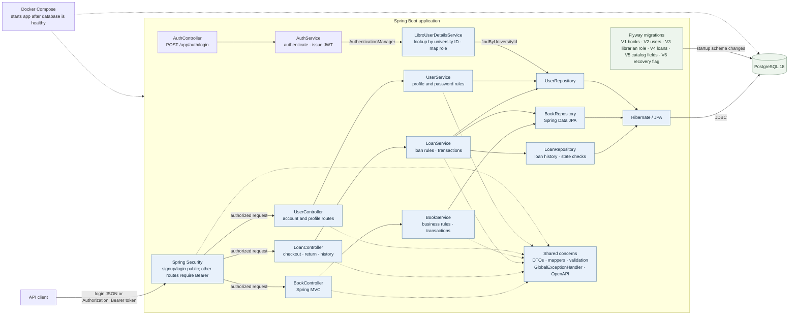
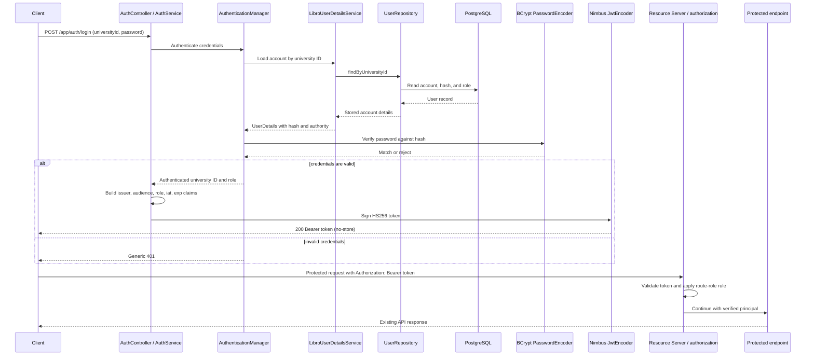
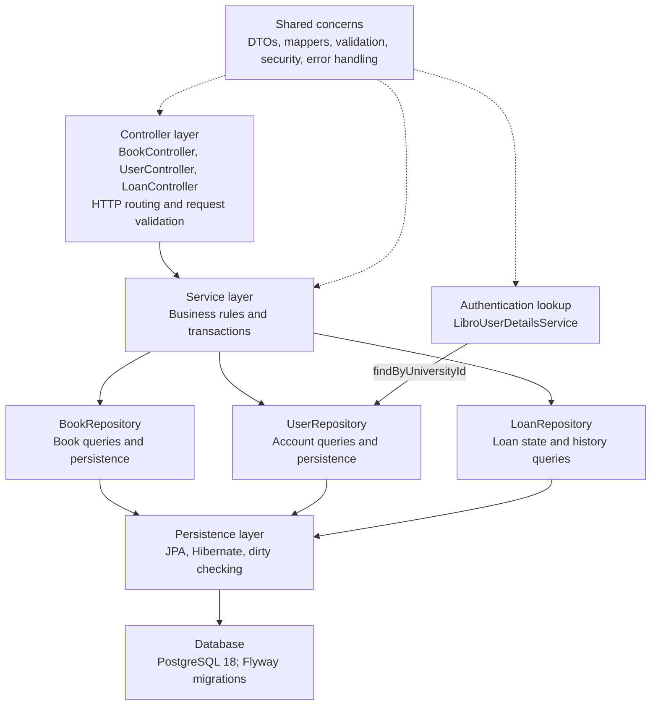
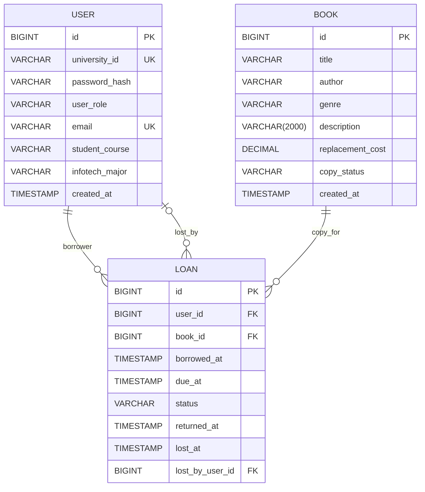
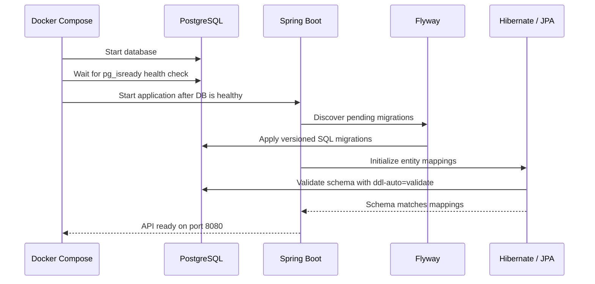

# Architecture Overview

How Libro is put together: the components, how a request flows through them, the layer rules, and the data model. It is the short tour; the [Engineering Reference](reference/engineering-reference.md) holds the detailed contracts, and the code, migrations, and tests are authoritative if this page lags.

## Components

The system runs as a Spring Boot API alongside PostgreSQL. Book, user, and loan requests pass through their HTTP and business layers to persistence; Flyway prepares the schema at startup. Shared validation, mapping, security configuration, and error handling support the API. Login uses `LibroUserDetailsService` for account lookup; protected Bearer requests validate locally without a database lookup.

Login passes the submitted university ID and password to Spring Security's authentication manager. `LibroUserDetailsService` loads the account and BCrypt verifies its stored hash. After login, Resource Server validates each Bearer token's signature and claims, maps the signed role, and applies route authorization without reloading the user. Signup and login are public; all other routes require a token. Controllers do not access the repository directly.

### Current Authentication and Authorization Flow

The client submits credentials once to receive a short-lived token, then sends the token on protected requests. HTTPS is required outside local development.

Account and loan access is checked against the authenticated user's university ID and role. `ADMINISTRATOR` is the library-assistant role, and `LIBRARIAN` is the library's librarian. Students and faculty borrow and return their own loans; staff review only the histories permitted by their role.

| Current rule | Allowed access |
| --- | --- |
| Public operations | POST /app/users/signup; POST /app/auth/login; GET /livez and /readyz |
| Read books | STUDENT, FACULTY, ADMINISTRATOR, LIBRARIAN |
| Add, update, or delete books | ADMINISTRATOR, LIBRARIAN |
| Create school faculty and library assistant accounts | LIBRARIAN |
| List/read student and faculty profiles | ADMINISTRATOR, LIBRARIAN |
| List/read library assistant profiles | LIBRARIAN |
| Update student/faculty profiles and passwords | Owner, ADMINISTRATOR, LIBRARIAN |
| Update library assistant profiles and passwords | Owner, LIBRARIAN |
| Delete own student/faculty account | Owner |
| Delete student/faculty accounts | ADMINISTRATOR, LIBRARIAN |
| Delete library assistant accounts | LIBRARIAN |
| Borrow and return own loans | STUDENT, FACULTY |
| View own loan history | STUDENT, FACULTY, ADMINISTRATOR, LIBRARIAN |
| View or mark student/faculty loans lost | ADMINISTRATOR, LIBRARIAN |
| View or mark library-assistant loans lost | LIBRARIAN |

### Layered Design

Account operations and login use `UserRepository`: `UserService` uses it for signup, profile, and password operations, and asks `UserAccessPolicy` whether the caller may act on the loaded account; `LoanService` uses it to identify and lock borrowers; `LibroUserDetailsService` loads the account Spring Security authenticates at login. Bearer-token validation does not query the account again and does not route through `UserController` or `UserService`.

### Current Persistence Model

The current schema stores books, users, and loans. A Book row is one physical copy. Loan rows identify the borrower from the authenticated principal and preserve checkout, return, or loss history. The database permits only one active loan per copy. See [Domain Decisions](guides/domain-decisions.md) for the reasoning.

Each checkout creates a new `LOAN` row for one physical copy and one borrower; `lost_by_user_id` is optional because only a lost loan has a staff resolver. Its lifecycle status is `ACTIVE`, `RETURNED`, or `LOST`; overdue is calculated at request time and is not stored. Returned and lost events remain in history. Students and faculty may have up to three active loans each, and a borrower with an overdue loan cannot start another loan. Library assistants and librarians can mark authorized active loans lost, which also marks the physical copy lost. A copy with any loan history is retained and cannot be deleted; deletion returns `409 Conflict`. Penalties and repeat-offender rules are future scope.

## Design Rules

These rules are applied the same way in every feature package; the project uses layered feature packages rather than hexagonal ports and adapters because the domain is a CRUD-heavy catalog with one real workflow (loans), one inbound adapter (REST), and one outbound adapter (JPA). JPA annotations stay on the domain classes; if a feature later gains a second adapter, that feature can introduce a port interface without restructuring the others.

| Rule | Where it shows up |
| --- | --- |
| Package by feature, then by layer | `app.book`, `app.loan`, `app.user`, `app.auth`, each with `controller`, `service`, `repository`, `entity`, `dto`, `mapper`, `exception`; shared code in `app.global` |
| Controllers handle HTTP only | Bind and validate input, choose the status code, wrap the result in `ApiResponse`; no repository access, no mapping |
| Services own rules, transactions, and mapping | Accept request DTOs, return response DTOs; `@Transactional(readOnly = true)` by default, `@Transactional` on writes |
| Entities never leave a transaction | Mapping runs inside the service (open-in-view is off), so no `Book`, `User`, or `Loan` reaches a controller |
| Authorization in two layers | `SecurityConfig` gates routes by role; services check ownership and target role after loading the record (`UserAccessPolicy`, `LoanService`) |
| One error shape, few handlers | `ResourceNotFoundException` subclasses become 404, `InvalidRequestException` subclasses become 400, anything unexpected becomes a generic 500; all use `ErrorResponse` with the request ID |
| Schema owned by Flyway | Forward-only migrations; Hibernate only validates (`ddl-auto=validate`) |

## Feature Details

### Catalog and discovery

Each `Book` is one physical borrowable copy. Separate copies can share a title or author and still have independent availability and loan histories. The catalog supports:

- Create, view, replace, partially update, and delete copy records.
- Search by title, author, genre, or exact replacement cost; combine text and inclusive replacement-cost filters.
- Paginate and sort results, with supported sort fields validated by the API.
- Filter by a replacement-cost range or a maximum budget. Every successful response uses the `ApiResponse` envelope (`success`, `message`, `data`, `timestamp`); errors use `ErrorResponse`. Every list endpoint is paginated (zero-based `page`, default `size` 12, maximum 100, `sort=property,direction`).
- Record an optional description and a positive replacement cost. Replacement cost is catalog information, not a fee charged to a borrower.

### Collection insight

Collection statistics include the number of copies, total and average replacement cost, the copy with the highest replacement cost, and counts by genre.

### Loans and circulation

- Students and faculty borrow and return their own copies and view their own paged loan history.
- Loans are due 14 calendar days after checkout. A borrower can have at most three active loans; an overdue active loan blocks another checkout.
- Library assistants and librarians can view permitted patron histories and resolve an active loan as lost. That action records who resolved it and marks the copy unavailable.
- Returned and lost loans remain in history. Overdue loans are not automatically marked lost, and replacement cost does not create a penalty balance.

### Accounts and permissions

- Public signup always creates a student account. Librarians can create faculty and library-assistant accounts.
- Students and faculty manage their own profiles, passwords, and account deletion. Administrators (library assistants) can manage student and faculty accounts; librarians can also manage library-assistant accounts.
- The service checks account ownership and role rules. Passwords are stored as BCrypt hashes and are omitted from account responses.

### API and operations

- Springdoc OpenAPI 3 generates Swagger UI and `/v3/api-docs` from the API contract.
- Request validation and shared error responses give clients structured field-level details for invalid requests and consistent responses for other expected failures.
- Spring Security uses stateless JWT Bearer authentication; signup, login, and Actuator health probes are public, and other routes require an Authorization header token.
- PostgreSQL stores the catalog, accounts, and loan history. Flyway applies versioned schema changes, while Hibernate validates mappings at startup.
- Docker Compose builds the application from source, starts it after PostgreSQL is healthy, and checks the public Actuator readiness endpoint.

## Request Lifecycle

### Create flow (`POST /app/books/add`)

1. Client sends a JSON payload to `/app/books/add`.
2. `BookController` receives the request and binds it to `BookRequestDTO`.
3. `@Valid` triggers Jakarta Validation on the DTO.
4. On success, `BookService.addBook()` converts the DTO to an entity via `BookMapper` and validates it.
5. `BookRepository.save()` persists the entity and assigns the generated ID.
6. Still inside the transaction, the service maps the entity to `BookResponseDTO`; the controller wraps it in `ApiResponse` and returns `201 Created`.

### Update flow (`PATCH /app/books/{id}`)

1. The controller passes `BookPatchRequestDTO` to `BookService.patchBook()`.
2. The service loads the managed `Book` entity with `findBookByIdForUpdate()`, taking a row lock shared with checkout and lost-copy resolution.
3. Field changes are applied conditionally to the locked, managed entity.
4. Hibernate dirty checking detects the modifications.
5. The service maps the entity to `BookResponseDTO`; the transaction then commits and flushes the update without an explicit `save()` call.

### Startup flow

Flyway owns schema creation and updates; Hibernate validates the resulting schema instead of changing it. The filter chain exposes signup, login, and Actuator health probes; protected API routes accept only Bearer tokens and enforce the current route rules.

## Troubleshooting

| Symptom | Likely Cause | Fix |
| --- | --- | --- |
| App fails to start with datasource errors | Missing or incorrect `SPRING_DATASOURCE_*` variables | Check `.env` and Docker Compose values |
| `400 Bad Request` on create or replace | Validation failed in `BookRequestDTO` | Make sure `title`, `author`, `genre`, and `replacement cost` are valid |
| `Invalid JSON format in request body` | Malformed request payload | Send valid JSON and set `Content-Type: application/json` |
| `Book not found` | The requested ID does not exist | Verify the ID with `GET /app/books/all` |
| `Invalid Number Format` | Non-numeric values were sent to a numeric endpoint | Use numeric values for `replacement cost`, `minReplacementCost`, `maxReplacementCost`, and similar fields |
| `Method not allowed` | Wrong HTTP verb was used | Match the method listed in the endpoint table |
| `401 Unauthorized` on a protected API or documentation route | Bearer token is missing, expired, malformed, or invalid | Log in at `POST /app/auth/login` and send the returned token in `Authorization: Bearer <token>` |
| `403 Forbidden` with a valid token | The token's role does not satisfy the route or service ownership rule | Check the [role policy](reference/security-roles-and-jwt-guide.md#role-policy) and the target account/loan scope |
| App fails during startup mentioning `LIBRO_JWT_SECRET_BASE64` | The required key is absent, invalid Base64, or decodes to fewer than 32 bytes | Generate a random key with `openssl rand -base64 32` and provide it through the environment |
| Docker app container fails to start | Docker build, configuration, or health probe failed | Inspect `docker compose logs app` and `docker compose ps`; the image builds the JAR from source |
| `library-app` keeps restarting with a schema validation error | Inspect `docker compose logs app`; an old development volume may have `books.id` as `INTEGER` while Hibernate expects `BIGINT` | If the volume contains only disposable development data, back up anything needed and intentionally remove it with `docker compose down -v`; otherwise preserve the volume and resolve the schema through a forward migration. Then rebuild with `docker compose up -d --build` |
| No Flyway messages or `flyway_schema_history` table | The Boot 4 Flyway starter is absent, or the container is running an old image | Keep `spring-boot-starter-flyway` and rebuild the image |

The complete diagnosis, pre-release reset procedure, clean-install behavior, and production-data warning are in [Development Problems Solved](guides/development-problems-solved.md).

## Where to Go Next

- [Engineering Reference](reference/engineering-reference.md): repository map, endpoint inventory, configuration, build and test workflows.
- [Role and JWT guide](reference/security-roles-and-jwt-guide.md) and [JWT design](reference/jwt-authentication-design.md): authentication details.
- [Loan guide](guides/loan.md): the loan lifecycle, schema, and API.
- [CI/CD and DevOps](devops/ci-cd.md) and the [runbook](devops/runbook.md): pipeline, deployment, and operations.
- [Development Problems Solved](guides/development-problems-solved.md): the problems behind the current design and how each was verified.
