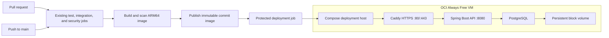

# CI/CD and DevOps

This page describes how Libro validates proposed changes and what is in place for container operations. It distinguishes the automated continuous-integration workflow from deployment automation: **CI is implemented; the GitHub Actions workflow does not currently publish or deploy the application.**

## Delivery pipeline

The workflow is [`.github/workflows/ci.yml`](../../.github/workflows/ci.yml). It uses GitHub-hosted Ubuntu runners and has two triggers:

| Event | What starts the workflow |
| --- | --- |
| `pull_request` | Runs when a pull request is opened, updated with new commits, or reopened. There is no base-branch filter, so PRs into any target branch are covered. A push to a branch with no open PR does not trigger this event. |
| `push` to `main` | Runs after each push event to `main`, including a merge that updates `main`. Direct pushes to other branches do not match this trigger. |

When a source branch has an open PR, pushing commits to it updates the PR and starts a new run. The `concurrency` setting cancels an older in-progress run for the same PR or branch when a newer run starts. The three jobs run independently and can execute in parallel.

## Quality and security gates

| Job | Timeout | What it checks |
| --- | ---: | --- |
| `test` | 15 minutes | Runs `./mvnw -B -ntp verify` for the Docker-free unit and MVC suite, Maven verification, and the JaCoCo 80% line-coverage floor. Uploads test and coverage reports. |
| `integration` | 25 minutes | Runs `./mvnw -B -ntp -Pintegration verify`, activating the Failsafe PostgreSQL integration suite with Testcontainers. This Maven lifecycle also runs the regular unit/MVC tests. Uploads Surefire, Failsafe, and coverage reports. |
| `security` | 20 minutes | Uses Trivy to scan dependency manifests and the built application image. It fails on fixable HIGH or CRITICAL vulnerabilities; findings without an available fix are ignored. |

The integration profile uses PostgreSQL 18 through Testcontainers, so the CI runner must provide Docker. The security job builds the production Dockerfile as `libro-api:ci` before scanning it. That image stays on the runner: the workflow does not push it to a registry.

Test report artifacts are retained for 14 days. Each job has its own timeout, so the limits are not added together; overall elapsed time is driven by the slowest job plus runner startup and queue time. If any job fails, the workflow fails.

## Runner and workflow controls

- Workflow permissions are limited to `contents: read`; CI has no deployment credentials.
- Java 25 is installed from Temurin, with Maven dependency caching enabled.
- Third-party GitHub Actions are pinned to commit SHAs. Trivy runs from its versioned official container image.
- Superseded runs for a matching ref are canceled to avoid spending runner time on stale commits.
- Trivy ignores unfixed findings. Accepted, time-bounded exceptions are recorded in [`.trivyignore`](../../.trivyignore) with an expiry comment.

The workflow reports check results to GitHub. Requiring `test`, `integration`, and `security` before merging is a separate repository branch-protection or ruleset setting; it is not configured by this workflow file. The engineering reference recommends requiring all three checks for `main`.

## Container operations

The repository includes a multi-stage [Dockerfile](../../Dockerfile) that compiles with JDK 25 and runs the packaged application on a JRE-only Alpine image as an unprivileged user. The image defines a readiness health check. [Docker Compose](../../docker-compose.yml) runs PostgreSQL with a persistent named volume, waits for database health before starting the API, and checks the API readiness endpoint.

An optional Caddy profile terminates TLS and keeps the API and database behind the proxy. It is a local/reference deployment setup, not a hosted production deployment. The app and database bind to loopback in the default Compose configuration; only the optional proxy binds public HTTP/HTTPS ports.

## Proposed OCI Always Free MVP

This is a deployment design, not provisioned infrastructure. The MVP target is one low-traffic demo VM running the API, PostgreSQL, and Caddy with Docker Compose. It intentionally has no high availability, autoscaling, or production patron data.

### MVP infrastructure decisions

- **Compute:** OCI's current Always Free documentation lists up to 2 OCPUs and 12 GB RAM for Ampere A1 in the tenancy's home region. The 200 GB Block Volume allowance includes boot volumes. Capacity can be unavailable, and Oracle may reclaim a Free Tier VM that stays below its documented CPU, network, and (for A1) memory utilization thresholds for seven days. Verify the account's current eligibility and quotas before provisioning; this is not an always-on service guarantee. See [OCI Always Free resources](https://docs.oracle.com/en-us/iaas/Content/FreeTier/freetier_topic-Always_Free_Resources.htm).
- **Architecture:** Use one ARM64 A1 VM and the existing Compose/Caddy pattern. The current Dockerfile uses Temurin Alpine images, but CI currently builds on an x86 runner; add an explicit `linux/arm64` build and scan before deploying to A1. Expose only Caddy on ports 80/443 and restrict SSH to a trusted source IP. Keep application 8080, PostgreSQL 5432, and management 9091 inaccessible from the public network.
- **Database:** Run PostgreSQL on the same VM for the demo, with its data on persistent block storage rather than the container's writable layer. Schedule encrypted database backups to Object Storage and prove a restore before the first public demo. Treat the single-VM database as a single point of failure; keep demo data synthetic. An Always Free-only tenancy currently has 20 GB of combined Object Storage, so use a short retention policy and monitor usage.
- **TLS and ingress:** Use Caddy with a real DNS name and ports 80/443. Domain registration is a separate cost item outside the VM allowance. The existing app-level login/signup limits are process-local; keep the app reachable only through the trusted proxy and complete gateway throttling and abuse monitoring before public exposure, as listed in the [roadmap](../reference/ROADMAP.md).
- **Image registry:** OCI Container Registry charges for stored images, so it is not automatically a zero-cost choice. For this public portfolio project, a public GitHub Container Registry image is a simpler MVP option: GitHub currently lists public packages as free and container image storage/bandwidth as free, with policy subject to change. Keep credentials and institutional data out of the image. See [OCI Registry pricing](https://docs.oracle.com/en-us/iaas/Content/Registry/Concepts/registryoverview.htm) and [GitHub Packages billing](https://docs.github.com/en/billing/concepts/product-billing/github-packages).

### MVP continuous delivery design

1. Keep pull requests limited to the existing CI checks. Configure `main` branch protection to require `test`, `integration`, and `security` before merge.
2. Add a deployment job that runs only for `main` after all three checks succeed. For the first release, make it manually approved or `workflow_dispatch`; automate deployment on each successful `main` push only after a successful restore and rollback rehearsal.
3. Build an ARM64 image once, scan that exact image, and publish it with an immutable commit SHA tag or digest. Deploy that exact artifact; avoid deploying a mutable `latest` tag or rebuilding a different image on the server.
4. Restrict deployment credentials to a `production` GitHub environment and to the deployment job. Keep the workflow's default permission at `contents: read`; grant `packages: write` only to the image-publication job and `id-token: write` only if OCI workload identity federation is used. For the initial VM update, a dedicated deploy key stored as an environment secret is simpler; OCI workload identity federation applies to OCI API access and avoids long-lived OCI API keys. Never put credentials in the repository. Approval-rule availability depends on repository visibility and plan. See [GitHub deployment environments](https://docs.github.com/en/actions/how-tos/deploy/configure-and-manage-deployments/manage-environments) and [OCI workload identity federation](https://docs.oracle.com/en-us/iaas/Content/Identity/api-getstarted/token_exchange_grant_type_workload_id-federation.htm).
5. Deploy through a production Compose override under `deploy/` that pulls the immutable image. Wait for `/readyz`, record the deployed image digest, and restore the previous image if the application health check fails. Back up PostgreSQL before Flyway changes; schema migrations are forward-only, so application rollback does not automatically roll back database changes.

For an existing database, verify the outstanding V3-to-V4 upgrade path before migrating its data; a new empty database follows the already-tested fresh migration path. Keep production secrets in the host's protected environment or secret store, including the required JWT key and administrator hash. Do not commit a production `.env` file.

### Later, outside the MVP

Multi-instance availability, blue/green deployment, a managed database, and Kubernetes add cost or operational load without improving a single-instance portfolio demo. Revisit them only when measured traffic, recovery goals, or an actual service commitment requires them.

The proposed OCI design is not deployed and does not close the existing public-exposure gates: real-domain TLS, alerts for login failures and rate-limit rejections, gateway-level throttling, and an independent security review. The [Development Roadmap](../reference/ROADMAP.md) tracks their status.
