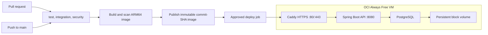

# CI/CD and DevOps

Libro is validated by an implemented GitHub Actions pipeline and packaged as a container. The deployment target is a single Oracle Cloud (OCI) Always Free VM running Docker Compose. This page explains what each stage does and why it was chosen.

| Area | Status |
| --- | --- |
| Continuous integration (`test`, `integration`, `security`) | Implemented in [`ci.yml`](../../.github/workflows/ci.yml) |
| Container image and Compose stack with health checks | Implemented ([Dockerfile](../../Dockerfile), [docker-compose.yml](../../docker-compose.yml)) |
| TLS reverse proxy (Caddy) | Implemented as an opt-in Compose profile |
| Operations scripts: deploy with rollback, smoke test, backup and restore, demo seed ([`scripts/`](../../scripts/)) | Implemented; rehearsed against a local Docker stack, not yet on OCI |
| Production Compose override and [runbook](runbook.md) | Implemented |
| Continuous delivery workflow to OCI | Designed below; no deploy workflow or provisioned VM exists |

## Target environment

**One OCI Always Free Ampere A1 (ARM64) VM** running the API, PostgreSQL, and Caddy under Docker Compose. It is a low-traffic demo with synthetic data. It deliberately has no high availability or autoscaling, because neither improves a single-instance portfolio service.

Design decisions and the reasons for them:

- **Compute.** OCI documents up to 2 OCPUs and 12 GB RAM of Ampere A1 in the home region, and a 200 GB Block Volume allowance that includes boot volumes. Capacity can be unavailable, and Oracle may reclaim an idle Free Tier VM that stays below its utilization thresholds for seven days, so this is a demo target and not an uptime guarantee. See [OCI Always Free resources](https://docs.oracle.com/en-us/iaas/Content/FreeTier/freetier_topic-Always_Free_Resources.htm).
- **Architecture.** The image must run on ARM64. The Dockerfile uses Temurin Alpine images, but CI builds on an x86 runner, so the deploy pipeline builds and scans a `linux/arm64` image before it is released.
- **Network.** Only Caddy listens publicly (80/443). SSH is restricted to a trusted source IP. The app (8080), PostgreSQL (5432), and management (9091) ports are not reachable from the internet.
- **Database.** PostgreSQL runs on the same VM with its data on a dedicated block volume (`LIBRO_DATA_DIR`), not the container's writable layer or the boot volume. It is a single point of failure, so only synthetic data is used. Nightly dumps from `scripts/backup.sh` are kept locally and can be copied to Object Storage, which encrypts at rest (the Always Free allowance is 20 GB combined, so retention is short).
- **TLS.** Caddy obtains certificates for a real DNS name; domain registration is outside the free allowance. The app's login/signup rate limits are per process, so the app port stays reachable only through the proxy.
- **Image registry.** OCI Container Registry bills for storage, so the design uses a public GitHub Container Registry image. GitHub lists public packages as free, subject to policy changes. See [GitHub Packages billing](https://docs.github.com/en/billing/concepts/product-billing/github-packages).

## Pipeline stages

### Continuous integration (implemented)

The workflow runs on GitHub-hosted Ubuntu runners for every pull request (any base branch) and every push to `main`. A newer run cancels a stale in-progress run for the same ref. The three jobs run in parallel and any failure fails the workflow.

| Job | Timeout | What it checks |
| --- | ---: | --- |
| `test` | 15 min | `./mvnw -B -ntp verify`: unit and MVC suite plus the JaCoCo 80% line-coverage floor. |
| `integration` | 25 min | `./mvnw -B -ntp -Pintegration verify`: the PostgreSQL 18 suite through Testcontainers, covering Flyway migrations, Hibernate schema validation, and concurrent-checkout races. |
| `security` | 20 min | Trivy scans dependency manifests and the built Docker image; it fails on fixable HIGH or CRITICAL findings. Accepted exceptions live in [`.trivyignore`](../../.trivyignore) with expiry comments. |

Controls: workflow permissions are `contents: read`, no deployment credentials exist in CI, third-party actions are pinned to commit SHAs, Trivy runs from a versioned official image, and test reports are kept for 14 days. Requiring all three checks before merging is a GitHub branch-protection setting, separate from the workflow file.

### Continuous delivery (design)

1. **Gate.** The deploy job runs only for `main` after `test`, `integration`, and `security` succeed.
2. **Build once.** Build a `linux/arm64` image, scan that exact image, and publish it tagged with the commit SHA. The server pulls that artifact by digest and never rebuilds or uses a mutable `latest` tag.
3. **Approve.** The first releases use a manually approved `production` environment (or `workflow_dispatch`). Automatic deployment on every `main` push waits until a backup restore and a rollback have been rehearsed.
4. **Deploy.** Over SSH, run `scripts/deploy.sh --image <registry reference pinned by digest>`. It backs up PostgreSQL, records the previous image, starts the stack from the base Compose file plus [`infra/docker-compose.prod.yml`](../../infra/docker-compose.prod.yml), and waits for health. Until the workflow exists, the same script builds the image on the VM from the checked-out commit.
5. **Verify.** `scripts/smoke.sh` checks `/readyz` and `/livez`, logs in as the public demo student, performs an authenticated read, and confirms that an anonymous read is rejected. Any failure triggers the rollback below; success records the new image as live.

## Environments

| Environment | Purpose | Runs on | Data |
| --- | --- | --- | --- |
| Local | Development and demos | Docker Compose on a developer machine; see [Local Setup](../guides/local-setup.md) | Disposable volume |
| CI | Verify every change | Ephemeral GitHub runners with Testcontainers | Throwaway containers |
| Production demo | Public portfolio instance | One OCI Always Free VM; see the [runbook](runbook.md) | Synthetic only |

There is no separate staging environment: one low-traffic VM does not justify a second copy, and CI plus the migration tests cover pre-release verification.

## Secrets handling

- No secret is stored in the repository. [`.env.example`](../../.env.example) holds placeholders; real `.env` files and key files (`*.pem`, `*.key`) are git-ignored.
- The application needs a PostgreSQL password, a Base64 JWT signing key of at least 32 bytes (`LIBRO_JWT_SECRET_BASE64`), and BCrypt hashes for the bootstrap accounts. Only hashes are accepted; plaintext account passwords never appear in configuration.
- On the VM, the production `.env` is owned by the deploy user with `chmod 600`; `scripts/deploy.sh` refuses to run if the file is group- or world-readable.
- Staff accounts on the live demo (`0000-0000` librarian, `0000-0001` administrator) use strong, unique passwords that exist only on the host. The only published credentials are patron-only demo logins ([Demo Accounts](../guides/demo-accounts.md)).
- GitHub Actions holds only the deploy SSH key and host details, as `production` environment secrets scoped to the deploy job. The default workflow permission stays `contents: read`; `packages: write` goes only to the image-publishing job, and `id-token: write` only if OCI workload identity federation replaces long-lived OCI API keys. See [GitHub deployment environments](https://docs.github.com/en/actions/how-tos/deploy/configure-and-manage-deployments/manage-environments) and [OCI workload identity federation](https://docs.oracle.com/en-us/iaas/Content/Identity/api-getstarted/token_exchange_grant_type_workload_id-federation.htm).
- Logs and API errors never contain password hashes, stack traces, or credentials.

## Rollback

- **Application.** Each release is an immutable image (a commit-tagged local build now, a digest-pinned registry reference once publishing exists). `scripts/deploy.sh` records the live and previous image under `$LIBRO_DATA_DIR/state` and restarts the previous one automatically if the new one is unhealthy or fails the smoke test.
- **Database.** Flyway migrations are forward-only, so an application rollback does not undo schema changes. `scripts/deploy.sh` takes a database backup before every deploy. `scripts/restore.sh` restores a dump in one transaction and is the recovery path for a bad migration; the [runbook](runbook.md) describes the restore rehearsal.
- **Existing data.** Before migrating a database that already holds data, verify the V3-to-V4 upgrade path. A new empty database follows the fresh-migration path that CI already tests.
- **Never** run `docker compose down -v` against production; it deletes the database volume.

## Monitoring

| Signal | Source | Status |
| --- | --- | --- |
| Liveness and readiness | Public `/livez` and `/readyz` on the app port, with details hidden; Docker and Compose health checks probe `/readyz` | Implemented |
| Metrics | Prometheus endpoint on the private management port 9091, including `libro.auth.logins` and `libro.rate_limit.rejections` | Implemented; not scraped by any deployed service |
| Request tracing | `X-Request-Id` on every response, log line, and error body | Implemented |
| Restarts | `restart: unless-stopped` on every service | Implemented |
| Post-deploy smoke test | `scripts/smoke.sh`, run by `scripts/deploy.sh` | Implemented |
| External uptime probe | A free hosted check against the public `/readyz` URL | Part of the deploy design |

Alert rules for login failures and rate-limit rejections are not configured.

## Public-exposure gates

The OCI design does not by itself close the gates recorded in the [roadmap](../reference/ROADMAP.md): real-domain TLS in production, alerts on login-failure and rate-limit metrics, gateway-level throttling before running more than one instance, and an independent security review.
