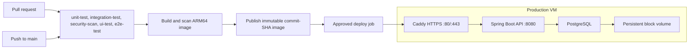

# CI/CD and DevOps

Libro is validated by an implemented GitHub Actions pipeline and packaged as a container. The planned deployment target is a single ARM64 Linux VM running Docker Compose. This page explains what each stage does and why it was chosen.

| Area | Status |
| --- | --- |
| Continuous integration (`unit-test`, `integration-test`, `security-scan`, `ui-test`, `e2e-test`) | Implemented in [`ci.yml`](../../.github/workflows/ci.yml) |
| Container image and Compose stack with health checks | Implemented ([Dockerfile](../../Dockerfile), [docker-compose.yml](../../docker-compose.yml)) |
| TLS reverse proxy (Caddy) | Implemented as an opt-in Compose profile |
| Operations scripts: deploy with rollback, smoke test, backup and restore, demo seed ([`scripts/`](../../scripts/)) | Implemented; rehearsed against a local Docker stack, not yet on a VM |
| Production Compose override and [runbook](runbook.md) | Implemented |
| Continuous delivery workflow ([`cd.yml`](../../.github/workflows/cd.yml)): ARM64 image build, scan, publish; UI build; gated deploy of both | Implemented; the deploy job stays off until the VM exists and deployment is enabled |
| Production VM | Not provisioned |

## Target environment

**One ARM64 Linux VM** running the API, PostgreSQL, and Caddy under Docker Compose. It is a low-traffic demo with synthetic data. The single-instance design has no high availability or autoscaling.

Design decisions and the reasons for them:

- **Compute.** Use an ARM64 Linux VM with enough CPU, memory, and persistent storage for the API, database, and demo workload. Availability, pricing, and reclaim policies depend on the selected provider and VM plan; confirm them before provisioning. A single VM is a demo target, not an uptime guarantee.
- **Architecture.** The image must run on ARM64. The Dockerfile uses Temurin Alpine images, but CI builds on an x86 runner, so the deploy pipeline builds and scans a `linux/arm64` image before it is released.
- **Network.** Only Caddy listens publicly (80/443). SSH is restricted to a trusted source IP. The app (8080), PostgreSQL (5432), and management (9091) ports are not reachable from the internet.
- **Database.** PostgreSQL runs on the same VM with its data on a dedicated persistent volume (`LIBRO_DATA_DIR`), not the container's writable layer. It is a single point of failure, so only synthetic data is used. Nightly dumps from `scripts/backup.sh` are kept locally. Off-host uploads require the storage provider's command-line tool and identity configuration; the current script implements one provider-specific upload path, so verify it before enabling bucket uploads.
- **TLS.** Caddy obtains certificates for a real DNS name; domain registration is outside the free allowance. The app's login/signup rate limits are per process, so the app port stays reachable only through the proxy.
- **Image registry.** The design uses a public GitHub Container Registry image, avoiding a separate registry for this demo. See [GitHub Packages billing](https://docs.github.com/en/billing/concepts/product-billing/github-packages).

## Pipeline stages

### Continuous integration (implemented)

The workflow runs on GitHub-hosted Ubuntu runners for every pull request (any base branch) and every push to `main`. A newer run cancels a stale in-progress run for the same ref. The five jobs run in parallel and any failure fails the workflow.

| Job | Timeout | What it checks |
| --- | ---: | --- |
| `unit-test` | 15 min | `./mvnw -B -ntp verify`: unit and MVC suite plus the JaCoCo 80% line-coverage floor. |
| `integration-test` | 25 min | `./mvnw -B -ntp -Pintegration -DskipUTs -Djacoco.haltOnFailure=false verify`: only the PostgreSQL 18 suite through Testcontainers (`-DskipUTs` turns off Surefire, so unit tests do not run twice), covering Flyway migrations, Hibernate schema validation, and concurrent-checkout races. |
| `security-scan` | 20 min | [`scripts/ci/trivy-scan.sh`](../../scripts/ci/trivy-scan.sh) scans dependency manifests and the built Docker image; it fails on fixable HIGH or CRITICAL findings. Accepted exceptions live in [`.trivyignore`](../../.trivyignore) with expiry comments. |
| `ui-test` | 15 min | Starts a test-profile API with disposable PostgreSQL, regenerates UI types from OpenAPI and checks for drift, then runs typecheck, lint, Vitest, and the production build. |
| `e2e-test` | 20 min | Starts PostgreSQL and the test-profile API (with a librarian created by the startup bootstrap and a random one-run password), then runs the Playwright journey in Chromium: register, sign in, search, borrow, return, and a staff lost-resolution, with axe in both themes. Reports upload on failure. |

Controls: workflow permissions are `contents: read`, no deployment credentials exist in CI, third-party actions are pinned to commit SHAs, Trivy runs from its official image pinned by digest, and test reports are kept for 14 days. The scan policy (severity, `--ignore-unfixed`, `.trivyignore`) lives in one script that CI and CD both call, so the merge gate and the release gate cannot drift apart. Requiring all five checks before merging is a GitHub branch-protection setting, separate from the workflow file; see [Branch protection](#branch-protection).

### Branch protection

`main` is protected by a GitHub branch-protection rule (a repository setting, not a file in this repo):

| Setting | Value | Why |
| --- | --- | --- |
| Required status checks | `unit-test`, `integration-test`, `security-scan`, `ui-test`, `e2e-test` | Nothing merges unless the same five jobs this workflow runs have passed. |
| Require a pull request | Yes, 0 required approvals | Direct pushes to `main` are rejected so every change passes CI first; no approval is required because the project has a single maintainer. |
| Require branches to be up to date | No | Avoids forcing a rebase and a full CI rerun after each unrelated merge. |
| Force pushes and branch deletion | Blocked | Protects `main` history. |
| Enforce for administrators | No | The repository owner can bypass the rule in an emergency; use it sparingly. |

If a job is renamed in `ci.yml`, update the required check names in the same change: a required check that no longer runs leaves pull requests stuck at "Expected, waiting for status". To review or change the rule, use Settings, then Branches on GitHub, or `gh api repos/<owner>/<repo>/branches/main/protection`.

### Continuous delivery (implemented, deploy gated)

[`cd.yml`](../../.github/workflows/cd.yml) is a separate workflow that extends CI; it does not replace it. It has three jobs: `image`, `ui`, and `deploy`.

| Job | Runs on | What it does |
| --- | --- | --- |
| `image` | Native GitHub-hosted ARM64 runner | Builds the one `linux/arm64` image, scans that exact image with `scripts/ci/trivy-scan.sh`, publishes it to GitHub Container Registry tagged with the commit SHA, and outputs the immutable digest. In a pull-request dry run it stops after the scan. |
| `ui` | GitHub-hosted runner | Builds `ui/dist` from the same validated commit (`npm ci`, `npm run build:history`, `npm run build`) and keeps it as the `libro-ui` workflow artifact. The API image does not contain the UI. |
| `deploy` | GitHub-hosted runner, then SSH to the VM | Needs `image` and `ui`. Runs only when the repository variable `OCI_DEPLOY_ENABLED` is `true` and the `production` environment approves. Backs up and deploys the image by digest with `scripts/deploy.sh`, smoke-tests it (rolling back on failure), then installs the UI with `scripts/install-ui.sh`. Never runs on pull requests, and never runs two deployments at once. |

1. **Gate.** The `image` job starts only when the `CI` workflow finished successfully for a push to `main` (or on a manual run). Pull requests that change `cd.yml`, the Dockerfile, the scan script, or the UI install and release-history scripts run a dry run with no push and no deploy.
2. **Build once.** On a native GitHub-hosted ARM64 runner it builds one `linux/arm64` image, scans that exact image with the same `scripts/ci/trivy-scan.sh` policy as CI (fixable HIGH or CRITICAL findings fail the release), and publishes it to GitHub Container Registry tagged with the full commit SHA. The job outputs the immutable digest. The server pulls that digest and never rebuilds, and no mutable `latest` tag is used.
3. **Build the UI.** The `ui` job builds `ui/dist` from the same validated commit (`npm ci`, `npm run build:history` for the release-history page, `npm run build`), packs it as one tarball, and keeps it as the `libro-ui` workflow artifact. The API image does not contain the UI.
4. **Approve.** The `deploy` job is skipped unless the repository variable `OCI_DEPLOY_ENABLED` is `true`, and it is held by the `production` environment's required reviewers. Automatic deployment on every `main` push waits until a backup restore and a rollback have been rehearsed on the VM.
5. **Deploy.** The job connects over SSH with a pinned host key, checks out the validated commit in `/opt/libro`, and runs `scripts/deploy.sh --image <digest>`, which refuses a reference without a digest. The script backs up PostgreSQL, records the previous image, starts the stack from the base Compose file plus [`infra/docker-compose.prod.yml`](../../infra/docker-compose.prod.yml), and waits for health. Run by hand without `--image`, the same script builds the image on the VM from the checked-out commit.
6. **Verify.** `scripts/smoke.sh` checks `/readyz` and `/livez`, logs in as the public demo student, performs an authenticated read, and confirms that an anonymous read is rejected. Any failure triggers the rollback below; success records the new image as live. Only then does the job stream the UI tarball over the same SSH connection to [`scripts/install-ui.sh`](../../scripts/install-ui.sh), which checks it contains `index.html` and updates `ui/dist` in place (new files first, `index.html` next, stale files last). The proxy serves that directory straight from its bind mount, so no restart is needed, and a rolled-back release never leaves a newer UI in front of an older API.

## Environments

| Environment | Purpose | Runs on | Data |
| --- | --- | --- | --- |
| Local | Development and demos | Docker Compose on a developer machine; see [Local Setup](../guides/local-setup.md) | Disposable volume |
| CI | Verify every change | Ephemeral GitHub runners with Testcontainers | Throwaway containers |
| Production demo | Public API instance | One ARM64 Linux VM; see the [runbook](runbook.md) | Synthetic only |

There is no separate staging environment: one low-traffic VM does not justify a second copy, and CI plus the migration tests cover pre-release verification.

## Secrets handling

- No secret is stored in the repository. [`.env.example`](../../.env.example) holds placeholders; real `.env` files and key files (`*.pem`, `*.key`) are git-ignored.
- The application needs a PostgreSQL password, a Base64 JWT signing key of at least 32 bytes (`LIBRO_JWT_SECRET_BASE64`), and BCrypt hashes for the bootstrap accounts. Only hashes are accepted; plaintext account passwords never appear in configuration.
- On the VM, the production `.env` is owned by the deploy user with `chmod 600`; `scripts/deploy.sh` refuses to run if the file is group- or world-readable.
- Staff accounts on the planned public demo (`0000-0000` librarian, `0000-0001` administrator) will use strong, unique passwords stored only on the host. The only published credentials are patron-only demo logins ([Demo Accounts](../guides/demo-accounts.md)).
- GitHub Actions holds four `production` environment secrets for the deploy job: the VM host, deploy user, private SSH key, and pinned host key. The default workflow permission stays `contents: read`; `packages: write` goes only to the image job, which uses the built-in `GITHUB_TOKEN`. The workflow uses no third-party actions beyond the SHA-pinned checkout. SSH keeps deployment access scoped to the VM and avoids granting the workflow provider-wide API access. See [GitHub deployment environments](https://docs.github.com/en/actions/how-tos/deploy/configure-and-manage-deployments/manage-environments).
- Logs and API errors never contain password hashes, stack traces, or credentials.

## Rollback

- **Application.** Each release is an immutable image (a commit-tagged local build now, a digest-pinned registry reference once publishing exists). `scripts/deploy.sh` records the live and previous image under `$LIBRO_DATA_DIR/state` and restarts the previous one automatically if the new one is unhealthy or fails the smoke test.
- **Database.** Flyway migrations are forward-only, so an application rollback does not undo schema changes. `scripts/deploy.sh` takes a database backup before every deploy. `scripts/restore.sh` restores a dump in one transaction and is the recovery path for a bad migration; the [runbook](runbook.md) describes the restore rehearsal.
- **Existing data.** Before migrating a database that already holds data, verify the V3-to-V4 upgrade path. A new empty database follows the fresh-migration path that CI already tests.
- **Never** run `docker compose down -v` against production; it deletes the database volume.

## Monitoring

| Signal | Source | Status |
| --- | --- | --- |
| Liveness and readiness | Public `/livez` and `/readyz` on the app port, with details hidden; the image's single `HEALTHCHECK` probes `/readyz`, and Compose and the deploy scripts rely on it | Implemented |
| Metrics | Prometheus endpoint on the private management port 9091, including `libro.auth.logins` and `libro.rate_limit.rejections` | Implemented; not scraped by any deployed service |
| Request tracing | `X-Request-Id` on every response, log line, and error body | Implemented |
| Restarts | `restart: unless-stopped` on every service | Implemented |
| Post-deploy smoke test | `scripts/smoke.sh`, run by `scripts/deploy.sh` | Implemented |
| External uptime probe | A free hosted check against the public `/readyz` URL | Part of the deploy design |

Alert rules for login failures and rate-limit rejections are not configured.

## Public-exposure gates

The single-VM design does not by itself close the gates recorded in the [roadmap](../reference/ROADMAP.md): real-domain TLS in production, alerts on login-failure and rate-limit metrics, gateway-level throttling before running more than one instance, and an independent security review.
