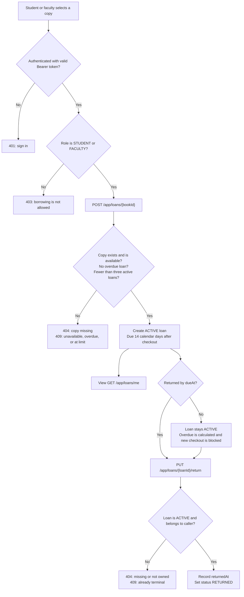
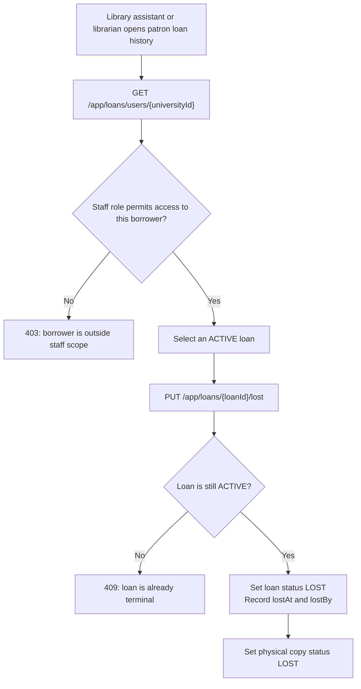
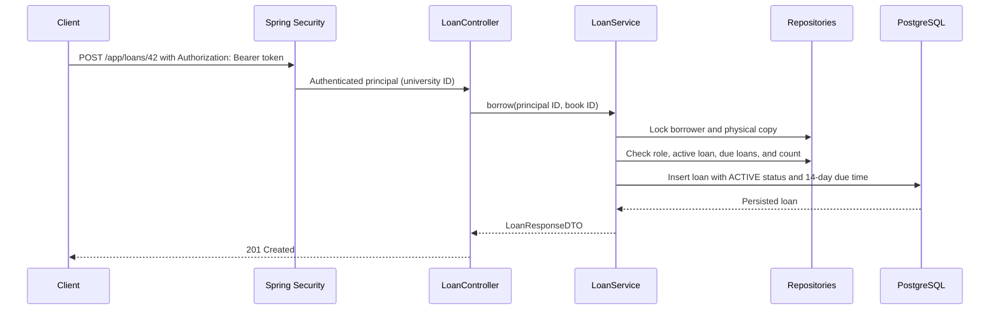

# Loan Implementation Guide

This guide describes the implemented loan feature. For exact live behavior, the Java code, Flyway migrations, and generated OpenAPI are authoritative. Loan routes require the stateless JWT Bearer authentication described in [JWT Authentication Design](../reference/jwt-authentication-design.md); unsafe requests do not require CSRF tokens.

## What a loan means

A `Loan` is one checkout event: one student or faculty borrower takes one physical `Book` copy at a recorded time. The row stays as history after the copy is returned or declared lost. A later checkout of that copy creates a new loan row.

`returnedAt == null` alone does **not** mean active. The explicit `status` is authoritative:

| Status | Meaning | `returnedAt` | Loan still active? |
|---|---|---|---|
| `ACTIVE` | Copy is checked out and not resolved | `null` | Yes |
| `RETURNED` | Borrower returned the copy | return time | No |
| `LOST` | Staff recorded that the copy was lost | `null` | No |

Overdue is a calculated condition, not a status: `status == ACTIVE && now.isAfter(dueAt)`. Therefore, overdue changes as time passes without a background job or database update. At exactly `dueAt`, the loan is not overdue; it becomes overdue immediately after that time.

## Rules implemented

- Only `STUDENT` and `FACULTY` can borrow and return loans. The borrower comes from the authenticated university ID, never from request data.
- Each book row is one physical copy. A copy can have only one `ACTIVE` loan at a time.
- A borrower can have at most **3 active loans**. A borrower with any overdue active loan cannot check out another copy.
- A loan is due **14 calendar days** after checkout. Weekends and holidays do not extend the due time.
- The service obtains loan timestamps with `LocalDateTime.now` and an Asia/Manila `Clock`, so it uses Manila wall time independently of the server timezone. `LocalDateTime` itself stores no timezone or UTC offset; the API contract treats these values as Manila-local time.
- `ADMINISTRATOR` means library assistant. Assistants and librarians cannot borrow or return, but can view their own histories.
- Library assistants may view and resolve student/faculty loans. Librarians may also view and resolve assistant loans. Neither staff role can manage another librarian's loan history.
- Staff marks a loan `LOST` through an explicit action. The loan records the staff member and time; the related physical book is marked `LOST` and cannot be borrowed again. This is a recorded resolution, not an automatic overdue transition.
- Any loan history prevents deletion of its referenced book copy or user. The API returns `409 Conflict`; the foreign keys use `ON DELETE RESTRICT`.
- There are no fines, penalty balances, borrower suspensions, or repeat-offender rules in this version. A lost loan closes the active loan slot but does not assess a penalty.
- History uses zero-based pages, defaults to 12 rows per page, permits at most 100, and only allows `id`, `borrowedAt`, `dueAt`, `returnedAt`, or `status` as sort fields. Sort direction is `asc` or `desc`; without a requested sort, history uses `borrowedAt` descending then `id` descending.
- The library-wide staff list at `GET /app/loans` uses the same pagination and sort rules. Optional `status` accepts `ACTIVE`, `RETURNED`, or `LOST`; `overdue=true` selects active loans whose due time is before the current Manila time; `borrower` selects one university ID. The query applies staff role scope and filters before counting pages. An unknown borrower returns 404; an out-of-scope borrower returns 403.

## User flow

### Borrower checkout and return



### Staff lost-copy resolution



An overdue loan is not automatically marked lost. The borrower can still return it; only authorized staff can resolve an active loan as lost. Assistants can resolve student/faculty loans, while librarians can also resolve library-assistant loans.

## Request flow through the code



The controller handles HTTP binding and response status. `LoanService` owns validation, role scope, transactions, and state transitions. Repositories own database access. `LoanMapper` creates a DTO while the transaction is open so lazy JPA relations are read safely. The database partial unique index is the final guard if two requests race for the same copy; pessimistic locks serialize checkouts for the same borrower and copy.

## Endpoints

| Method and path | Who may call it | Result |
|---|---|---|
| `POST /app/loans/{bookId}` | Students and faculty | Creates a loan; returns `201` and the loan DTO |
| `PUT /app/loans/{loanId}/return` | Students and faculty, for their own active loan | Records the return; returns `200` |
| `PUT /app/loans/{loanId}/lost` | Library assistants and librarians, within their target-role scope | Closes the loan as lost and marks the copy lost; returns `200` |
| `GET /app/loans/me` | All four roles | Caller’s own paged loan history |
| `GET /app/loans` | Library assistants and librarians | Paged library-wide list within the staff role's borrower scope |
| `GET /app/loans/users/{universityId}` | Library assistants and librarians, within their target-role scope | Target user’s paged loan history |

Example checkout response data:

```json
{
  "loanId": 81,
  "borrowerUniversityId": "2025-4321",
  "bookId": 42,
  "bookTitle": "1984",
  "borrowedAt": "2026-10-14T15:30:00",
  "dueAt": "2026-10-28T15:30:00",
  "returnedAt": null,
  "status": "ACTIVE",
  "overdue": false,
  "lostAt": null,
  "lostByUniversityId": null
}
```

The timestamps intentionally have no UTC offset because the contract is Manila `LocalDateTime`. `overdue` is computed for the response and is not stored. A missing loan, book, or account returns `404`; a role/ownership violation returns `403` or the privacy-preserving `404` for another borrower's return attempt; an unavailable copy, overdue borrower, active-loan limit, terminal loan transition, or protected deletion returns `409`.

## Files and responsibilities

`loan/controller/LoanController` owns HTTP routes; `loan/service/LoanService` owns state transitions, borrower and staff rules, and transactions; `loan/repository/LoanRepository` owns history and state queries. `loan/mapper/LoanMapper` creates response DTOs inside the service transaction. Checkout also uses `book/repository/BookRepository` and `user/repository/UserRepository` to lock the copy and borrower. `auth/config/SecurityConfig` supplies route gates, and `global/time/LibraryClockConfig` supplies the Asia/Manila clock. The [Engineering Reference](../reference/engineering-reference.md) has the complete repository map.

### Important persistence constraints

V4 adds `books.copy_status` and `loans`. Loan foreign keys use `ON DELETE RESTRICT`. `uq_loans_one_active_per_book` is a partial unique index on `book_id` where `status = 'ACTIVE'`. The loan check constraint requires state fields to match status: active has no return/loss data, returned has `returned_at`, and lost has `lost_at` and `lost_by_user_id`. Flyway owns schema changes; Hibernate remains `ddl-auto=validate`.

## Build and run locally

Prerequisites are Java 25 and Docker with Compose. The committed Maven Wrapper supplies the pinned Maven version for local builds and tests.

1. Copy `.env.example` to `.env`, set `LIBRO_ADMIN_PASSWORD_HASH` to a BCrypt hash, and set `LIBRO_JWT_SECRET_BASE64` to a random Base64 key generated with `openssl rand -base64 32`. Do not put a plaintext password or real secret in source control.
2. Start the local application and PostgreSQL; the Dockerfile builds the JAR from source:

   ```powershell
   docker compose up --build
   ```

   Flyway applies V1 through V6 at startup. Do not use `docker compose down -v` unless you intentionally want to destroy the database volume.

3. Run the default unit/MVC verification suite:

   ```powershell
   ./mvnw clean verify
   ```

To include PostgreSQL integration tests, run `./mvnw -Pintegration clean verify` with Docker available and `LIBRO_ADMIN_PASSWORD_HASH` set in the shell environment inherited by Maven to a test-only BCrypt hash. Maven does not load the Docker Compose `.env` file; Flyway V2 needs the variable to seed its bootstrap account in the disposable test database. The test profile supplies a deterministic test-only JWT key; production still requires `LIBRO_JWT_SECRET_BASE64`.

For a loan smoke test, have a library assistant or librarian create a book copy, log in as a student or faculty borrower through `POST /app/auth/login`, then send the returned Bearer token with `POST /app/loans/{bookId}`, `GET /app/loans/me`, and `PUT /app/loans/{loanId}/return`. The disposable-stack journey in `scripts/smoke-journey.sh` also exercises loss resolution and account recovery. Swagger UI is available at `http://localhost:8080/swagger-ui.html` only when `LIBRO_API_DOCS_ENABLED=true`. API requests use the Authorization header and do not require a CSRF token.

## Before extending the feature

`LoanServiceTest` covers checkout, return, lost-resolution, staff listing, role scope, ownership, and paging. `LoanSecurityMvcTest` checks route roles and principal-derived identity. `BookPersistenceIT` covers fresh V1-to-V6 schema validation, the V4-to-V5 value-preserving upgrade, and the concurrent catalog-edit/lost-resolution race. `LoanPersistenceIT` covers staff query counts, return persistence, the one-active-loan index, and deletion restrictions. `LoanMigrationIT` checks V3-to-V4 data preservation and constraints; `LoanConcurrencyIT` covers concurrent checkouts. Do not edit an applied migration; add a new forward-only migration.
