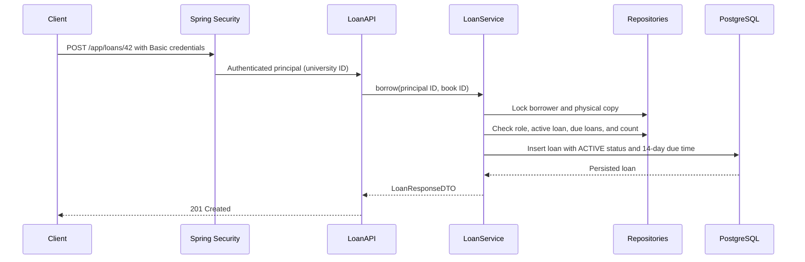

# Loan Implementation Guide

This guide describes the implemented loan feature. For exact live behavior, the Java code, Flyway migrations, and generated OpenAPI are authoritative. Authentication is currently HTTP Basic with CSRF enabled; JWT is still planned.

## What a loan means

A `Loan` is one checkout event: one student or faculty borrower takes one physical `Book` copy at a recorded time. The row stays as history after the copy is returned or declared lost. A later checkout of that copy creates a new loan row.

`returnedAt == null` alone does **not** mean active. The explicit `status` is authoritative:

| Status | Meaning | `returnedAt` | Loan still active? |
|---|---|---|---|
| `ACTIVE` | Copy is checked out and not resolved | `null` | Yes |
| `RETURNED` | Borrower returned the copy | return time | No |
| `LOST` | Staff recorded that the copy was lost | `null` | No |

Overdue is a calculated condition, not a status: `status == ACTIVE && now.isAfter(dueAt)`. Therefore, overdue changes as time passes without a background job or database update. At exactly `dueAt`, the loan is not overdue; it becomes overdue immediately after that time.

## Rules implemented

- Only `STUDENT` and `FACULTY` can borrow and return loans. The borrower comes from the authenticated university ID, never from request data.
- Each book row is one physical copy. A copy can have only one `ACTIVE` loan at a time.
- A borrower can have at most **3 active loans**. A borrower with any overdue active loan cannot check out another copy.
- A loan is due **14 calendar days** after checkout. Weekends and holidays do not extend the due time.
- Loan timestamps use `LocalDateTime` interpreted as Asia/Manila time. `LoanTimeConfig` supplies a Manila `Clock` so the service does not depend on the machine timezone.
- `ADMINISTRATOR` means library assistant. Assistants and librarians cannot borrow or return, but can view their own histories.
- Library assistants may view and resolve student/faculty loans. Librarians may also view and resolve assistant loans. Neither staff role can manage another librarian's loan history.
- Staff marks a loan `LOST` through an explicit action. The loan records the staff member and time; the related physical book is marked `LOST` and cannot be borrowed again. This is a recorded resolution, not an automatic overdue transition.
- Any loan history prevents deletion of its referenced book copy or user. The API returns `409 Conflict`; the foreign keys use `ON DELETE RESTRICT`.
- There are no fines, penalty balances, borrower suspensions, or repeat-offender rules in this version. A lost loan closes the active loan slot but does not assess a penalty.
- History defaults to 12 rows per page, permits at most 100, and only allows approved sort fields.

## User flow

```mermaid
flowchart TD
    Start[Student or faculty selects a copy] --> Auth[HTTP Basic authenticates caller]
    Auth --> Borrow[POST /app/loans/{bookId}]
    Borrow --> Checks{Role, copy, overdue, and 3-loan checks pass?}
    Checks -->|No| Conflict[Return 403 or 409]
    Checks -->|Yes| Create[Create ACTIVE loan; dueAt = borrowedAt + 14 days]
    Create --> History[View history with GET /app/loans/me]
    History --> Choice{What happens to the copy?}
    Choice -->|Borrower returns it| Return[PUT /app/loans/{loanId}/return]
    Return --> Returned[Record returnedAt; status = RETURNED]
    Choice -->|Staff confirms it is lost| Lost[PUT /app/loans/{loanId}/lost]
    Lost --> Closed[Record lostAt and lostBy; status = LOST]
    Closed --> CopyLost[Set book copy status = LOST]
```

## Request flow through the code



The controller handles HTTP binding and response status. `LoanService` owns validation, role scope, transactions, and state transitions. Repositories own database access. `LoanMapper` creates a DTO while the transaction is open so lazy JPA relations are read safely. The database partial unique index is the final guard if two requests race for the same copy; pessimistic locks serialize checkouts for the same borrower and copy.

## Endpoints

| Method and path | Who may call it | Result |
|---|---|---|
| `POST /app/loans/{bookId}` | Students and faculty | Creates a loan; returns `201` and the loan DTO |
| `PUT /app/loans/{loanId}/return` | Students and faculty, for their own active loan | Records the return; returns `200` |
| `PUT /app/loans/{loanId}/lost` | Library assistants and librarians, within their target-role scope | Closes the loan as lost and marks the copy lost; returns `200` |
| `GET /app/loans/me` | All four roles | Caller’s own paged loan history |
| `GET /app/loans/users/{universityId}` | Library assistants and librarians, within their target-role scope | Target user’s paged loan history |

Example checkout response data:

```json
{
  "loanId": 81,
  "borrowerUniversityId": "2025-4321",
  "bookId": 42,
  "bookTitle": "1984",
  "borrowedAt": "2026-10-14T15:30:00",
  "dueAt": "2026-10-28T15:30:00",
  "returnedAt": null,
  "status": "ACTIVE",
  "overdue": false,
  "lostAt": null,
  "lostByUniversityId": null
}
```

The timestamps intentionally have no UTC offset because the contract is Manila `LocalDateTime`. `overdue` is computed for the response and is not stored. A missing loan, book, or account returns `404`; a role/ownership violation returns `403` or the privacy-preserving `404` for another borrower's return attempt; an unavailable copy, overdue borrower, active-loan limit, terminal loan transition, or protected deletion returns `409`.

## Files and responsibilities

```text
src/main/java/app/
├── auth/SecurityConfig.java                 # HTTP route role gates; Basic + CSRF remain enabled
├── book/
│   ├── entity/Book.java                     # Physical copy, including IN_COLLECTION or LOST
│   ├── entity/BookCopyStatus.java
│   └── repository/BookRepository.java        # Pessimistic copy lock
├── loan/
│   ├── config/LoanTimeConfig.java            # Asia/Manila Clock
│   ├── controller/LoanAPI.java               # HTTP endpoints and OpenAPI descriptions
│   ├── dto/LoanResponseDTO.java              # Client response, never the entity
│   ├── entity/Loan.java                      # One checkout event and state transitions
│   ├── entity/LoanStatus.java                # ACTIVE, RETURNED, LOST
│   ├── exception/                            # Safe loan conflict/not-found exceptions
│   ├── mapper/LoanMapper.java                # Entity to response DTO
│   ├── repository/LoanRepository.java        # History, counts, checks, and loan lock
│   └── service/LoanService.java              # Rules, transactions, role scope
├── user/repository/UserRepository.java       # Pessimistic borrower lock
└── global/exceptions/GlobalExceptionHandler.java

src/main/resources/db/migration/
├── V1__create_books_table.sql
├── V2__create_users_table.sql
├── V3__add_librarian_role.sql
└── V4__add_loans_and_copy_status.sql
```

### Important persistence constraints

V4 adds `books.copy_status` and `loans`. Loan foreign keys use `ON DELETE RESTRICT`. `uq_loans_one_active_per_book` is a partial unique index on `book_id` where `status = 'ACTIVE'`. The loan check constraint requires state fields to match status: active has no return/loss data, returned has `returned_at`, and lost has `lost_at` and `lost_by_user_id`. Flyway owns schema changes; Hibernate remains `ddl-auto=validate`.

## Build and run locally

Prerequisites are Java 25, Maven 3.x, and Docker Desktop if you want PostgreSQL through Compose. There is no Maven wrapper in this repository.

1. Copy `envFileExample` to `.env` and set `LIBRO_ADMIN_PASSWORD_HASH` to a BCrypt hash. Do not put a plaintext password or real secret in source control.
2. Build the JAR that the Docker image copies:

   ```powershell
   mvn clean package
   ```

3. Start the local application and PostgreSQL:

   ```powershell
   docker compose up --build
   ```

   Flyway applies V1 through V4 at startup. Do not use `docker compose down -v` unless you intentionally want to destroy the database volume.

4. Run the full Maven verification suite when ready to verify behavior:

   ```powershell
   mvn clean verify
   ```

The PostgreSQL persistence profile requires a working Docker daemon. For a loan smoke test, authenticate as a student/faculty user, create a book copy, call `POST /app/loans/{bookId}`, inspect `GET /app/loans/me`, then return it. Swagger UI is at `http://localhost:8080/swagger-ui.html`; because CSRF remains enabled, state-changing requests must include the configured CSRF token.

## Before extending the feature

Add focused service, MVC/security, and PostgreSQL tests for loan state changes, concurrent checkout limits, role boundaries, Flyway V4 schema validation, and deletion restrictions. Do not edit V4 after it has reached a persistent database; add a new forward-only migration. Keep the README relationship diagram and this guide synchronized with the entity and database model.
