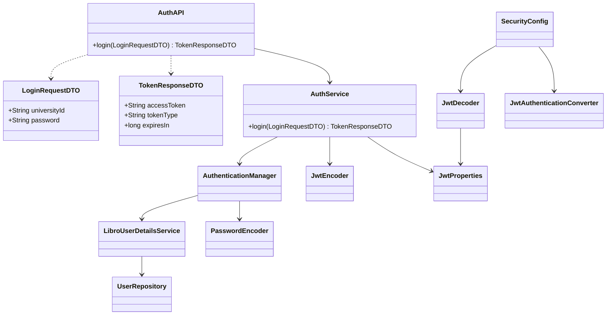
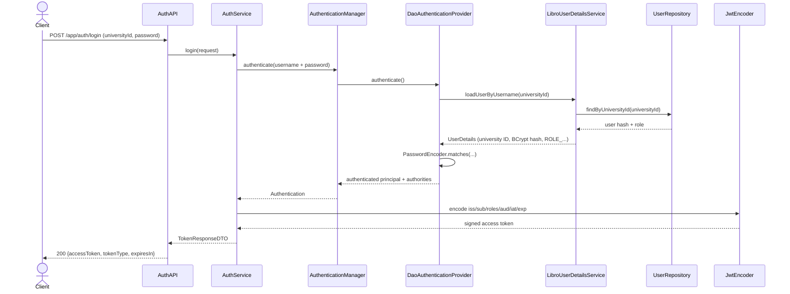
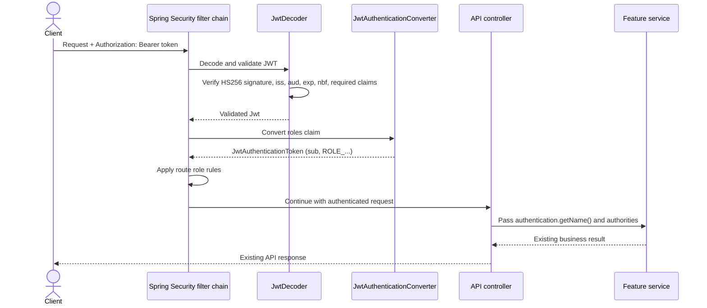

# JWT Authentication Design Proposal

**Status:** proposal for review; JWT is not implemented in the current system.  
**Scope:** replace HTTP Basic with local JWT login and Bearer authentication while preserving the existing role, account-ownership, loan, and API contracts.  
**Prepared:** 2026-10-19

This proposal turns the JWT plan in [Security Roles and JWT Guide](security-roles-and-jwt-guide.md) into a concrete design for review. It is not a claim about live behavior and it does not change application code.

## 1. Design summary

Add `POST /app/auth/login`. It authenticates the submitted university ID and password through Spring Security's existing user lookup and BCrypt encoder, then returns a signed access token that expires after 15 minutes. Protected API requests send that token in `Authorization: Bearer <token>`. Spring Security's OAuth2 Resource Server support validates the token and builds the same kind of role-bearing `Authentication` object that current controllers already consume.

The application remains a single service that issues its own tokens and validates them. It is **not** a general OAuth 2.0 authorization server: there are no third-party clients, consent flows, refresh tokens, external identity provider, or authorization-server endpoints in this first version.

Keep the existing role policy in `SecurityConfig` and the ownership/target-account rules in `UserService` and `LoanService`. A JWT proves the caller's university ID and role snapshot; it does not authorize a request by itself. Existing controllers can continue to use `Authentication.getName()` for the university ID and `Authentication.getAuthorities()` for role checks.

## 2. Current system facts this design depends on

- HTTP Basic is the current authentication mechanism. `LibroUserDetailsService` loads the account by university ID and returns its BCrypt hash and `ROLE_...` authority.
- `PasswordConfig` provides the existing BCrypt `PasswordEncoder`.
- `SecurityConfig` currently requires authentication except for public signup, enables HTTP Basic, and leaves CSRF enabled.
- Controllers pass the authenticated name and authorities into services. Loan checkout derives its borrower from that name; no request body should choose the borrower.
- Roles are `STUDENT`, `FACULTY`, `ADMINISTRATOR` (library assistant), and `LIBRARIAN`. Keep their meanings and route matrix from the [role guide](security-roles-and-jwt-guide.md#role-policy).
- There is no current JWT dependency, login route, JWT config, or JWT persistence table. No Flyway migration is needed for this design.

These are based on the repository's current code and engineering documents as checked on the date above. Recheck them before implementation if the security code has changed.

## 3. Proposed request contracts

### Login

`POST /app/auth/login` is public and accepts JSON:

```json
{
  "universityId": "2025-4321",
  "password": "<user supplied password>"
}
```

The login request has no role, status, or token claims. Validate that both values are present. Authenticate with `AuthenticationManager`; do not query the repository or compare password hashes manually in the controller or token code.

Successful response (`200 OK`):

```json
{
  "accessToken": "<signed JWT>",
  "tokenType": "Bearer",
  "expiresIn": 900
}
```

Return the same generic `401 Unauthorized` result for an unknown university ID and an incorrect password. Do not reveal whether an account exists, return a password/hash, or include the access token in logs or error messages. Signup remains public and continues to create `STUDENT` only.

### Protected API request

```http
GET /app/books/42
Authorization: Bearer <access-token>
```

Accept the access token only from the Authorization header. Do not support token query parameters, form fields, or cookies. A bearer token grants access to anyone who possesses it, so use HTTPS outside local development and redact Authorization headers from access logs. This header transport follows [RFC 6750](https://www.rfc-editor.org/rfc/rfc6750.html).

## 4. Token policy

Use a signed JWS access token with the following claims:

| Claim | Proposed value | Purpose |
| --- | --- | --- |
| `iss` | `libro-api` by default; deployment-configurable | The trusted Libro token issuer |
| `sub` | Authenticated user's university ID | Stable caller identity used by current controllers/services |
| `roles` | One-element array such as `["STUDENT"]` | Maps to `ROLE_STUDENT` for existing route and service rules |
| `iat` | Issuance time | Token audit/age claim |
| `exp` | `iat + 900 seconds` | Short access-token lifetime |
| `aud` | `libro-api` | Recommended recipient check so the token is intended for this API |

`aud` is a small addition to the existing guide's proposed claims. It is recommended and should be validated as well as issued; decide explicitly if deployment requires a different audience. RFC 8725 calls for audience validation when tokens may be used by multiple recipients. The application must accept one configured audience only.

Use `HS256` with one random Base64-encoded secret containing at least 256 bits (32 bytes) of entropy. Pin the accepted algorithm to HS256 in both encoder and decoder configuration. Never select an algorithm based on an untrusted token header, permit `none`, or accept another algorithm as a fallback. Algorithm verification and key/algorithm binding are called out in [RFC 8725](https://www.rfc-editor.org/rfc/rfc8725.html).

Do not put passwords, password hashes, names, email addresses, course/major, or other profile fields in the token. A JWT is signed, not encrypted; anyone holding it can read its claims. The role is a snapshot taken at login and can be stale until expiry.

Use access tokens only for the first release. Do not add refresh tokens, a token table, or a denylist. The token's `exp` is set 900 seconds after `iat`, but the validator allows 30 seconds of clock skew. A role change, password change, or account deletion may therefore leave an already issued token usable until `exp` plus that 30-second allowance (up to about 15 minutes 30 seconds when clocks are synchronized). If immediate revocation later becomes a requirement, assess token-version checks or a server-side revocation design separately; those reduce the stateless property.

### Example token and runtime authentication objects

Illustrative decoded claims (not a token and not an API response):

```json
{
  "iss": "libro-api",
  "sub": "2025-4321",
  "aud": "libro-api",
  "roles": ["STUDENT"],
  "iat": 1792400000,
  "exp": 1792400900
}
```

After validation, Spring Security should expose a `JwtAuthenticationToken` whose name is the `sub` value and whose authorities contain `ROLE_STUDENT`:

```text
JwtAuthenticationToken
  name        = "2025-4321"
  principal   = Jwt(iss="libro-api", sub="2025-4321", ...)
  authorities = [ROLE_STUDENT]
  authenticated = true
```

This is the runtime object contract that lets existing controller calls to `authentication.getName()` and `authentication.getAuthorities()` keep working.

## 5. Proposed classes and responsibilities

Keep the additions under the existing `app.auth` feature package. Names can be adjusted to match local naming conventions during implementation.

| Class or type | Proposed package | Responsibility |
| --- | --- | --- |
| `AuthAPI` | `app.auth.controller` | Expose only `POST /app/auth/login`; validate request DTO and return token response; no repository access |
| `LoginRequestDTO` | `app.auth.dto` | JSON input with `universityId` and `password`; no role or client-supplied claims |
| `TokenResponseDTO` | `app.auth.dto` | Return `accessToken`, `tokenType`, and `expiresIn`; never a JPA entity |
| `AuthService` | `app.auth.service` | Call `AuthenticationManager.authenticate(...)`; build a token from the successfully authenticated principal and its one role |
| `JwtProperties` | `app.auth.config` | Bind issuer, audience, Base64 secret, and 900-second lifetime from configuration; validate required settings on startup |
| `JwtConfiguration` | `app.auth.config` | Decode/validate the configured key and expose `JwtEncoder`, `JwtDecoder`, and role-claim converter beans |
| Existing `LibroUserDetailsService` | `app.auth` | Continue loading university ID, password hash, and role from `UserRepository` for login |
| Existing `PasswordConfig` | `app.user.config` | Continue supplying BCrypt; no second encoder or manual password comparison |
| Existing `SecurityConfig` | `app.auth` | Preserve route authorization; enable Resource Server JWT; final state is stateless and has no HTTP Basic |
| Existing `OpenApiConfig` | `app.global.config` | Replace global Basic scheme with HTTP Bearer/JWT scheme and accurate public-operation declarations |

Keep token construction in `AuthService` for this one login flow; a separate token-service class would add a layer without a second caller. Do not add a JWT entity, repository, or migration. Token issue/validation does not belong in `UserService`.

### Class relationship diagram



Spring Security's `DaoAuthenticationProvider` is designed to use `UserDetailsService` and `PasswordEncoder` for username/password authentication; reuse that mechanism rather than creating a custom password-authentication path ([Spring Security: DaoAuthenticationProvider](https://docs.spring.io/spring-security/reference/servlet/authentication/passwords/dao-authentication-provider.html)). Resource Server uses a decoder and authentication converter for JWT validation and authority construction ([Spring Security: JWT Resource Server](https://docs.spring.io/spring-security/reference/servlet/oauth2/resource-server/jwt.html)).

## 6. Request flows

### Login and token issue



The submitted role is never part of the flow. The signed role comes from the principal successfully authenticated by the existing user lookup.

### Bearer request and authorization



The protected-request path does not need a database lookup for each token. That is the stateless tradeoff and the reason role/account changes can remain effective only after token expiration.

## 7. Security configuration rules

### Authentication and authorization

1. Add Spring Boot's Resource Server starter. It brings in the Resource Server and JOSE support used to decode and verify JWT Bearer tokens; do not add a separate JWT library or write a custom request filter. Add this dependency under `<dependencies>` in `pom.xml` (without a version; Spring Boot's dependency management supplies it):

   ```xml
   <dependency>
       <groupId>org.springframework.boot</groupId>
       <artifactId>spring-boot-starter-oauth2-resource-server</artifactId>
   </dependency>
   ```

   See [Spring Security Resource Server dependencies](https://docs.spring.io/spring-security/reference/servlet/oauth2/resource-server/jwt.html#oauth2resourceserver-jwt-minimaldependencies).
2. Obtain the configured `AuthenticationManager` and authenticate a `UsernamePasswordAuthenticationToken` in `AuthService`. Ensure it uses the existing `LibroUserDetailsService` and BCrypt `PasswordEncoder`.
3. Configure `JwtEncoder` for issuance and `JwtDecoder` for request validation with the same external HS256 secret. Pin HS256 explicitly.
4. Configure validation for signature, exact issuer, audience, expiry, and any `nbf` claim. Require a non-empty `sub` and exactly one known `UserRole` value in `roles`. Do not accept a correctly signed token with a missing or unrecognized role.
5. Configure `JwtAuthenticationConverter` to read `roles` and map `STUDENT` to `ROLE_STUDENT`, etc. Continue to use the current `.hasRole(...)` rules and service-layer ownership checks.
6. Permit only `POST /app/users/signup` and `POST /app/auth/login` without authentication. Do not permit all of `/app/auth/**` or `/app/users/**`. Keep all book, account, and loan role matchers intact.
7. On the final Bearer-only chain, use `SessionCreationPolicy.STATELESS` and remove `.httpBasic(...)`. Do not create a login session or persist `SecurityContext` across requests.

### CSRF and transport

Keep CSRF enabled while HTTP Basic is still accepted, including any brief Basic-plus-Bearer verification period. HTTP Basic credentials can be automatically attached by browsers, so disabling CSRF during that period would change the existing risk model.

After Basic is removed and the application accepts credentials only from the explicit Authorization header, disable CSRF for this API-only security chain. The header is not automatically attached by browsers like a cookie. If the application later stores tokens in cookies or adds session authentication, revisit this decision and re-enable appropriate CSRF defenses. Require HTTPS in deployment and redact credentials/tokens from logs. Spring Security's [CSRF documentation](https://docs.spring.io/spring-security/reference/servlet/exploits/csrf.html) explains the browser-attached credential distinction.

### Configuration and secret handling

Suggested settings (names can follow the existing `LIBRO_*` convention):

```properties
libro.security.jwt.issuer=${LIBRO_JWT_ISSUER:libro-api}
libro.security.jwt.audience=${LIBRO_JWT_AUDIENCE:libro-api}
libro.security.jwt.secret-base64=${LIBRO_JWT_SECRET_BASE64}
libro.security.jwt.access-token-ttl-seconds=900
```

- Supply `LIBRO_JWT_SECRET_BASE64` through the deployment secret manager or local untracked environment file. Do not commit a real secret or put it in Java, a migration, docs, examples, image layers, or logs.
- Decode the value at startup and fail fast if it is absent, malformed, or shorter than 32 bytes. Generate it from cryptographically secure randomness; length checks cannot prove key quality. Do not use a development fallback secret in a production profile.
- All application replicas that issue or validate tokens must receive the same active key and issuer/audience settings. With the single shared HS256 key, rotating it invalidates existing tokens; coordinate rotation across replicas. Consider asymmetric keys only if separate services need verification without having the power to issue tokens.
- Keep the access lifetime fixed at 900 seconds for the first release. If it becomes configurable, validate a safe upper bound rather than accepting arbitrary long values.

## 8. Error and OpenAPI contract

- Login: invalid ID/password gives the same generic 401 result; a structurally invalid JSON request gives 400.
- Protected request without a token, or with malformed, expired, wrong-signature, wrong-issuer, wrong-audience, not-yet-valid, or invalid-claims token: 401.
- Valid token without the route's required role: 403. Ownership and target-role violations continue to return the current service/API error and must not be converted to 401.
- Never include a raw token, password, decoder stack trace, key details, or cryptographic exception message in an API response. The recommendation below is to keep Spring Security's Bearer 401/403 handling (which runs before MVC advice) and use the shared JSON `ErrorResponse` for login failures handled inside MVC; document that response-shape difference.
- Replace the OpenAPI HTTP Basic scheme with an HTTP Bearer scheme and `bearerFormat = "JWT"`. Protected operations inherit Bearer security. Explicitly declare signup and login as public operations so the generated `/v3/api-docs` does not require a token for them. Document login request/response DTOs and 400/401 responses.
- Preserve the existing project policy for Swagger UI and `/v3/api-docs` access unless a separate product decision makes those routes public.

## 9. Basic-to-Bearer migration plan

1. **Add login and token plumbing:** add the dependency, configuration properties, encoder/decoder, DTOs, `AuthAPI`, and `AuthService`. Keep current HTTP Basic and CSRF while building and testing the Bearer path.
2. **Verify using signed test tokens:** exercise the real `JwtDecoder` and converter in MVC tests. A test helper that injects a mocked JWT authentication is useful for role-rule tests, but it does not verify signature, issuer, expiry, or malformed-token handling.
3. **Prepare cutover configuration:** provide the signing secret to each runtime, ensure generated OpenAPI describes Bearer auth, and confirm clients can obtain and send the token.
4. **Cut over:** remove `.httpBasic(...)`, set stateless session policy, and disable CSRF only for the final header-only Bearer API. Keep signup and login the only public application POST routes.
5. **Verify removal:** prove Basic credentials no longer authenticate any protected route. Do not leave dual authentication as the permanent system state.
6. **Align owned documentation:** update `AGENTS.md`, the engineering reference, the security guide, README, OpenAPI annotations, and roadmap only when the implementation actually ships. Until then, label JWT as planned.

## 10. Test plan and acceptance matrix

Tests belong under the existing `src/test/java/unit/auth` MVC/security area, with focused `AuthService` unit tests. Use a fixed test-only key and issuer; never copy a production key into tests. For token-validation cases, create real signed compact tokens and pass them through the real decoder/filter chain.

| Scenario | Expected result | What it proves |
| --- | --- | --- |
| Anonymous request to signup | Existing public signup result (with current validation/CSRF behavior during transition) | Signup remains public and role is pinned to STUDENT |
| Anonymous request to login with valid credentials | 200 and Bearer token response | Login is public and issues token |
| Unknown ID vs wrong password | Same 401 status and generic response shape | No account enumeration |
| Password contains more than 72 UTF-8 bytes | Same generic 401 at login; signup/password change reject it as invalid input | All password flows enforce the BCrypt byte boundary consistently |
| Missing token on protected endpoint | 401 | Protected routes require authentication |
| Malformed compact token | 401 | Decoder rejects malformed input |
| Token with altered signature | 401 | Signature verification is active |
| Token signed by a different secret | 401 | Runtime key is enforced |
| Token signed with an unaccepted algorithm, including `alg=none` or HS384 | 401 | Decoder accepts only HS256 and rejects algorithm substitution |
| Expired token beyond configured clock skew | 401 | Expiration validation is active |
| Wrong `iss` or `aud` | 401 | Token belongs to the configured issuer and API |
| Future `nbf`, absent subject, empty/unknown role | 401 | Required claims and time window are enforced |
| Valid STUDENT token on a book read | 200 | `sub` and user role map to existing principal semantics |
| Valid STUDENT token on book write or librarian-only account creation | 403 | Existing role gates remain in force |
| Valid LIBRARIAN token on an allowed staff route | Existing success status | `roles` maps to `ROLE_LIBRARIAN` |
| Student loan request | Loan service sees token subject as borrower | Caller ownership is preserved with JWT subject |
| Valid token for another user's loan operation | Existing ownership denial | JWT does not bypass service ownership checks |
| Account/role/password changed after token issue | Token is rejected after `exp` plus the configured 30-second clock-skew allowance | Documented revocation limitation; with synchronized clocks, the maximum is about 15 minutes 30 seconds from `iat` |
| Basic credentials after final cutover | 401 | HTTP Basic has actually been removed |
| Unsafe Bearer request after cutover without CSRF token | Reaches authorization/controller outcome | Header-only stateless API has final CSRF policy |
| OpenAPI `/v3/api-docs` contract | Bearer on protected routes; no requirement on signup/login | Published security metadata matches filter chain |

Also retain the existing service tests for user ownership and loan policies. Authentication changes should not weaken their role matrix or replace their tests with controller-only checks. No schema or PostgreSQL migration test is needed for the initial JWT design because it adds no persistent state.

## 11. Decisions for assessment

The proposal is ready for review. The main choices to confirm are:

1. **Audience claim:** adopt the recommended `aud = libro-api` claim and validate it, in addition to the existing target's issuer claim.
2. **CSRF cutover:** keep CSRF during temporary Basic/Bearer verification; disable it only after HTTP Basic is removed and Authorization-header-only transport is enforced.
3. **Revocation window:** accept a 900-second token lifetime plus the configured 30-second clock-skew allowance for a role/password change or account deletion to take effect for already issued JWTs.
4. **Error body:** this proposal recommends Spring's standard Bearer 401/403 responses and the shared JSON `ErrorResponse` for login failures; add custom filter-chain handlers only if one consistent JSON shape becomes a firm API requirement.
5. **Key shape:** use the proposed shared HS256 secret for this single application; revisit asymmetric signing if token verification is separated into other services.

## 12. Detailed implementation proposal and code

This section is written as a junior backend engineer's implementation proposal: each code block names its file, shows the proposed implementation, and explains how it connects to the existing request flow. The code is a proposal, not compiled application code. Implement it in the sequence in Section 14 and verify each phase before moving to the next.

The change adds six classes: `AuthAPI`, two DTOs, `AuthService`, `JwtProperties`, and `JwtConfiguration`. It updates five existing classes: `SecurityConfig`, `GlobalExceptionHandler`, `OpenApiConfig`, `PasswordPolicy`, and `UserService`. `PasswordPolicy` and `UserService` need a small UTF-8 byte-length check because BCrypt has a 72-byte input boundary; see Section 12.9. No custom JWT filter, JWT database table, refresh-token store, or separate token-service class is needed.

The snippets are proposals, not compiled code. Imports are shown so you can see which Spring feature owns each job. Existing route matchers are included in the security example so the token conversion can be read in the context of the rules it must preserve.

### 12.1 Login request DTO

**File:** `src/main/java/app/auth/dto/LoginRequestDTO.java`

```java
package app.auth.dto;

import app.user.validation.PasswordPolicy;
import io.swagger.v3.oas.annotations.media.Schema;
import jakarta.validation.constraints.NotBlank;
import jakarta.validation.constraints.Pattern;
import jakarta.validation.constraints.Size;
import lombok.Getter;
import lombok.NoArgsConstructor;
import lombok.Setter;

/**
 * Contains the credentials a user submits to request a Libro access token.
 * <p>
 * This type deliberately has no {@code toString()} method: logging the DTO
 * would otherwise risk writing the raw password to a log.
 * </p>
 */
@Getter
@Setter
@NoArgsConstructor
@Schema(description = "Credentials used to log in. The password is never returned.")
public class LoginRequestDTO {

    /** University ID used as the account's login name. */
    @NotBlank(message = "University ID is required")
    @Pattern(regexp = "\\d{4}-\\d{4}", message = "University ID must follow the format 2025-4321")
    @Schema(description = "University ID in ####-#### format.", example = "2025-4321")
    private String universityId;

    /** Raw password; passed directly to Spring Security and never stored here. */
    @NotBlank(message = "Password is required")
    @Size(max = PasswordPolicy.MAX_PASSWORD_LENGTH, message = "Password must not exceed 72 characters")
    @Schema(accessMode = Schema.AccessMode.WRITE_ONLY)
    private String password;
}
```

**Line-by-line teaching notes**

1. The DTO is only an HTTP input shape. It does not contain the database `User` entity, and the client cannot submit a role.
2. The university ID rule matches the existing account format. A malformed ID gets a validation error; a well-formed but unknown ID gets the same login failure as a wrong password.
3. Login checks password presence and a size limit, but deliberately does not re-run the signup complexity policy. Existing accounts must be able to log in even if a future policy becomes stricter.
4. `@NoArgsConstructor` and setters let Jackson populate the request using the same DTO style already used in this project.
5. Avoid Lombok `@Data` here. It generates a `toString()` containing both fields, including the password.

### 12.2 Token response DTO

**File:** `src/main/java/app/auth/dto/TokenResponseDTO.java`

```java
package app.auth.dto;

import io.swagger.v3.oas.annotations.media.Schema;

/**
 * Returns the short-lived access token and its advertised lifetime.
 *
 * @param accessToken signed token sent in later Bearer requests
 * @param tokenType authentication scheme clients use with the token
 * @param expiresIn token lifetime in seconds from issuance
 */
@Schema(description = "Short-lived access token. The token must be kept secret by the client.")
public record TokenResponseDTO(
        @Schema(description = "Signed access token; send it only in the Authorization header.")
        String accessToken,
        @Schema(example = "Bearer")
        String tokenType,
        @Schema(example = "900")
        long expiresIn
) {
}
```

**Line-by-line teaching notes**

1. A record is a small immutable response object, so there is no need for Lombok getters or setters.
2. `expiresIn` lets clients know when to ask the user to log in again; it does not extend or renew the token.
3. This response should be sent with `Cache-Control: no-store` so an intermediary or browser cache does not retain the token.

### 12.3 Login controller

**File:** `src/main/java/app/auth/controller/AuthAPI.java`

```java
package app.auth.controller;

import app.auth.dto.LoginRequestDTO;
import app.auth.dto.TokenResponseDTO;
import app.auth.service.AuthService;
import io.swagger.v3.oas.annotations.Operation;
import io.swagger.v3.oas.annotations.tags.Tag;
import jakarta.validation.Valid;
import org.springframework.http.CacheControl;
import org.springframework.http.HttpHeaders;
import org.springframework.http.ResponseEntity;
import org.springframework.web.bind.annotation.PostMapping;
import org.springframework.web.bind.annotation.RequestBody;
import org.springframework.web.bind.annotation.RequestMapping;
import org.springframework.web.bind.annotation.RestController;

/**
 * HTTP boundary for creating an access token from user credentials.
 * <p>
 * Credential checks and token creation belong in {@link AuthService}; this
 * controller only binds input and shapes the HTTP response.
 * </p>
 */
@RestController
@RequestMapping("/app/auth")
@Tag(name = "Authentication", description = "Login and access-token issuance")
public class AuthAPI {

    private final AuthService authService;

    /**
     * Creates the authentication controller.
     *
     * @param authService authentication and token-issuance operations
     */
    public AuthAPI(AuthService authService) {
        this.authService = authService;
    }

    /**
     * Authenticates the supplied account and returns a short-lived Bearer token.
     *
     * @param request university ID and raw password from the request body
     * @return HTTP 200 with an uncached access-token response
     */
    @PostMapping("/login")
    @Operation(summary = "Log in", security = {})
    public ResponseEntity<TokenResponseDTO> login(@Valid @RequestBody LoginRequestDTO request) {
        TokenResponseDTO token = authService.login(request);
        return ResponseEntity.ok()
                .cacheControl(CacheControl.noStore())
                .header(HttpHeaders.PRAGMA, "no-cache")
                .body(token);
    }
}
```

**Line-by-line teaching notes**

1. `@RequestMapping("/app/auth")` plus `@PostMapping("/login")` gives the exact public route `POST /app/auth/login`.
2. `@Valid` runs the DTO boundary checks before any password lookup.
3. The controller does not accept `Authentication` because login starts with no authenticated principal. `AuthService` creates the trusted one after checking the password.
4. `security = {}` tells OpenAPI this operation is public even though the global document says protected operations need Bearer auth. Confirm the generated spec in an OpenAPI MVC test.
5. `no-store` and `no-cache` prevent caches from keeping a successful login response. Never log `request` or `token`.

### 12.4 Authentication and token creation service

**File:** `src/main/java/app/auth/service/AuthService.java`

```java
package app.auth.service;

import app.auth.config.JwtProperties;
import app.auth.dto.LoginRequestDTO;
import app.auth.dto.TokenResponseDTO;
import app.user.entity.enums.UserRole;
import app.user.validation.PasswordPolicy;
import java.time.Instant;
import java.util.Arrays;
import java.util.List;
import org.springframework.security.authentication.AuthenticationManager;
import org.springframework.security.authentication.AuthenticationServiceException;
import org.springframework.security.authentication.UsernamePasswordAuthenticationToken;
import org.springframework.security.core.Authentication;
import org.springframework.security.core.GrantedAuthority;
import org.springframework.security.oauth2.jose.jws.MacAlgorithm;
import org.springframework.security.oauth2.jwt.JwsHeader;
import org.springframework.security.oauth2.jwt.JwtClaimsSet;
import org.springframework.security.oauth2.jwt.JwtEncoder;
import org.springframework.security.oauth2.jwt.JwtEncoderParameters;
import org.springframework.stereotype.Service;

/**
 * Authenticates Libro credentials and issues the system's access token.
 * <p>
 * Spring Security checks the password against the stored BCrypt hash. This
 * service never reads a password hash or constructs a JPA user itself.
 * </p>
 */
@Service
public class AuthService {

    private final AuthenticationManager authenticationManager;
    private final JwtEncoder jwtEncoder;
    private final JwtProperties jwtProperties;

    /**
     * Creates the login service.
     *
     * @param authenticationManager Spring Security username/password authentication
     * @param jwtEncoder signed JWT encoder backed by the configured secret
     * @param jwtProperties trusted issuer, audience, and token lifetime
     */
    public AuthService(
            AuthenticationManager authenticationManager,
            JwtEncoder jwtEncoder,
            JwtProperties jwtProperties
    ) {
        this.authenticationManager = authenticationManager;
        this.jwtEncoder = jwtEncoder;
        this.jwtProperties = jwtProperties;
    }

    /**
     * Verifies credentials and signs a token using only the authenticated identity and role.
     *
     * @param request login credentials from the client
     * @return token response with a 15-minute maximum lifetime
     * @throws org.springframework.security.authentication.BadCredentialsException when credentials are invalid
     * @throws AuthenticationServiceException if the authenticated account has an invalid role setup
     */
    public TokenResponseDTO login(LoginRequestDTO request) {
        if (!PasswordPolicy.isWithinBcryptByteLimit(request.getPassword())) {
            throw new org.springframework.security.authentication.BadCredentialsException(
                    "University ID or password is incorrect");
        }

        Authentication authentication = authenticationManager.authenticate(
                UsernamePasswordAuthenticationToken.unauthenticated(
                        request.getUniversityId(), request.getPassword()));

        String role = authenticatedLibroRole(authentication);
        Instant issuedAt = Instant.now();
        Instant expiresAt = issuedAt.plusSeconds(jwtProperties.accessTokenTtlSeconds());

        JwtClaimsSet claims = JwtClaimsSet.builder()
                .issuer(jwtProperties.issuer())
                .subject(authentication.getName())
                .audience(List.of(jwtProperties.audience()))
                .claim("roles", List.of(role))
                .issuedAt(issuedAt)
                .expiresAt(expiresAt)
                .build();

        JwsHeader header = JwsHeader.with(MacAlgorithm.HS256).build();
        String encodedToken = jwtEncoder.encode(JwtEncoderParameters.from(header, claims)).getTokenValue();
        return new TokenResponseDTO(encodedToken, "Bearer", jwtProperties.accessTokenTtlSeconds());
    }

    /**
     * Extracts exactly one Libro role from Spring's authenticated authorities.
     *
     * @param authentication successful result returned by the configured authentication manager
     * @return the enum name stored in the token's {@code roles} claim
     * @throws AuthenticationServiceException if no single known Libro role is present
     */
    private String authenticatedLibroRole(Authentication authentication) {
        List<String> roles = authentication.getAuthorities().stream()
                .map(GrantedAuthority::getAuthority)
                .filter(authority -> authority.startsWith("ROLE_"))
                .map(authority -> authority.substring("ROLE_".length()))
                .toList();

        if (roles.size() != 1 || Arrays.stream(UserRole.values())
                .noneMatch(role -> role.name().equals(roles.getFirst()))) {
            throw new AuthenticationServiceException("Authenticated account has invalid role configuration");
        }
        return roles.getFirst();
    }
}
```

**Line-by-line teaching notes**

1. `AuthenticationManager` is the same Spring Security entry point used by username/password providers. The call sends an unauthenticated username/password token into the provider chain.
2. `LibroUserDetailsService` loads the account and BCrypt hash; Spring's `DaoAuthenticationProvider` calls the existing `PasswordEncoder`. The service never calls `UserRepository` itself.
3. The token's subject comes from `authentication.getName()`, not from a second request field and not from a role lookup supplied by the client.
4. The byte-length guard happens before BCrypt. The existing 72-character DTO limit alone does not guarantee a maximum of 72 UTF-8 bytes for non-ASCII passwords.
5. Authorities may include Spring's own factor authorities in addition to application roles. The code selects only `ROLE_...`, then requires exactly one recognized `UserRole` before issuing a token.
6. `Instant` is timezone-independent. The loan feature's Manila `Clock` is for local loan dates; JWT timestamps are UTC instants and should not inherit Manila wall-clock semantics.
7. `JwtClaimsSet` is the payload. `JwsHeader` pins the signing algorithm for this token. `JwtEncoder` performs the cryptographic work.
8. No token `jti` is included because there is no denylist or token registry to use it. Adding a decorative ID would not provide revocation.
9. Invalid credentials propagate as `BadCredentialsException`; the global MVC handler below gives them a generic 401 body. Do not catch every `AuthenticationException` here: an authentication-provider/database failure should not be disguised as a bad password.

### 12.5 Validated JWT settings

**File:** `src/main/java/app/auth/config/JwtProperties.java`

```java
package app.auth.config;

import jakarta.validation.constraints.Max;
import jakarta.validation.constraints.NotBlank;
import jakarta.validation.constraints.Positive;
import org.springframework.boot.context.properties.ConfigurationProperties;
import org.springframework.validation.annotation.Validated;

/**
 * Deployment-controlled settings required to issue and validate Libro access tokens.
 *
 * @param issuer exact {@code iss} value expected on tokens
 * @param audience exact API recipient expected in {@code aud}
 * @param secretBase64 Base64-encoded HMAC key supplied outside source control
 * @param accessTokenTtlSeconds maximum access-token lifetime, capped at 15 minutes
 */
@Validated
@ConfigurationProperties(prefix = "libro.security.jwt")
public record JwtProperties(
        @NotBlank String issuer,
        @NotBlank String audience,
        @NotBlank String secretBase64,
        @Positive @Max(900) long accessTokenTtlSeconds
) {
}
```

**Line-by-line teaching notes**

1. `@ConfigurationProperties` groups related settings and keeps environment parsing out of the controller and service.
2. `@Validated` makes startup fail for blank issuer/audience/key or a non-positive/over-900-second lifetime.
3. The secret has a separate runtime length check after Base64 decoding; annotations cannot verify decoded key size.
4. The 900-second ceiling prevents someone from accidentally changing the access-token lifetime to hours in deployment configuration.

### 12.6 Key, encoder, decoder, validators, and role mapping

**File:** `src/main/java/app/auth/config/JwtConfiguration.java`

```java
package app.auth.config;

import app.user.entity.enums.UserRole;
import java.time.Duration;
import java.time.Instant;
import java.util.Arrays;
import java.util.Collection;
import java.util.List;
import java.util.Base64;
import javax.crypto.SecretKey;
import javax.crypto.spec.SecretKeySpec;
import org.springframework.boot.context.properties.EnableConfigurationProperties;
import org.springframework.context.annotation.Bean;
import org.springframework.context.annotation.Configuration;
import org.springframework.security.oauth2.core.OAuth2Error;
import org.springframework.security.oauth2.core.OAuth2TokenValidator;
import org.springframework.security.oauth2.core.OAuth2TokenValidatorResult;
import org.springframework.security.oauth2.core.DelegatingOAuth2TokenValidator;
import org.springframework.security.oauth2.jose.jws.MacAlgorithm;
import org.springframework.security.oauth2.jwt.Jwt;
import org.springframework.security.oauth2.jwt.JwtDecoder;
import org.springframework.security.oauth2.jwt.JwtEncoder;
import org.springframework.security.oauth2.jwt.JwtIssuerValidator;
import org.springframework.security.oauth2.jwt.JwtTimestampValidator;
import org.springframework.security.oauth2.jwt.NimbusJwtDecoder;
import org.springframework.security.oauth2.jwt.NimbusJwtEncoder;
import org.springframework.security.oauth2.server.resource.authentication.JwtAuthenticationConverter;
import org.springframework.security.oauth2.server.resource.authentication.JwtGrantedAuthoritiesConverter;

/**
 * Builds the local HS256 token encoder/decoder and maps the Libro role claim.
 * <p>
 * Spring Security Resource Server owns Bearer parsing and signature verification;
 * this class supplies its trusted key and Libro-specific claim rules.
 * </p>
 */
@Configuration
@EnableConfigurationProperties(JwtProperties.class)
public class JwtConfiguration {

    private static final int MINIMUM_KEY_BYTES = 32;
    private static final Duration CLOCK_SKEW = Duration.ofSeconds(30);

    /**
     * Decodes and validates the signing key once during application startup.
     *
     * @param properties configured Base64 key
     * @return HMAC-SHA-256 key shared by the encoder and decoder
     * @throws IllegalStateException if the setting is malformed or too short
     */
    @Bean
    public SecretKey jwtSecretKey(JwtProperties properties) {
        final byte[] keyBytes;
        try {
            keyBytes = Base64.getDecoder().decode(properties.secretBase64());
        } catch (IllegalArgumentException exception) {
            throw new IllegalStateException("LIBRO_JWT_SECRET_BASE64 must contain valid Base64", exception);
        }

        if (keyBytes.length < MINIMUM_KEY_BYTES) {
            throw new IllegalStateException("LIBRO_JWT_SECRET_BASE64 must decode to at least 32 bytes");
        }
        return new SecretKeySpec(keyBytes, "HmacSHA256");
    }

    /**
     * Creates the Spring Security encoder with one explicitly selected signing algorithm.
     *
     * @param key validated HMAC key
     * @return HS256 JWT encoder
     */
    @Bean
    public JwtEncoder jwtEncoder(SecretKey key) {
        return NimbusJwtEncoder.withSecretKey(key)
                .algorithm(MacAlgorithm.HS256)
                .build();
    }

    /**
     * Creates a decoder that accepts only valid Libro access tokens.
     *
     * @param key validated HMAC key
     * @param properties trusted issuer, audience, and maximum token lifetime
     * @return configured Spring Security JWT decoder
     */
    @Bean
    public JwtDecoder jwtDecoder(SecretKey key, JwtProperties properties) {
        NimbusJwtDecoder decoder = NimbusJwtDecoder.withSecretKey(key)
                .macAlgorithm(MacAlgorithm.HS256)
                .build();

        OAuth2TokenValidator<Jwt> issuerAndTime = new DelegatingOAuth2TokenValidator<>(
                new JwtTimestampValidator(CLOCK_SKEW),
                new JwtIssuerValidator(properties.issuer())
        );
        OAuth2TokenValidator<Jwt> audience = jwt -> jwt.getAudience().equals(List.of(properties.audience()))
                ? OAuth2TokenValidatorResult.success()
                : invalidToken();

        decoder.setJwtValidator(new DelegatingOAuth2TokenValidator<>(
                issuerAndTime,
                audience,
                libroClaimsValidator(properties)
        ));
        return decoder;
    }

    /**
     * Maps the signed {@code roles} claim to the existing {@code ROLE_...} authorities.
     *
     * @return converter used by Spring Security after the decoder validates the token
     */
    @Bean
    public JwtAuthenticationConverter jwtAuthenticationConverter() {
        JwtGrantedAuthoritiesConverter roles = new JwtGrantedAuthoritiesConverter();
        roles.setAuthoritiesClaimName("roles");
        roles.setAuthorityPrefix("ROLE_");

        JwtAuthenticationConverter converter = new JwtAuthenticationConverter();
        converter.setJwtGrantedAuthoritiesConverter(roles);
        return converter;
    }

    /**
     * Requires this application's minimum claim shape and maximum token lifetime.
     *
     * @param properties configured maximum token lifetime
     * @return validator that rejects malformed or excessive Libro claims
     */
    private OAuth2TokenValidator<Jwt> libroClaimsValidator(JwtProperties properties) {
        return jwt -> {
            Object roleClaim = jwt.getClaims().get("roles");
            boolean oneKnownRole = roleClaim instanceof Collection<?> roles
                    && roles.size() == 1
                    && roles.iterator().next() instanceof String roleName
                    && Arrays.stream(UserRole.values()).anyMatch(role -> role.name().equals(roleName));

            Instant issuedAt = jwt.getIssuedAt();
            Instant expiresAt = jwt.getExpiresAt();
            boolean validLifetime = issuedAt != null
                    && expiresAt != null
                    && expiresAt.isAfter(issuedAt)
                    && !expiresAt.isAfter(issuedAt.plusSeconds(properties.accessTokenTtlSeconds()))
                    && !issuedAt.isAfter(Instant.now().plus(CLOCK_SKEW));

            return jwt.getSubject() != null && !jwt.getSubject().isBlank() && oneKnownRole && validLifetime
                    ? OAuth2TokenValidatorResult.success()
                    : invalidToken();
        };
    }

    /**
     * Creates a generic validator failure without returning claim contents to the caller.
     *
     * @return generic invalid-token result
     */
    private static OAuth2TokenValidatorResult invalidToken() {
        return OAuth2TokenValidatorResult.failure(new OAuth2Error("invalid_token", "Invalid access token", null));
    }
}
```

**Line-by-line teaching notes**

1. Base64 is just a way to carry random bytes through an environment variable; it does not make the key secret. The runtime environment/secret manager protects the value.
2. `SecretKeySpec` turns the decoded bytes into the JCA key object used by Nimbus. The minimum-length check prevents the common weak-key mistake; it cannot prove the bytes were generated randomly.
3. Encoder and decoder both pin HS256. This blocks algorithm substitution and prevents a key intended for one algorithm from being silently used with another.
4. `JwtTimestampValidator` checks `exp` and `nbf` with an explicit 30-second clock-skew allowance, and `JwtIssuerValidator` checks the issuer. That means a token may be accepted for up to 30 seconds after `exp`, so tests must place expired examples beyond that window.
5. The audience validator requires exactly the configured single audience. A correctly signed token for another API is still rejected.
6. The claim validator requires subject, issue/expiry timestamps, one supported role, and a maximum 900-second lifetime. It returns one generic failure instead of exposing which claim failed.
7. The role converter maps `STUDENT` to `ROLE_STUDENT`, which means current `.hasRole("STUDENT")` checks keep working.
8. Unknown and malformed roles are rejected before authority checks. If the role list later changes, update the enum, database constraint, and role tests together.

The `NimbusJwtEncoder`/`NimbusJwtDecoder` secret-key builders and `JwtGrantedAuthoritiesConverter` are documented Spring Security APIs. See [encoder API](https://docs.spring.io/spring-security/reference/api/java/org/springframework/security/oauth2/jwt/NimbusJwtEncoder.SecretKeyJwtEncoderBuilder.html), [decoder API](https://docs.spring.io/spring-security/reference/api/java/org/springframework/security/oauth2/jwt/NimbusJwtDecoder.SecretKeyJwtDecoderBuilder.html), and [authority converter API](https://docs.spring.io/spring-security/reference/api/java/org/springframework/security/oauth2/server/resource/authentication/JwtGrantedAuthoritiesConverter.html).

### 12.7 Security configuration changes

**File:** existing `src/main/java/app/auth/SecurityConfig.java`. This is the **final Bearer-only** form. During temporary verification while Basic is still enabled, leave CSRF enabled; do not deploy the disabled-CSRF version until Basic is removed.

```java
package app.auth;

import app.auth.LibroUserDetailsService;
import org.springframework.context.annotation.Bean;
import org.springframework.context.annotation.Configuration;
import org.springframework.http.HttpMethod;
import org.springframework.security.authentication.AuthenticationManager;
import org.springframework.security.authentication.ProviderManager;
import org.springframework.security.authentication.dao.DaoAuthenticationProvider;
import org.springframework.security.config.annotation.web.builders.HttpSecurity;
import org.springframework.security.config.annotation.web.configuration.EnableWebSecurity;
import org.springframework.security.config.http.SessionCreationPolicy;
import org.springframework.security.crypto.password.PasswordEncoder;
import org.springframework.security.oauth2.server.resource.authentication.JwtAuthenticationConverter;
import org.springframework.security.web.SecurityFilterChain;

/**
 * Configures login authentication and Bearer authorization for Libro's HTTP API.
 */
@Configuration
@EnableWebSecurity
public class SecurityConfig {

    /**
     * Publishes the same database-backed user lookup and BCrypt check for login requests.
     *
     * @param userDetailsService existing university-ID account lookup
     * @param passwordEncoder existing BCrypt encoder
     * @return Spring Security manager used by {@code AuthService}
     */
    @Bean
    public AuthenticationManager authenticationManager(
            LibroUserDetailsService userDetailsService,
            PasswordEncoder passwordEncoder
    ) {
        DaoAuthenticationProvider provider = new DaoAuthenticationProvider(userDetailsService);
        provider.setPasswordEncoder(passwordEncoder);
        return new ProviderManager(provider);
    }

    /**
     * Protects API routes with stateless JWT authentication and the existing role matrix.
     *
     * @param http Spring Security HTTP configuration
     * @param jwtAuthenticationConverter maps the signed Libro role claim
     * @return the configured Bearer-only filter chain
     * @throws Exception if Spring cannot build the filter chain
     */
    @Bean
    public SecurityFilterChain filterChain(
            HttpSecurity http,
            JwtAuthenticationConverter jwtAuthenticationConverter
    ) throws Exception {
        http
                // Safe only after Basic and cookie/session authentication are gone.
                .csrf(csrf -> csrf.disable())
                .sessionManagement(session -> session
                        .sessionCreationPolicy(SessionCreationPolicy.STATELESS))
                .authorizeHttpRequests(auth -> auth
                        .requestMatchers(HttpMethod.POST, "/app/users/signup", "/app/auth/login").permitAll()
                        .requestMatchers(HttpMethod.POST, "/app/users/faculty").hasRole("LIBRARIAN")
                        .requestMatchers(HttpMethod.POST, "/app/users/administrators").hasRole("LIBRARIAN")

                        .requestMatchers(HttpMethod.GET, "/app/users").hasAnyRole("ADMINISTRATOR", "LIBRARIAN")
                        .requestMatchers(HttpMethod.GET, "/app/users/**")
                        .hasAnyRole("STUDENT", "FACULTY", "ADMINISTRATOR", "LIBRARIAN")
                        .requestMatchers(HttpMethod.PATCH, "/app/users/**")
                        .hasAnyRole("STUDENT", "FACULTY", "ADMINISTRATOR", "LIBRARIAN")
                        .requestMatchers(HttpMethod.PUT, "/app/users/**")
                        .hasAnyRole("STUDENT", "FACULTY", "ADMINISTRATOR", "LIBRARIAN")
                        .requestMatchers(HttpMethod.DELETE, "/app/users/**")
                        .hasAnyRole("STUDENT", "FACULTY", "ADMINISTRATOR", "LIBRARIAN")

                        .requestMatchers(HttpMethod.POST, "/app/loans/**").hasAnyRole("STUDENT", "FACULTY")
                        .requestMatchers(HttpMethod.PUT, "/app/loans/*/return").hasAnyRole("STUDENT", "FACULTY")
                        .requestMatchers(HttpMethod.PUT, "/app/loans/*/lost")
                        .hasAnyRole("ADMINISTRATOR", "LIBRARIAN")
                        .requestMatchers(HttpMethod.GET, "/app/loans/me")
                        .hasAnyRole("STUDENT", "FACULTY", "ADMINISTRATOR", "LIBRARIAN")
                        .requestMatchers(HttpMethod.GET, "/app/loans/users/**")
                        .hasAnyRole("ADMINISTRATOR", "LIBRARIAN")

                        .requestMatchers(HttpMethod.GET, "/app/books/**")
                        .hasAnyRole("STUDENT", "FACULTY", "ADMINISTRATOR", "LIBRARIAN")
                        .requestMatchers(HttpMethod.POST, "/app/books/**").hasAnyRole("ADMINISTRATOR", "LIBRARIAN")
                        .requestMatchers(HttpMethod.PUT, "/app/books/**").hasAnyRole("ADMINISTRATOR", "LIBRARIAN")
                        .requestMatchers(HttpMethod.PATCH, "/app/books/**").hasAnyRole("ADMINISTRATOR", "LIBRARIAN")
                        .requestMatchers(HttpMethod.DELETE, "/app/books/**").hasAnyRole("ADMINISTRATOR", "LIBRARIAN")

                        // Anything added later is protected by default until its rule is reviewed.
                        .anyRequest().authenticated()
                )
                .oauth2ResourceServer(oauth2 -> oauth2.jwt(jwt ->
                        jwt.jwtAuthenticationConverter(jwtAuthenticationConverter)));
        return http.build();
    }
}
```

**Line-by-line teaching notes**

1. The explicit `AuthenticationManager` uses the existing `LibroUserDetailsService` and BCrypt encoder. We do not create another password provider or store another password format.
2. `STATELESS` tells Spring not to create a server session to remember that login. The client must send its access token on each protected request.
3. The two public matchers are exact HTTP POST routes. Avoid a broad `permitAll("/app/auth/**")` rule; a future admin-only auth endpoint could otherwise become public by accident.
4. The route-role matchers are copied from the current security policy. The token only supplies authorities; it does not change who is allowed to do what.
5. The user service still checks target-account role and ownership. A student token cannot become an administrator token by changing a path or JSON field.
6. The final `.anyRequest().authenticated()` rule makes new endpoints private by default.
7. CSRF is disabled only in the final state shown. During Basic plus Bearer verification, retain `.httpBasic(...)` and CSRF until cutover; otherwise browser-attached Basic credentials could be exposed to cross-site request forgery.

The `AuthenticationManager` and `DaoAuthenticationProvider` wiring follows Spring Security's documented [custom REST login pattern](https://docs.spring.io/spring-security/reference/servlet/authentication/passwords/index.html#publish-authentication-manager-bean).

### 12.8 Generic login failure response

The login controller calls the `AuthenticationManager` directly. That call happens inside MVC, so a `@RestControllerAdvice` handler is needed for its credential exception. The filter chain's invalid Bearer responses do not pass through this advice.

**Focused addition to:** `src/main/java/app/global/exceptions/GlobalExceptionHandler.java`

```java
import org.springframework.security.authentication.BadCredentialsException;
import org.springframework.security.core.userdetails.UsernameNotFoundException;

/**
 * Converts login credential failures to the same client-safe response.
 *
 * @param exception credential failure from the authentication provider
 * @return HTTP 401 with no indication that the university ID exists
 */
@ExceptionHandler({BadCredentialsException.class, UsernameNotFoundException.class})
public ResponseEntity<ErrorResponse> handleInvalidLogin(Exception exception) {
    ErrorResponse error = new ErrorResponse(
            "Authentication failed",
            "University ID or password is incorrect",
            401
    );
    return ResponseEntity.status(HttpStatus.UNAUTHORIZED).body(error);
}
```

This method should sit alongside the other specific exception handlers, before the catch-all. It deliberately does not use `exception.getMessage()` because framework messages can reveal which credential lookup failed. Database outages and provider configuration errors should still reach the existing generic 500 path.

### 12.9 Enforce BCrypt's byte limit consistently

The current `PasswordPolicy` caps passwords at 72 Java characters. BCrypt's input boundary is measured in bytes, so multibyte characters can exceed that limit even when the character count passes. Add a shared byte check, then call it before encoding on signup/password change and before BCrypt authentication on login.

**Focused addition to:** `src/main/java/app/user/validation/PasswordPolicy.java`

```java
import java.nio.charset.StandardCharsets;

/** Maximum UTF-8 byte length accepted by the BCrypt password boundary. */
public static final int MAX_BCRYPT_PASSWORD_BYTES = 72;

/**
 * Checks BCrypt's byte boundary in addition to the DTO's character limit.
 *
 * @param password raw password from a validated request
 * @return true when BCrypt can process every UTF-8 byte without truncation
 */
public static boolean isWithinBcryptByteLimit(String password) {
    return password != null
            && password.getBytes(StandardCharsets.UTF_8).length <= MAX_BCRYPT_PASSWORD_BYTES;
}
```

Add the same guard immediately before `passwordEncoder.encode(...)` in `UserService.createUserWithRole(...)` and the password update method:

```java
if (!PasswordPolicy.isWithinBcryptByteLimit(password)) {
    throw new IllegalArgumentException("Password must not exceed 72 UTF-8 bytes");
}
```

Use the actual local variable in each method (`request.getPassword()` for signup and `request.getNewPassword()` for password change). In `AuthService`, return the same generic 401 used for other bad credentials when the submitted password exceeds the byte cap. This avoids both a framework exception and a different response that could expose credential-processing details.

This is a discovered pre-existing password-policy gap, not a JWT requirement by itself. When implementing it, first confirm the repository's resolved Spring Security version and its BCrypt behavior; Spring's [CVE-2025-22228 advisory](https://spring.io/security/cve-2025-22228/) documents an overlength-password issue in affected versions.

**Line-by-line teaching notes**

1. `String.length()` counts UTF-16 code units, while `getBytes(UTF_8).length` counts the bytes BCrypt receives. Those counts can differ for non-ASCII characters.
2. A shared helper prevents signup, password change, and login from applying three slightly different password limits.
3. Check before encoding and before `AuthenticationManager.authenticate(...)`; never silently truncate a password to make it fit.
4. Keep the current character and complexity checks too. The byte check adds a boundary rule; it does not replace the account-creation policy.

### 12.10 OpenAPI scheme change

Replace the Basic scheme in `OpenApiConfig` with this scheme and keep it as the document-wide default:

```java
@SecurityScheme(
        name = "bearerAuth",
        type = SecuritySchemeType.HTTP,
        scheme = "bearer",
        bearerFormat = "JWT"
)
@OpenAPIDefinition(
        security = @SecurityRequirement(name = "bearerAuth"),
        info = @Info(/* current project metadata */)
)
```

`AuthAPI.login` already has `@Operation(security = {})`. Add the same operation-level empty security declaration to public signup. Then verify generated `/v3/api-docs`: login/signup have no security requirement, and protected operations require `bearerAuth`. An annotation that looks right in source is not proof that the generated OpenAPI has the intended shape.

## 13. Loophole review: how this could still go wrong

| Loophole | What an attacker or bug could do | Proposed guard and remaining limit |
| --- | --- | --- |
| Client chooses a role | Submit `LIBRARIAN` at login or edit a token claim | Login DTO has no role; role comes from authenticated `UserDetails`; signed claim is validated |
| Algorithm confusion | Send `alg=none` or a different algorithm | Encoder and decoder explicitly pin HS256; the acceptance matrix requires a real Bearer-filter test for `alg=none` and a validly signed token using an unaccepted algorithm |
| Weak or committed key | Guess the HMAC key and mint a librarian token | Require 32 decoded bytes, generate with secure randomness, external secret storage, no fallback, scan source/config before release |
| Key differs across replicas | Some instances issue tokens other instances reject | Provision the same active key and issuer/audience settings to all instances; deployment check should fail before traffic |
| Audience or issuer omitted | Reuse a token created for a different application | Validate exact configured `iss` and single expected `aud`; test each wrong value |
| Wrong subject field | A controller sees a name or email rather than the university ID | Set `sub` from `Authentication.getName()` and test `getName()` reaches `LoanService` unchanged |
| Multiple or unknown role claims | A malformed role list maps to unexpected authorities | Require exactly one value from `UserRole`; reject absent, duplicate, and unknown roles |
| Role changes take effect too late | A demoted staff member keeps staff powers | Current proposal accepts until `exp` plus 30 seconds of clock skew (about 15 minutes 30 seconds from `iat` with synchronized clocks); immediate revocation needs server-side state/version checks |
| Deleted account token remains valid | Deleted user's token can still read routes that do not re-load the user | Same `exp` plus 30-second skew window; test/document it. Shorter TTL or token-version lookup is needed for faster revocation |
| Token stolen and replayed | Anyone with the token can act as that user until expiry | HTTPS, short lifetime, header-only transport, no logs, no-store responses; bearer theft cannot be prevented by signature checking |
| Browser stores token unsafely | XSS steals a token from local storage | Backend cannot pick frontend storage safely; prefer in-memory storage for browser clients and prevent XSS. If switched to cookies, revisit CSRF |
| Basic remains enabled accidentally | Attacker keeps sending reusable passwords after rollout | Final negative test sends Basic credentials and expects 401; remove `.httpBasic(...)` in the shipped cutover |
| CSRF disabled during overlap | Browser automatically sends Basic credentials while unsafe requests no longer need CSRF | Keep CSRF enabled until Basic/session authentication is gone; only then apply stateless header-only configuration |
| CSRF decision becomes stale | A future frontend stores JWT in a cookie | Cookie transport changes the browser credential model; re-enable CSRF or use a deliberate same-site/CSRF-token design |
| `exp` has hidden leeway | Token works briefly after the displayed expiry | Spring's standard timestamp validation permits clock skew. This design sets 30 seconds and tests expiry beyond that allowance |
| Token lives too long after config typo | A deployment changes 900 seconds to a much larger value | `JwtProperties` caps the value at 900 seconds; validator also rejects a token whose `exp - iat` exceeds configured TTL |
| Error reveals account existence | Unknown ID returns 404 while wrong password returns 401 | Map `BadCredentialsException` and `UsernameNotFoundException` to the same generic 401; test same status and body |
| Login brute force | Repeated guesses are cheap enough to find credentials | BCrypt and generic errors help, but do not stop repeated attempts. **Approved deployment requirement:** before public internet exposure, configure the gateway to throttle repeated requests to `POST /app/auth/login` and monitor for abusive attempts. The gateway owner sets and verifies appropriate thresholds. Avoid permanent account lockout without a recovery plan because attackers can use it for denial of service |
| Password work is abused | Huge passwords consume CPU or exploit BCrypt's input boundary | Reject blank/oversize input before authentication; the 72-character cap limits characters, while the shared 72-byte guard protects BCrypt. Do not run signup complexity checks at login |
| Character count differs from BCrypt's byte limit | A password with multibyte UTF-8 characters can pass a 72-character check and exceed BCrypt's 72-byte input boundary | Enforce 72 UTF-8 bytes at signup, password change, and login; verify the resolved Spring Security version against [CVE-2025-22228](https://spring.io/security/cve-2025-22228/) and use its documented behavior |
| Password is logged by accident | DTO `toString()` or request logging writes credentials | No `@Data`, no request-body logging, no exception containing the password; test log policy operationally |
| Login response is cached | Browser/proxy retains a bearer token | Return `Cache-Control: no-store` and `Pragma: no-cache` |
| Filter error bypasses global JSON advice | Invalid JWT response shape differs from normal API errors | Spring Security errors occur before MVC advice; document default Bearer 401/403 behavior or add dedicated security handlers as a separate, tested choice |
| Swagger promises the wrong auth | Global Basic security remains in generated docs or login is shown protected | Update scheme and public operation overrides, then assert the generated OpenAPI document |
| OpenAPI/Swagger is accidentally opened | A broad permit rule exposes docs or unrelated routes | Do not add broad `/swagger-ui/**` or `/v3/api-docs/**` permit rules as part of JWT; preserve current docs access policy |
| Duplicate login endpoints | A permissive matcher exposes future auth operations | Permit only the exact login POST route, not the whole `/app/auth/**` namespace |
| Missing token versus denied role confused | Clients retry invalid requests or handlers leak access details | Missing/invalid token is 401; valid token with an insufficient role is 403; test both separately |
| Token parser replaced with custom filter | Hand-rolled code misses signature, time, issuer, or edge-case validation | Use Spring Resource Server's Bearer filter, `JwtDecoder`, and converter; do not parse JWT strings manually |
| CSRF test helpers mask broken validation | `jwt()` test post-processor bypasses real signature verification | Use `jwt()` only for focused authorization tests; use actual signed compact tokens through the real filter for signature/issuer/expiry tests |

### Risks I would block release on

1. The production secret is missing, short, committed, written into logs, or inconsistent across instances.
2. An invalid token reaches a controller, or a valid student token gets a staff authority.
3. HTTP Basic still authenticates after the advertised cutover.
4. Login reveals whether a university ID exists or puts credentials/token data in logs.
5. CSRF is disabled while Basic or cookie/session credentials are still accepted.
6. Generated OpenAPI claims different security behavior from the filter chain.
7. Signup, password change, or login accepts a password beyond the BCrypt byte boundary or produces inconsistent outcomes for the same password.
8. The API is exposed to the public internet without gateway throttling and monitoring for repeated requests to `POST /app/auth/login`.

**Approved deployment decision:** gateway-based throttling and monitoring for the login endpoint are required before public internet exposure. The gateway owner selects and verifies the request thresholds and alerting; the application proposal does not prescribe a vendor or implement a rate limiter.

## 14. Step-by-step integration plan

This is the order I would follow as the engineer implementing the change. Each phase has a clear outcome and a check before proceeding. The complete proposed Java files are in Section 12; this section explains how to integrate them without changing the current account, loan, or role behavior accidentally.

### Phase 1: Add the Resource Server dependency

Add the Maven dependency shown in Section 7. Keep the existing Spring Security starter. The new starter gives Spring the Bearer-token support; it does not add a login endpoint or change the existing HTTP Basic behavior by itself.

**Check:** resolve the Maven dependency tree or compile the project to confirm dependency resolution. Do not remove Basic or change CSRF in this phase.

### Phase 2: Add request and response DTOs, then the login endpoint

Create `LoginRequestDTO`, `TokenResponseDTO`, and `AuthAPI` from Sections 12.1–12.3. The login DTO accepts only the university ID and password. The controller validates the input, delegates to `AuthService`, and returns a no-store token response. It does not query `UserRepository` or decide a role.

During the transition, keep CSRF enabled. An unsafe POST to login may need a CSRF token while the old Basic flow is still active. The final Bearer-only configuration changes that policy only after Basic is removed.

**Check:** inspect the generated OpenAPI operation for login: it should show the request/response DTOs and no Bearer requirement. Add `@Operation(security = {})` to public signup as described in Section 12.10.

### Phase 3: Wire password authentication and validate JWT settings

Add the `AuthenticationManager` bean from Section 12.7, configured with the existing `LibroUserDetailsService` and `PasswordEncoder`. Add `JwtProperties` and the key/encoder/decoder configuration from Sections 12.5–12.6. Add the deployment properties shown in Section 7, but provide the actual secret only through the process environment or a secret manager.

Before adding token issuance, verify startup fails for a missing, malformed, or shorter-than-32-byte decoded secret. Use a disposable test-only key in tests; never copy a deployed key into the repository.

**Check:** an `AuthService` unit test should prove correct credentials authenticate and incorrect credentials fail. Confirm an unknown university ID and a wrong password produce the same public 401 response.

### Phase 4: Issue a token using only authenticated account data

Add `AuthService` from Section 12.4. It calls `AuthenticationManager.authenticate(...)`; Spring checks the password against the stored BCrypt hash. Only after success does the service build claims from the returned `Authentication`: `sub` comes from its name, and `roles` comes from its trusted authorities. The client never supplies its role.

The role is a login-time snapshot. With the current design, account deletion or role changes do not invalidate a token immediately; the token can remain usable through its expiry and configured clock allowance.

**Check:** decode a token created with the test key and assert the expected subject, one known role, issuer, audience, issue time, and expiry. Also assert the claims contain no password, password hash, or profile fields.

### Phase 5: Enable Bearer validation while keeping Basic temporarily

Wire the configured `JwtDecoder` and `JwtAuthenticationConverter` into `.oauth2ResourceServer(...).jwt(...)`. Preserve the current route matchers. During this overlap phase, keep `.httpBasic(...)` and CSRF enabled so existing callers continue to work while signed Bearer requests are tested.

The transition should look like this security configuration fragment; do not copy the final stateless/CSRF-disabled settings from Section 12.7 yet:

```java
http
        .authorizeHttpRequests(auth -> auth
                // Keep the current route and role matchers here.
                .anyRequest().authenticated()
        )
        .httpBasic(basic -> {})
        .oauth2ResourceServer(oauth2 -> oauth2.jwt(jwt ->
                jwt.jwtAuthenticationConverter(jwtAuthenticationConverter)));
```

There is deliberately no `.csrf(csrf -> csrf.disable())` or `SessionCreationPolicy.STATELESS` in this temporary configuration. CSRF is enabled by default and remains enabled while Basic is accepted.

The Resource Server filter reads `Authorization: Bearer <token>`, validates it, and builds Spring's authenticated request identity. Spring then checks the route's role rule before the controller runs. The controller and service continue to receive the university ID through `Authentication.getName()`; loan ownership checks remain in `LoanService`.

**Check:** send real signed tokens through MockMvc and the real filter chain. Verify missing, malformed, expired, wrong-signature, wrong-issuer, wrong-audience, wrong-algorithm, and invalid-role tokens return 401. Verify a valid student token reaches book reads but receives 403 on staff-only routes. Keep separate service tests for ownership behavior.

### Phase 6: Cut over to Bearer-only authentication

After the Bearer flow, role matrix, account ownership checks, OpenAPI contract, and client integration pass:

1. Remove `.httpBasic(...)` from `SecurityConfig`.
2. Set `SessionCreationPolicy.STATELESS`.
3. Disable CSRF for this header-only API chain, as shown in the final configuration in Section 12.7.
4. Keep only exact `POST /app/users/signup` and `POST /app/auth/login` matchers public. Keep `.anyRequest().authenticated()` as the default.

Do these together as a controlled cutover. Do not deploy the CSRF-disabled configuration while Basic or cookie/session authentication is still accepted.

**Check:** a request with Basic credentials but no Bearer token must receive 401. An unsafe request with a valid Bearer token and no CSRF token should reach the normal authorization/controller outcome. Missing/invalid tokens should get 401; valid tokens with insufficient roles should get 403.

### Phase 7: Update OpenAPI, repository docs, and deployment controls

Replace the global Basic security scheme with Bearer/JWT, mark signup and login public, and verify the generated `/v3/api-docs` output rather than relying only on annotations. Update `AGENTS.md`, README, the engineering reference, security guide, loan guide, and roadmap only after the runtime cutover is complete.

Before public internet exposure, the deployment owner must configure gateway throttling and monitoring for repeated requests to `POST /app/auth/login`. The code proposal does not select a gateway or invent rate thresholds.

**Check:** run the regular Maven suite and the PostgreSQL integration profile where Docker is available, follow the test plan in Section 10, and verify the production secret is present in the deployment secret manager and is not logged.

### Example client flow

The client first calls login with credentials:

```http
POST /app/auth/login
Content-Type: application/json

{
  "universityId": "2025-4321",
  "password": "<user password>"
}
```

The API responds with an access token. The client stores it only in its appropriate secure client-side storage, then sends it on protected requests:

```http
GET /app/books/42
Authorization: Bearer <access-token>
```

The client does not send the password again for this request. Spring verifies the token and applies the endpoint role rule before the request reaches `BookAPI`.

**Proposal status:** the Java code blocks are implementation examples and have not been compiled. Once implementation is approved, each phase still needs its listed checks; passing a compile alone does not prove the security behavior.

## Primary references

- [Spring Security OAuth 2.0 Resource Server JWT](https://docs.spring.io/spring-security/reference/servlet/oauth2/resource-server/jwt.html) — decoder, encoder, token validation, and authority conversion. Checked 2026-10-19.
- [Spring Security DaoAuthenticationProvider](https://docs.spring.io/spring-security/reference/servlet/authentication/passwords/dao-authentication-provider.html) — `UserDetailsService` and `PasswordEncoder` authentication. Checked 2026-10-19.
- [Spring Security CSRF Protection](https://docs.spring.io/spring-security/reference/servlet/exploits/csrf.html) — CSRF considerations for browser-attached credentials. Checked 2026-10-19.
- [Spring Security CVE-2025-22228 advisory](https://spring.io/security/cve-2025-22228/) — BCrypt password handling for inputs beyond its 72-byte boundary; verify the version resolved by this repository before implementation.
- [RFC 6750: Bearer Token Usage](https://www.rfc-editor.org/rfc/rfc6750.html) — Authorization header transport and bearer-token semantics.
- [RFC 7519: JSON Web Token](https://www.rfc-editor.org/rfc/rfc7519.html) — registered claim meanings including `iss`, `sub`, `aud`, `exp`, and `iat`.
- [RFC 8725: JSON Web Token Best Current Practices](https://www.rfc-editor.org/rfc/rfc8725.html) — algorithm verification, issuer/subject validation, and audience validation.
